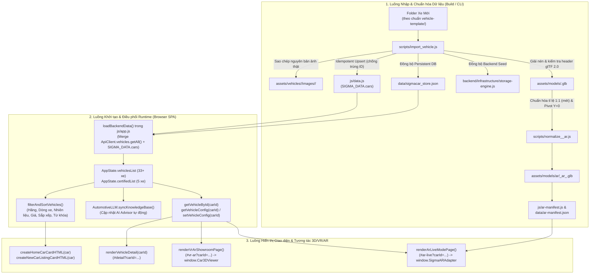

# KẾ HOẠCH KIẾN TRÚC & TRIỂN KHAI TỔNG THỂ HỆ THỐNG VEHICLE TEMPLATE & AR/VR SHOWROOM SIGMACAR (`AR_IMPLEMENTATION_PLAN.md`)

- **Phiên bản tài liệu:** `3.0 — Complete Architectural Blueprint & Handoff Specification for 3.8 Flash High`
- **Ngày hoàn thiện:** `11/11/2026`
- **Vai trò biên soạn:** Senior Software Architect & Technical Planner
- **Đối tượng thực thi:** Coding Model **3.8 Flash High**
- **Phạm vi tài liệu:** Phân tích toàn diện kiến trúc dự án thương mại điện tử ô tô **SIGMACAR**, toàn bộ **38 bản ghi xe hiện có** (`33` xe mới trong `SIGMA_DATA.cars` + `5` xe qua sử dụng trong `SIGMA_DATA.certifiedCars`), hệ thống chuẩn hóa nhập xe **`vehicle-template/`**, kho tài nguyên **`3Dmodel/`** (6 mẫu xe), và kiến trúc **Thực tế tăng cường (AR 1:1) & Thực tế ảo (VR 360°)** để bàn giao hướng dẫn thực thi cấp độ file/hàm chính xác tuyệt đối.

---

## MỤC LỤC

- **[A. Project Architecture (Kiến trúc Dự án Hiện tại)](#a-project-architecture-kiến-trúc-dự-án-hiện-tại)**
  - [A.1. Tổng quan Kiến trúc Hệ thống](#a1-tổng-quan-kiến-trúc-hệ-thống)
  - [A.2. Cấu trúc Thư mục Liên quan (Đã xác minh)](#a2-cấu-trúc-thư-mục-liên-quan-đã-xác-minh)
  - [A.3. Các Dependency, Module và Component Liên quan](#a3-các-dependency-module-và-component-liên-quan)
  - [A.4. Luồng Dữ liệu Hiện tại (End-to-End Data Flow)](#a4-luồng-dữ-liệu-hiện-tại-end-to-end-data-flow)
- **[B. Existing Vehicle Template Analysis (Phân tích Toàn bộ Template & Dữ liệu Vehicle Hiện có)](#b-existing-vehicle-template-analysis-phân-tích-toàn-bộ-template--dữ-liệu-vehicle-hiện-có)**
  - [B.1. Kiểm kê Toàn bộ 38 Xe Đang Tồn tại & 4 Nhóm Archetype Dữ liệu](#b1-kiểm-kê-toàn-bộ-38-xe-đang-tồn-tại--4-nhóm-archetype-dữ-liệu)
  - [B.2. Kiểm kê 6 Thư mục Tài nguyên 3D Gốc (`3Dmodel/` & `Tesla-Cybertruck/`)](#b2-kiểm-kê-6-thư-mục-tài-nguyên-3d-gốc-3dmodel--tesla-cybertruck)
  - [B.3. Bảng Đối chiếu Điểm Giống và Khác Nhau Giữa Các Archetype](#b3-bảng-đối-chiếu-điểm-giống-và-khác-nhau-giữa-các-archetype)
  - [B.4. Xác định Template Chuẩn Để Kế thừa & Quy ước Đặt tên](#b4-xác-định-template-chuẩn-để-kế-thừa--quy-ước-đặt-tên)
  - [B.5. Phân loại 4 Nhóm Thành phần (Kế thừa / Tái sử dụng / Tạo mới / Đặc thù)](#b5-phân-loại-4-nhóm-thành-phần-kế-thừa--tái-sử-dụng--tạo-mới--đặc-thù)
- **[C. New Vehicle & AR Integration (Tích hợp Vehicle Mới & Hệ thống AR/VR)](#c-new-vehicle--ar-integration-tích-hợp-vehicle-mới--hệ-thống-arvr)**
  - [C.1. Danh sách Trường Dữ liệu Chuẩn Cần Bổ sung (`vehicle.json` → `SIGMA_DATA.cars`)](#c1-danh-sách-trường-dữ-liệu-chuẩn-cần-bổ-sung-vehiclejson--sigma_datacars)
  - [C.2. Danh sách Hình ảnh, Quy tắc Ảnh Bìa & Tài nguyên 3D/AR Cần Có](#c2-danh-sách-hình-ảnh-quy-tắc-ảnh-bìa--tài-nguyên-3dar-cần-có)
  - [C.3. Các Component/Hàm Cần Tái sử dụng Nguyên trạng](#c3-các-componenthàm-cần-tái-sử-dụng-nguyên-trạng)
  - [C.4. Các Component/File Cần Chỉnh sửa hoặc Bổ sung Khi Thêm Xe / Mở rộng AR](#c4-các-componentfile-cần-chỉnh-sửa-hoặc-bổ-sung-khi-thêm-xe--mở-rộng-ar)
  - [C.5. Các Vị trí Tích hợp Vehicle Mới & Liên kết Routing](#c5-các-vị-trí-tích-hợp-vehicle-mới--liên-kết-routing)
- **[D. UI/UX Implementation Specifications (Đặc tả Giao diện & Trải nghiệm Người dùng)](#d-uiux-implementation-specifications-đặc-tả-giao-diện--trải-nghiệm-người-dùng)**
  - [D.1. Vehicle Card (Thẻ Xe tại Trang chủ, Dòng xe mới, Xe qua sử dụng, Showroom)](#d1-vehicle-card-thẻ-xe-tại-trang-chủ-dòng-xe-mới-xe-qua-sử-dụng-showroom)
  - [D.2. Vehicle Detail Page (`#detail?carId=<id>`)](#d2-vehicle-detail-page-detailcaridid)
  - [D.3. Hệ thống Gallery, Bộ lọc Danh mục Ảnh & Lightbox HD (Quy tắc Chống Ảnh Giả)](#d3-hệ-thống-gallery-bộ-lọc-danh-mục-ảnh--lightbox-hd-quy-tắc-chống-ảnh-giả)
  - [D.4. Bảng Thông số Kỹ thuật, Giá bán & Các Phiên bản Cấu hình (`trims`)](#d4-bảng-thông-số-kỹ-thuật-giá-bán--các-phiên-bản-cấu-hình-trims)
  - [D.5. Showroom 360° / VR (`#vr-ar`) & Chế độ AR Thực tế 1:1 (`#ar-live`)](#d5-showroom-360--vr-vr-ar--chế-độ-ar-thực-tế-11-ar-live)
  - [D.6. Responsive Layout, Interaction & Loading/Error States](#d6-responsive-layout-interaction--loadingerror-states)
- **[E. File-Level Implementation Instructions (Hướng dẫn Thực thi Cấp độ File cho 3.8 Flash High)](#e-file-level-implementation-instructions-hướng-dẫn-thực-thi-cấp-độ-file-cho-38-flash-high)**
  - [E.1. Chi tiết Từng File Hiện có Cần Chỉnh sửa / Đồng bộ](#e1-chi-tiết-từng-file-hiện-có-cần-chỉnh-sửa--đồng-bộ)
  - [E.2. Chi tiết Các File Cần Tạo Mới Khi Tích hợp Mẫu Xe Mới hoặc Biến thể AR](#e2-chi-tiết-các-file-cần-tạo-mới-khi-tích-hợp-mẫu-xe-mới-hoặc-biến-thể-ar)
  - [E.3. Danh sách Thông tin Đã Xác minh vs. Chưa Xác minh (Không Được Suy Đoán)](#e3-danh-sách-thông-tin-đã-xác-minh-vs-chưa-xác-minh-không-được-suy-đoán)
- **[F. Implementation Sequence (Trình tự Triển khai 7 Phase theo Phụ thuộc)](#f-implementation-sequence-trình-tự-triển-khai-7-phase-theo-phụ-thuộc)**
- **[G. Testing & Quality Assurance (Chiến lược Kiểm thử, Kịch bản QA & Rollback)](#g-testing--quality-assurance-chiến-lược-kiểm-thử-kịch-bản-qa--rollback)**
- **[H. Final Acceptance Criteria (Checklist Nghiệm thu Cuối cùng dành cho 3.8 Flash High)](#h-final-acceptance-criteria-checklist-nghiệm-thu-cuối-cùng-dành-cho-38-flash-high)**

---

## A. Project Architecture (Kiến trúc Dự án Hiện tại)

### A.1. Tổng quan Kiến trúc Hệ thống

**SIGMACAR: Electric & Certified** là nền tảng thương mại điện tử ô tô kết hợp **Showroom 3D 360° / VR / AR 1:1** và **Trợ lý AI tư vấn thông minh (Live RAG)**, được xây dựng theo kiến trúc **Full-Stack Vanilla JavaScript + Node.js HTTP Server + Static Bundle (`dist/`)** cho Cloudflare Pages:

1. **Frontend Single-Page Application (SPA):**
   - Không sử dụng React/Vue/Angular hay bundler phức tạp (Webpack/Vite). Toàn bộ giao diện chạy trực tiếp từ `index.html`, `css/style.css` và các script nạp tuần tự ở cuối `index.html` (dòng `755–768`).
   - Điều hướng bằng **Hash Router** (`#home`, `#new-cars`, `#certified`, `#accessories`, `#detail?carId=...`, `#vr-ar?carId=...`, `#ar-live?carId=...`, `#ar-home?carId=...`, `#compare`, `#ai-advisor`, `#test-drive`, `#support`, `#seller-dashboard`, `#profile`) do `parseHashRoute()`, `navigateTo()`, và `renderCurrentRoute()` trong `js/app.js` (dòng `496–680`) điều phối.
2. **Hệ thống Đồ họa 3D, VR & AR (Dual-Engine Architecture):**
   - **Engine 1 — Showroom 360° & Không gian VR (`js/car-3d-viewer.js`):** Sử dụng **Three.js `r128`** (`js/libs/three.min.js`, `OrbitControls.js`, `GLTFLoader.js`, `RoomEnvironment.js`) để dựng buồng studio 3D thời gian thực, chuẩn hóa kích thước hiển thị (`targetSize = 4.3` đơn vị), xoay 360°, đổi màu sơn PBR (`setBodyColor`), đổi mâm (`setWheelType`), gắn điểm chạm `hotspots` 3D, đi bộ bằng bàn phím `WASD`/`QE` (`setVRStudioMode`), và kết nối kính VR qua `navigator.xr.requestSession('immersive-vr')`.
   - **Engine 2 — Thực tế Tăng cường AR 1:1 (`js/ar-manifest.js` + `js/ar-adapter.js`):** Sử dụng **`@google/model-viewer`** (`js/libs/model-viewer.min.js`) được cô lập hoàn toàn trong custom element `<model-viewer>` với cấu hình `ar`, `ar-modes="webxr scene-viewer quick-look"`, `ar-scale="fixed"`, `ar-placement="floor"`, đọc dữ liệu mô hình chuẩn kích thước mét thật (`1 glTF unit = 1m`) từ **Sidecar Manifest** (`SIGMA_AR_MANIFEST`).
3. **Hệ thống Dữ liệu & Backend API (`server.js` + `backend/`):**
   - **3 nguồn dữ liệu xe đồng bộ (Triple-Store Sync):**
     1. `js/data.js` (`const SIGMA_DATA = { cars: [...], certifiedCars: [...], ... }`): Nguồn dữ liệu tĩnh nạp ngay trên trình duyệt và dùng làm fallback tức thì khi chạy static hosting (Cloudflare Pages) hoặc khi offline.
     2. `backend/infrastructure/storage-engine.js` (`dbState.vehicles`): Khởi tạo cơ sở dữ liệu mặc định cho Node.js backend.
     3. `data/sigmacar_store.json` (`store.vehicles`): File JSON lưu trữ bền vững (persistent store) của backend khi chạy `node server.js`.
   - Công cụ `scripts/import_vehicle.js` đảm bảo mọi xe mới khi được nhập từ thư mục chuẩn `vehicle-template` sẽ được **Upsert đồng thời** vào cả 3 nơi này và đóng gói ra `dist/` qua `scripts/build_dist.js`.

---

### A.2. Cấu trúc Thư mục Liên quan (Đã xác minh)

Toàn bộ các đường dẫn dưới đây đã được kiểm tra trực tiếp trên workspace `d:\Project nhập môn cntt`:

```text
d:\Project nhập môn cntt\
├── index.html                                 # Entrypoint SPA duy nhất (770 dòng)
├── _headers                                   # Cấu hình CORS & MIME cho Cloudflare Pages (.glb, .usdz)
├── server.js                                  # Node.js Full-Stack Server + Static File Server (126 dòng)
├── AR_IMPLEMENTATION_PLAN.md                  # Tài liệu Kiến trúc & Kế hoạch Triển khai này
│
├── css/
│   └── style.css                              # Stylesheet toàn cục (Design tokens, Grid, Card, Detail, VR/AR, Responsive)
│
├── js/
│   ├── libs/
│   │   ├── three.min.js                       # Three.js r128 core (dùng cho Showroom 360° & VR)
│   │   ├── OrbitControls.js                   # Điều khiển xoay/thu phóng camera Three.js
│   │   ├── GLTFLoader.js                      # Bộ nạp mô hình .glb cho Three.js
│   │   ├── RoomEnvironment.js                 # Môi trường phản chiếu PBR Studio cho Three.js
│   │   └── model-viewer.min.js                # Google <model-viewer> bundle (dùng cho AR 1:1)
│   ├── car-3d-viewer.js                       # Module Three.js 360° & VR Studio (1.022 dòng)
│   ├── data.js                                # Cơ sở dữ liệu trung tâm SIGMA_DATA (2.774 dòng, 33 xe mới + 5 xe cũ)
│   ├── ar-manifest.js                         # Sidecar AR Manifest & Resolver SIGMA_AR_MANIFEST (147 dòng)
│   ├── ar-adapter.js                          # Bộ điều phối AR SigmaARAdapter (354 dòng)
│   ├── api-client.js                          # HTTP Client kết nối Backend REST API & Fallback LocalStorage
│   ├── automotive-llm.js                      # Động cơ AI tư vấn & Live RAG đồng bộ danh mục xe
│   ├── ai-engine.js                           # Xử lý hội thoại AI Advisor
│   └── app.js                                 # Application Controller, Router, Filter Engine & 14 Views (9.831 dòng)
│
├── data/
│   ├── sigmacar_store.json                    # Persistent JSON database cho Backend API
│   └── ar-manifest.json                       # Bản JSON chuẩn của AR Sidecar Manifest
│
├── backend/
│   ├── config.js                              # Cấu hình cổng server và AI endpoint
│   ├── api/router.js                          # Định tuyến REST API (/api/v1/vehicles, /orders, /auth...)
│   └── infrastructure/storage-engine.js       # Quản lý đọc/ghi sigmacar_store.json & seed dbState.vehicles
│
├── vehicle-template/                          # THƯ MỤC TEMPLATE CHUẨN ĐỂ THÊM XE MỚI
│   ├── vehicle.json                           # Schema mẫu v1.0.0 (188 dòng)
│   ├── README.md                              # Tài liệu đặc tả schema và quy tắc nhập xe (114 dòng)
│   ├── images/
│   │   ├── exterior/                          # Ảnh ngoại thất
│   │   ├── interior/                          # Ảnh nội thất
│   │   ├── dashboard/                         # Ảnh khoang lái & màn hình
│   │   ├── engine/                            # Ảnh động cơ / mô-tơ / khung gầm
│   │   ├── specifications/                    # Ảnh bản vẽ kích thước kỹ thuật
│   │   └── gallery/                           # Ảnh thực tế / lifestyle
│   ├── 3d/
│   │   ├── model.glb                          # File 3D glTF 2.0 nhị phân
│   │   └── textures/                          # Texture tách rời (nếu có)
│   └── documents/
│       ├── specifications.pdf                 # Tài liệu thông số PDF
│       └── warranty.pdf                       # Tài liệu bảo hành PDF
│
├── Tesla-Cybertruck/                          # Thư mục xe thực tế đầu tiên triển khai theo vehicle-template
│   ├── vehicle.json                           # Dữ liệu chuẩn hóa Tesla Cybertruck (217 dòng)
│   ├── README.md                              # Tài liệu mẫu xe Tesla Cybertruck
│   ├── data/data.txt                          # Dữ liệu văn bản gốc
│   ├── images/exterior/cover.jpg              # Ảnh bìa thực tế duy nhất trong data của Cybertruck
│   ├── 3d/model.glb                           # File GLB gốc (416.804 bytes)
│   └── documents/                             # PDF thông số và bảo hành
│
├── 3Dmodel/                                   # Kho lưu trữ 6 bộ dữ liệu 3D & thông số xe thô (Master Archive)
│   ├── Tesla-Cybertruck/                      # Đã tích hợp vào Showroom (id: "tesla-cybertruck")
│   ├── bmw-m4-widebody/                       # Chưa tích hợp vào Showroom
│   ├── lamborghini-aventador/                 # Chưa tích hợp vào Showroom
│   ├── mercedes-g63-amg/                      # Chưa tích hợp vào Showroom
│   ├── porsche-911-gt3/                       # Chưa tích hợp vào Showroom
│   └── vinfast-vf9/                           # Đã có xe "vinfast-vf9" trong catalog, chưa gắn GLB riêng
│
├── assets/
│   ├── catalog/                               # Ảnh đại diện của các xe CAR-001..010 & VinFast (car-camry.jpg...)
│   ├── vehicles/
│   │   └── <vehicle-id>/                      # Tài nguyên riêng của từng xe nhập qua import_vehicle.js
│   │       ├── images/{exterior,interior,dashboard,engine,specifications,gallery}/
│   │       ├── 3d/textures/
│   │       └── documents/
│   └── models/
│       ├── sigma-car-3d.glb                   # Model 3D mặc định cho các xe chưa có GLB riêng
│       ├── tesla_cybertruck.glb               # Model 3D Showroom 360°/VR của Tesla Cybertruck
│       └── ar/                                # Các biến thể GLB/USDZ đã chuẩn hóa tỉ lệ 1:1 (mét) cho AR
│           ├── tesla_cybertruck_ar_v1.glb
│           ├── tesla_cybertruck_ar_stealth_black.glb
│           ├── tesla_cybertruck_ar_ceramic_white.glb
│           └── tesla_cybertruck_ar_tactical_green.glb
│
├── scripts/
│   ├── import_vehicle.js                      # Pipeline tự động nhập & đồng bộ xe từ folder chuẩn (1.301 dòng)
│   ├── normalize_cybertruck_ar.js             # Script chuẩn hóa GLB 1:1 (scale, pivot tiếp đất, PBR) cho AR (191 dòng)
│   └── build_dist.js                          # Đóng gói thư mục dist/ cho Cloudflare Pages (34 dòng)
│
└── tests/
    ├── test_ar_phase1.js                      # Kiểm thử tự động Phase 1 (GLB bounds, pivot, MIME)
    └── test_ar_full_suite.js                  # Bộ kiểm thử tích hợp toàn diện AR & Vehicle State
```

---

### A.3. Các Dependency, Module và Component Liên quan

Thứ tự nạp script trong `index.html` (dòng `755–768`) quy định chặt chẽ chuỗi phụ thuộc global trên `window`:

| Thứ tự | Đường dẫn Script trong `index.html` | Biến Global Xuất ra (`window.*` / Global Scope) | Vai trò & Phụ thuộc |
| :---: | :--- | :--- | :--- |
| 1 | `js/libs/three.min.js` | `window.THREE` (r128) | Thư viện WebGL nền tảng cho `Car3DViewer`. **Tuyệt đối không ghi đè hoặc nâng cấp riêng lẻ.** |
| 2 | `js/libs/OrbitControls.js` | `THREE.OrbitControls` | Điều khiển xoay camera quanh xe trong `#detail` và `#vr-ar`. Phụ thuộc `window.THREE`. |
| 3 | `js/libs/GLTFLoader.js` | `THREE.GLTFLoader` | Giải mã file `.glb` cho Showroom 360°/VR. Phụ thuộc `window.THREE`. |
| 4 | `js/libs/RoomEnvironment.js` | `THREE.RoomEnvironment` | Tạo ánh sáng phản chiếu PBR kim loại/kính trong buồng tối Studio. |
| 5 | `js/car-3d-viewer.js?v=3.0` | `window.Car3DViewer` | Quản lý vòng đời viewer 360° & VR (`init`, `setBodyColor`, `setWheelType`, `setRotationAngle`, `setVRStudioMode`, `enterWebXR`, `dispose`). |
| 6 | `js/data.js?v=3.0` | `SIGMA_DATA` | Chứa `SIGMA_DATA.cars` (33 xe mới), `SIGMA_DATA.certifiedCars` (5 xe lướt), `branches`, `accessories`, `components`. |
| 7 | `js/ar-manifest.js?v=3.0` | `window.SIGMA_AR_MANIFEST` | Sidecar registry ánh xạ `(carId, colorIdx)` sang cấu hình AR 1:1 (`glbUrl`, `usdzUrl`, `dimensionsMeters`, `readiness`). |
| 8 | `js/ar-adapter.js?v=3.0` | `window.SigmaARAdapter` | Lazy-load `js/libs/model-viewer.min.js`, khởi tạo `<model-viewer>`, kích hoạt WebXR / Scene Viewer / Quick Look, đổi màu AR và giải phóng bộ nhớ (`dispose`). |
| 9 | `js/api-client.js?v=3.0` | `window.ApiClient` | Giao tiếp REST API `/api/v1/*` với cơ chế tự động fallback về `SIGMA_DATA` khi server tĩnh. |
| 10 | `js/automotive-llm.js?v=3.0` | `window.AutomotiveLLM` | Đồng bộ toàn bộ `AppState.vehiclesList` vào bộ nhớ RAG (`syncKnowledgeBase`) để AI tư vấn đúng thông số và giá. |
| 11 | `js/ai-engine.js?v=3.0` | `window.SigmaAIEngine` | Giao diện xử lý luồng chat AI và tính toán vừa gara. |
| 12 | `js/app.js?v=3.0` | `AppState`, `window.FilterEngine`, `window.openCarDetail`, `window.openVrArShowroom`, `window.openArLive`, `window.openArAtHome`, `window.addCarToCompare`, `window.bookCarTestDrive` | Trái tim điều phối toàn bộ ứng dụng, bộ lọc, tìm kiếm, trạng thái cấu hình xe (`AppState.vehicleConfigs`) và 14 trang giao diện. |

---

### A.4. Luồng Dữ liệu Hiện tại (End-to-End Data Flow)



**Cơ chế Hợp nhất Dữ liệu Quan trọng tại Runtime (`loadBackendData` — `js/app.js` dòng `468–491`):**
- Khi ứng dụng khởi chạy, `ApiClient.vehicles.getAll()` lấy danh sách xe từ `/api/v1/vehicles`.
- Để đảm bảo các trường mở rộng trong `SIGMA_DATA.cars` (như `categorizedImages`, `trims`, `evSpecs`, `dimensionsDetail`, `model3d`) không bao giờ bị mất nếu API trả về bản ghi rút gọn, `loadBackendData()` thực hiện phép gộp:
  ```javascript
  const local = SIGMA_DATA.cars.find(c => c.id === v.id);
  return { ...(local || {}), ...v };
  ```
- Do đó, **bắt buộc cả `js/data.js`, `backend/infrastructure/storage-engine.js` và `data/sigmacar_store.json` phải luôn chứa bản ghi đầy đủ giống hệt nhau**.

---

## B. Existing Vehicle Template Analysis (Phân tích Toàn bộ Template & Dữ liệu Vehicle Hiện có)

### B.1. Kiểm kê Toàn bộ 38 Xe Đang Tồn tại & 4 Nhóm Archetype Dữ liệu

Qua kiểm tra toàn bộ `2.774` dòng của `js/data.js`, dự án hiện đang quản lý chính xác **38 bản ghi xe** (`33` xe trong `SIGMA_DATA.cars` và `5` xe trong `SIGMA_DATA.certifiedCars`), được chia thành **4 nhóm cấu trúc dữ liệu (Archetypes)** theo lịch sử phát triển của dự án:

#### Nhóm Archetype 1: Nhóm Xe Đa Thương hiệu từ `Data-xe.xlsx` (`10` mẫu xe — `CAR-001` đến `CAR-010`)
- **Danh sách đầy đủ (10 xe):**
  1. `toyota-camry` (`CAR-001` — Toyota Camry 2.5Q, Sedan, `gas`, `1.405.000.000 VNĐ`)
  2. `honda-crv` (`CAR-002` — Honda CR-V L AWD, SUV, `gas`, `1.310.000.000 VNĐ`)
  3. `ford-ranger` (`CAR-003` — Ford Ranger Wildtrak 2.0L Bi-Turbo, SUV / subCategory `Bán tải`, `gas`, `979.000.000 VNĐ`)
  4. `hyundai-tucson` (`CAR-004` — Hyundai Tucson 2.0L Đặc Biệt, SUV, `gas`, `839.000.000 VNĐ`)
  5. `mazda-cx5` (`CAR-005` — Mazda CX-5 2.0L Premium, SUV, `gas`, `829.000.000 VNĐ`)
  6. `vinfast-vf8` (`CAR-006` — VinFast VF 8 Plus, SUV, `ev`, `1.270.000.000 VNĐ`)
  7. `mercedes-glc300` (`CAR-007` — Mercedes-Benz GLC 300 4MATIC, SUV, `gas`, `2.799.000.000 VNĐ`)
  8. `bmw-330i` (`CAR-008` — BMW 330i M Sport, Sedan, `gas`, `1.869.000.000 VNĐ`)
  9. `kia-seltos` (`CAR-009` — Kia Seltos 1.5L Luxury, Compact, `gas`, `649.000.000 VNĐ`)
  10. `mitsubishi-xpander` (`CAR-010` — Mitsubishi Xpander Cross, Compact / subCategory `MPV 7 chỗ`, `gas`, `698.000.000 VNĐ`)
- **Đặc điểm cấu trúc:** Có cờ `"isDataXe": true` (phục vụ bộ lọc chip `📋 Data-xe (CAR-001..010)`), ảnh đại diện nằm tại `assets/catalog/car-<slug>.jpg`, dùng mảng `features` gộp chung, không có `categorizedImages`, không có `trims`, không có `model3d` riêng (dùng fallback `assets/models/sigma-car-3d.glb`).

#### Nhóm Archetype 2: Dải Sản phẩm Ô tô Điện VinFast Mở rộng (`15` mẫu xe)
- **Danh sách đầy đủ (15 xe, kết hợp cùng `vinfast-vf8` ở Nhóm 1 tạo thành 16 phiên bản VinFast):**
  11. `vinfast-vf3` (`VF3-ECO` — VinFast VF 3 Eco, Compact, `ev`, `285.000.000 VNĐ`)
  12. `vinfast-vf7` (`VF7-AWD` — VinFast VF 7 Plus AWD, SUV, `ev`, `999.000.000 VNĐ`)
  13. `vinfast-vf9` (`VF9-PLUS` — VinFast VF 9 Plus 7 Chỗ, SUV, `ev`, `1.589.000.000 VNĐ`)
  14. `vinfast-vf2` (`VF2` — VinFast VF 2, Compact, `ev`, `188.000.000 VNĐ`)
  15. `vinfast-vf5` (`VF5` — VinFast VF 5 Plus, SUV, `ev`, `496.000.000 VNĐ`)
  16. `vinfast-vf6` (`VF6-ECO` — VinFast VF 6 Eco, SUV, `ev`, `646.000.000 VNĐ`)
  17. `vinfast-vf-mpv7` (`VFMPV7` — VinFast VF MPV 7, Compact / `MPV Điện 7 chỗ`, `ev`, `750.000.000 VNĐ`)
  18. `vinfast-vf8-all-new` (`VF8-2026` — VinFast VF 8 Thế hệ mới (2026), SUV, `ev`, `1.150.000.000 VNĐ`)
  19. `vinfast-vf-wild` (`VFWILD` — VinFast VF Wild, SUV / `Bán tải Điện`, `ev`, `890.000.000 VNĐ`)
  20. `vinfast-vf3-plus` (`VF3-PLUS` — VinFast VF 3 Plus, Compact, `ev`, `296.000.000 VNĐ`)
  21. `vinfast-vf6-plus` (`VF6-PLUS` — VinFast VF 6 Plus, SUV, `ev`, `699.000.000 VNĐ`)
  22. `vinfast-vf7-eco` (`VF7-ECO` — VinFast VF 7 Eco, SUV, `ev`, `740.000.000 VNĐ`)
  23. `vinfast-vf7-plus` (`VF7-PLUS` — VinFast VF 7 Plus (FWD), SUV, `ev`, `850.000.000 VNĐ`)
  24. `vinfast-vf8-eco` (`VF8-ECO` — VinFast VF 8 Eco, SUV, `ev`, `853.100.000 VNĐ`)
  25. `vinfast-vf9-eco` (`VF9-ECO` — VinFast VF 9 Eco 7 Chỗ, SUV, `ev`, `1.491.000.000 VNĐ`)
- **Đặc điểm cấu trúc:** Có đầy đủ thông số xe điện cấp cao nhất (`range`, `battery`, `fastCharge`, `powertrain`, `officialUrl`), ảnh đặt tại `assets/catalog/car-vf*.jpg`, liên kết với bảng linh kiện pin `SIGMA_DATA.components` (dòng `2586–2770`).

#### Nhóm Archetype 3: Dòng Xe Thương hiệu Nội bộ SIGMACAR (`7` mẫu xe — `SIG-001` đến `SIG-007`)
- **Danh sách đầy đủ (7 xe):**
  26. `model-e` (`SIG-001` — SIGMA Model E, SUV, `ev`, `1.290.000.000 VNĐ`, ảnh `assets/model-e.jpg`)
  27. `vision-s` (`SIG-002` — SIGMA Vision S, Sedan, `ev`, `2.150.000.000 VNĐ`, ảnh `assets/vision-s.jpg`)
  28. `city-g` (`SIG-003` — SIGMA City G, Compact, `ev`, `720.000.000 VNĐ`, ảnh `assets/city-g.jpg`)
  29. `x-series-gt` (`SIG-004` — SIGMA X-Series GT, SUV, `ev`, `3.150.000.000 VNĐ`, ảnh `assets/x-series.jpg`)
  30. `grand-7` (`SIG-005` — SIGMA Grand 7, SUV 7 chỗ, `ev`, `1.790.000.000 VNĐ`, ảnh `assets/family-7.jpg`)
  31. `aero-cross` (`SIG-006` — SIGMA Aero Cross, Compact, `ev`, `980.000.000 VNĐ`, ảnh `assets/aero-c.jpg`)
  32. `horizon-mpv` (`SIG-007` — SIGMA Horizon MPV, Compact / `MPV Điện Thương Gia`, `ev`, `1.850.000.000 VNĐ`, ảnh `assets/van-v.jpg`)
- **Đặc điểm cấu trúc:** Các màu sắc trong mảng `colors` trỏ tới các ảnh đổi màu riêng (`assets/car-color-blue.jpg`, `assets/car-color-dark.jpg`, `assets/car-color-silver.jpg`). Được tham chiếu mặc định trong các gợi ý của AI Advisor và টেস্ট mẫu.

#### Nhóm Archetype 4: Chuẩn `vehicle-template` Mở rộng Đầy đủ (`1` mẫu xe thực tế đã nhập: `tesla-cybertruck` + `1` mẫu chuẩn trong `vehicle-template/`)
- **Danh sách:**
  33. `tesla-cybertruck` (`TSL-CT-01` — Tesla Cybertruck, Pickup, `ev`, `7.500.000.000 VNĐ`, dòng `1991–2228` trong `js/data.js`).
- **Đặc điểm cấu trúc (Chuẩn mực cao nhất của hệ thống):**
  - Bao gồm **toàn bộ các trường phẳng** của Archetype 1–3 để tương thích 100% với bộ lọc, thẻ xe và bảng so sánh cũ (`id`, `productCode`, `name`, `brand`, `subtitle`, `type`, `category`, `subCategory`, `fuel`, `price`, `priceFormatted`, `priceShort`, `badge`, `range`, `hp`, `power`, `torque`, `acceleration`, `seats`, `battery`, `fastCharge`, `topSpeed`, `transmission`, `drive`, `dimensions`, `wheelbase`, `groundClearance`, `stock`, `excelStock`, `year`, `warranty`, `image`, `colors`, `colorsSummary`, `features`, `description`, `excelSpecs`, `isAvailable`).
  - Bổ sung **các cấu trúc dữ liệu chuyên sâu**:
    - `version`, `salePrice`, `salePriceFormatted`, `priceNote`, `rangeExtendedKm`, `engine`
    - `dimensionsDetail`: `{ overall, lengthMm, widthMm, widthUnfoldedMm, heightMm, wheelbase, groundClearance, curbWeight, payloadCapacity, towingCapacity, cargoVolume }`
    - `warrantyDetail`: `{ policy, vehicleYears, vehicleKm, batteryYears, batteryKm, documentUrl }`
    - `thumbnail`, `cover`, `galleryImages`: mảng đường dẫn ảnh thực tế
    - `categorizedImages`: `{ exterior: [...], interior: [...], dashboard: [...], engine: [...], specifications: [...], gallery: [...] }`
    - `trims`: mảng các phiên bản cấu hình (`RWD`, `Dual-Motor AWD`, `Cyberbeast Tri-Motor AWD`) với giá và thông số riêng
    - `evSpecs`: `{ batteryCapacity, rangeKm, rangeExtendedKm, fastCharge, architecture, v2x }`
    - `fuelConsumption`: `{ combined, urban, highway, unit }` (hoặc `null` với xe điện)
    - `safetyFeatures`: mảng chuỗi trang bị an toàn & khung gầm
    - `comfortFeatures`: mảng chuỗi trang bị tiện nghi & công nghệ
    - `model3d`: `{ enabled: true, glbPath: "assets/models/tesla_cybertruck.glb", arSupported: true, vrSupported: true, scale: 1, initialAngle: 137, hotspots: [...] }`
    - `documents`: `{ specificationsPdf, warrantyPdf }`
    - Đồng thời có cấu hình Sidecar AR 1:1 đã kiểm chứng trong `js/ar-manifest.js` và `data/ar-manifest.json`.

#### Nhóm Bổ trợ: Xe Qua Sử Dụng Chính Hãng (`SIGMA_DATA.certifiedCars` — `5` mẫu xe `cpo-1` đến `cpo-5`)
- **Danh sách:** `cpo-1` (SIGMA Model E Premium), `cpo-2` (SIGMA Vision S Executive), `cpo-3` (SIGMA City G Smart), `cpo-4` (SIGMA Model E Luxury), `cpo-5` (SIGMA E-Vision Premium Special).
- **Đặc điểm cấu trúc:** Dùng schema rút gọn dành riêng cho xe lướt (`id`, `name`, `year`, `vin`, `odo`, `odoNum`, `price`, `priceFormatted`, `batteryHealth`, `color`, `inspection`, `warranty`, `category`, `image`, `badge`, `status`), hiển thị qua `renderCertifiedCars()` và `createHomeCertifiedCardHTML()`.

---

### B.2. Kiểm kê 6 Thư mục Tài nguyên 3D Gốc (`3Dmodel/` & `Tesla-Cybertruck/`)

Bảng dưới đây ghi nhận kết quả kiểm tra thực tế từng byte của cả **6 mẫu xe** trong thư mục `3Dmodel/` để **3.8 Flash High** nắm rõ trạng thái dữ liệu và đặc tính kỹ thuật của từng file `.glb` khi mở rộng thêm xe mới hoặc triển khai AR:

| Thư mục trong `3Dmodel/` | Trạng thái trong Showroom (`js/data.js`) | Tên file `.glb` trong `.zip` & Kích thước | Số Mesh Primitives / Vật liệu | Kích thước BBox gốc (glTF units) & Vấn đề Kỹ thuật cần xử lý khi tích hợp | Giá bán trong `data/data.txt` |
| :--- | :--- | :--- | :--- | :--- | :--- |
| `Tesla-Cybertruck` (và `./Tesla-Cybertruck`) | **ĐÃ TÍCH HỢP** (`id: "tesla-cybertruck"`, `productCode: "TSL-CT-01"`) | `tesla_cybertruck.glb` (`416.804` bytes, SHA-256: `EC1C8DBB...`) | `14` primitives / `8` materials | BBox gốc: `1.151 × 1.087 × 3.276` (nhỏ hơn thực tế ~1.734 lần, tâm lệch). **Đã được chuẩn hóa 1:1** (`5.682m × 1.996m × 1.886m`) trong `assets/models/ar/tesla_cybertruck_ar_*.glb`. | Có đầy đủ (`3.8 - 11.5 tỷ VNĐ`; giá đại diện AWD: `7.500.000.000 VNĐ`) |
| `vinfast-vf9` | Đã có xe `vinfast-vf9` (`1.589 tỷ`) & `vinfast-vf9-eco` (`1.491 tỷ`), **chưa gắn `model3d.glbPath` riêng** | `2023_vinfast_vf_9.glb` (`20.996.468` bytes ~ 21 MB) | `219` primitives / `56` materials | BBox gốc: `2.456 × 1.720 × 5.111` (dài ~5.11m gần sát `5.118 mm` thực tế, nhưng chiều rộng `2.456` cần đối chiếu có/không gương). Dung lượng ~21 MB kèm 20 texture tách rời trong `.zip` — cần nén/tối ưu trước khi đưa lên AR di động. | `data.txt` chưa ghi số tiền VNĐ cụ thể, nhưng `js/data.js` **đã có giá chính thức** (`1.589.000.000 VNĐ`). |
| `bmw-m4-widebody` | **CHƯA TÍCH HỢP** | `bmw_m4_widebody__www.vecarz.com.glb` (`14.703.268` bytes ~ 14.7 MB) | `54` primitives / `40` materials | BBox gốc: `2.054 × 1.384 × 4.799` (chiều dài `4.799m` khớp với `4.794 mm` trong `data.txt`, nhưng `minY = -0.692` nghĩa là tâm đặt giữa thân xe, chưa đặt bánh tại `Y = 0`). | **Chưa có giá VNĐ trong `data.txt`** (`validateNormalizedVehicle` sẽ chặn nếu `price <= 0`; phải xác nhận giá trước khi import). |
| `lamborghini-aventador` | **CHƯA TÍCH HỢP** | `lamborghini_aventador.glb` (`8.943.476` bytes ~ 8.9 MB) | `273` primitives / `16` materials | BBox gốc: `105.000 × 85.466 × 489.669` (**Đơn vị centimet/custom**, lớn gấp ~100 lần mét; nếu mở AR trực tiếp xe sẽ dài ~489 mét!). Bắt buộc phải chạy script normalize scale về `4.780m` và dịch đáy bánh về `Y = 0`. | **Chưa có giá VNĐ trong `data.txt`** (cần cung cấp giá bán trong `vehicle.json` trước khi import). |
| `mercedes-g63-amg` | **CHƯA TÍCH HỢP** | `mercedes-benz_g-class_g63_amg.glb` (`21.630.388` bytes ~ 21.6 MB) | `1.545` primitives / `31` materials | BBox gốc: `2.426 × 1.988 × 4.606` (tỉ lệ mét hợp lý, đáy `minY = -0.023`). Tuy nhiên có tới **1.545 mesh primitives** (rất nhiều ốc vít/chi tiết nhỏ tách rời) — gây quá tải draw calls trên di động nếu không gộp mesh (mesh merge) trước khi xuất AR. | **Chưa có giá VNĐ trong `data.txt`** (cần cung cấp giá bán trong `vehicle.json` trước khi import). |
| `porsche-911-gt3` | **CHƯA TÍCH HỢP** | `2022_porsche_911_gt3_992.glb` (`14.849.844` bytes ~ 14.8 MB) | `278` primitives / `33` materials | BBox gốc: `2.042 × 1.258 × 4.560` (khớp kích thước thật `4.573 × 1.852 × 1.279 mm` của Porsche 911 GT3 992, `minY = 0.002` đã tiếp đất chuẩn). | **Chưa có giá VNĐ trong `data.txt`** (cần cung cấp giá bán trong `vehicle.json` trước khi import). |

---

### B.3. Bảng Đối chiếu Điểm Giống và Khác Nhau Giữa Các Archetype

| Tiêu chí Đối chiếu | Archetype 1 (`CAR-001..010` Excel) | Archetype 2 (`VinFast EV` 15 xe) | Archetype 3 (`SIGMACAR` 7 xe) | Archetype 4 (`vehicle-template` / `tesla-cybertruck`) |
| :--- | :--- | :--- | :--- | :--- |
| **Định danh (`id`, `productCode`)** | `id` dạng slug (`toyota-camry`), `productCode`: `CAR-001`..`CAR-010`, có `isDataXe: true` | `id` dạng slug (`vinfast-vf8-eco`), `productCode`: `VF3-ECO`..`VF9-ECO` | `id` dạng slug (`model-e`), `productCode`: `SIG-001`..`SIG-007` | `id` dạng slug (`tesla-cybertruck`), `productCode`: `TSL-CT-01` |
| **Định dạng Giá (`price`, `priceFormatted`, `priceShort`)** | Có đủ 3 trường (`number`, `"1.405.000.000 VNĐ"`, `"1.405 tỷ"`) | Có đủ 3 trường | Có đủ 3 trường | Có đủ 3 trường + bổ sung `salePrice`, `salePriceFormatted`, `priceNote`, và bảng `trims` đa phiên bản |
| **Phân loại (`category`, `subCategory`, `fuel`)** | `category`: `Sedan`/`SUV`/`Compact`, `fuel`: `gas`/`ev` | `category`: `SUV`/`Compact`, `fuel`: `ev` | `category`: `SUV`/`Sedan`/`Compact`, `fuel`: `ev` | `category`: `Pickup` (hoặc `Sedan`/`SUV`/`MPV`/`Compact`), `subCategory`: `Bán tải Thuần Điện`, `fuel`: `ev`/`gas`/`diesel`/`hybrid` |
| **Quản lý Hình ảnh (`image`, `categorizedImages`)** | Chỉ có 1 ảnh `image: "assets/catalog/car-*.jpg"` | Chỉ có 1 ảnh `image: "assets/catalog/car-vf*.jpg"` | Có 1 ảnh chính + ảnh theo màu trong `colors[].img` | Lưu tại `assets/vehicles/<id>/images/<category>/`, có `image`, `thumbnail`, `cover`, `galleryImages`, và `categorizedImages` 6 danh mục (**chỉ lưu ảnh thật tồn tại trong folder**) |
| **Trang bị An toàn & Tiện nghi** | Dùng chung 1 mảng `features: [...]` | Dùng chung 1 mảng `features: [...]` | Dùng chung 1 mảng `features: [...]` | Tách rõ `safetyFeatures: [...]`, `comfortFeatures: [...]` **VÀ** tự động gộp vào `features: [...]` để tương thích ngược |
| **Thông số Kích thước & Bảo hành** | Chuỗi phẳng `dimensions`, `wheelbase`, `groundClearance`, `warranty` | Chuỗi phẳng `dimensions`, `wheelbase`, `groundClearance`, `warranty` | Chuỗi phẳng `dimensions`, `wheelbase`, `groundClearance`, `warranty` | Giữ nguyên chuỗi phẳng (`dimensions`, `wheelbase`, `groundClearance`, `warranty`) **VÀ** có thêm object chi tiết `dimensionsDetail`, `warrantyDetail`, `evSpecs`, `fuelConsumption` |
| **Tích hợp 3D / VR / AR (`model3d`)** | Không có trường `model3d` (dùng fallback `sigma-car-3d.glb`) | Không có trường `model3d` | Không có trường `model3d` | Có `model3d: { enabled: true, glbPath: "assets/models/<id>.glb", arSupported: true, vrSupported: true, scale: 1, initialAngle: 137, hotspots: [...] }` + Sidecar `SIGMA_AR_MANIFEST` |

---

### B.4. Xác định Template Chuẩn Để Kế thừa & Quy ước Đặt tên

**Kết luận Kiến trúc:** Mọi mẫu xe mới thêm vào dự án trong tương lai **BẮT BUỘC phải kế thừa chuẩn Archetype 4 (`vehicle-template/vehicle.json` + `Tesla-Cybertruck/vehicle.json`)** thông qua công cụ `scripts/import_vehicle.js`.

**Các quy ước đặt tên (Naming Conventions) bắt buộc phải tuân thủ:**
1. **`id` (Vehicle Slug):** Chữ thường, nối bằng dấu gạch ngang `-` (`kebab-case`), không dấu tiếng Việt, khớp với hàm `slugify()` trong `scripts/import_vehicle.js` (dòng `48–58`). Ví dụ: `"tesla-cybertruck"`, `"porsche-911-gt3"`, `"mercedes-g63-amg"`, `"bmw-m4-widebody"`.
2. **Thư mục tài nguyên hình ảnh & tài liệu của xe:** Đặt tại `assets/vehicles/<id>/images/<category>/<filename>` và `assets/vehicles/<id>/documents/<filename>`, trong đó `<category>` thuộc đúng 6 tên chuẩn: `exterior`, `interior`, `dashboard`, `engine`, `specifications`, `gallery`.
3. **Tên file mô hình 3D Showroom (`.glb`):** Đặt tại `assets/models/<id_with_underscores>.glb` (thay `-` bằng `_` theo đúng quy ước tại dòng `820` của `scripts/import_vehicle.js`: `const destGlbName = "${vehicleId.replace(/-/g, '_')}.glb"`). Ví dụ: `id = "tesla-cybertruck"` → `assets/models/tesla_cybertruck.glb`.
4. **Tên file mô hình 3D AR chuẩn 1:1 (`.glb` / `.usdz`):** Đặt tại `assets/models/ar/<id_with_underscores>_ar_<variant_key>.glb` (và `.usdz` nếu có) và đăng ký trong `js/ar-manifest.js` + `data/ar-manifest.json`.
5. **Hàm và Biến trong Source Code:**
   - Tra cứu xe theo ID: **Luôn dùng `getVehicleById(carId)`** (`js/app.js` dòng `34–41`).
   - Đọc/Ghi cấu hình màu sơn, mâm xe, góc xoay của người dùng: **Luôn dùng `getVehicleConfig(carId)` và `setVehicleConfig(carId, updates)`** (`js/app.js` dòng `43–65`).

---

### B.5. Phân loại 4 Nhóm Thành phần (Kế thừa / Tái sử dụng / Tạo mới / Đặc thù)

#### 1. Những thành phần BẮT BUỘC PHẢI KẾ THỪA (Mandatory Inherited Conventions)
- Cấu trúc thư mục đầu vào `vehicle-template/` (`vehicle.json`, `images/{exterior,interior,dashboard,engine,specifications,gallery}`, `3d/model.glb`, `documents/`).
- Cấu trúc bản ghi chuẩn hóa `normalizedProduct` do `scripts/import_vehicle.js` (dòng `1072–1141`) sinh ra, bảo đảm có mặt đồng thời cả các trường phẳng (cho Card/Filter/Compare) và các trường object sâu (cho Detail/3D/AR).
- Quy tắc **Chỉ hiển thị ảnh thực tế có trong data folder**: Tuyệt đối không tự sinh ảnh SVG giả lập hoặc chèn ảnh placeholder (`assets/detail-gallery-1..5.jpg`) vào `galleryImages` hay `categorizedImages` khi thư mục xe thiếu ảnh ở một hạng mục.
- Quy tắc **Tự động nhận diện ảnh bìa (Cover Image Priority)** trong `scripts/import_vehicle.js` (dòng `926–1002`): Ưu tiên đường dẫn tường minh trong `images.thumbnail`/`images.cover` → file ảnh raster (`.jpg`, `.png`, `.webp`) có tên chứa `cover`, `bia`, `thumbnail`, `hero`, `main`, `front`, `profile` → ảnh raster đầu tiên trong `exterior/`.

#### 2. Những thành phần CÓ THỂ TÁI SỬ DỤNG NGUYÊN TRẠNG (Reusable Components — Không cần viết lại)
- **Pipeline Nhập & Đồng bộ Xe:** `scripts/import_vehicle.js` và `scripts/build_dist.js`.
- **Bộ lọc & Tìm kiếm Đa chiều:** `filterAndSortVehicles()`, `getDynamicBrandFilterItems()`, `getVehicleFuel()`, `getVehicleNumericPrice()`, `matchesPriceRange()`, `performLiveSearch()` trong `js/app.js`. (Lưu ý: `getDynamicBrandFilterItems()` tự động quét `AppState.vehiclesList` để tạo nút lọc Hãng xe mới mà không cần sửa HTML/JS!).
- **Hệ thống Card Xe:** `createHomeCarCardHTML(car)`, `createNewCarListingCardHTML(car)`, `createHomeCertifiedCardHTML(car)`, `bindCardEvents()` trong `js/app.js` (dòng `9177–9328`).
- **Trang Chi tiết Xe:** `renderVehicleDetail(carId)` trong `js/app.js` (dòng `2216–2850`), bao gồm bảng `trims`, bảng thông số kỹ thuật động (tự động nhận diện xe Điện vs. xe Xăng/Dầu), danh sách `safetyFeatures` / `comfortFeatures`, trình xem 3D inline (`#detail-inline-3d-stage`), bộ lọc danh mục ảnh (`#detail-gallery-cat-bar`), và Lightbox phóng to HD (`#detail-img-lightbox-modal`).
- **Showroom 360° & VR:** `renderVrArShowroomPage()` (`js/app.js` dòng `3700–4281`) và `window.Car3DViewer` (`js/car-3d-viewer.js`).
- **Trình điều khiển AR 1:1:** `renderArLiveModePage()` (`js/app.js` dòng `4286–4656`) và `window.SigmaARAdapter` (`js/ar-adapter.js`).

#### 3. Những thành phần CẦN TẠO MỚI khi thêm mẫu xe mới hoặc mở rộng AR (Components/Files to Create)
- Thư mục dữ liệu của mẫu xe mới (theo cấu trúc `vehicle-template/`) kèm file `vehicle.json` chuẩn hóa.
- Các file tài nguyên được sao chép tự động vào `assets/vehicles/<id>/...` và `assets/models/<id_with_underscores>.glb`.
- Nếu mẫu xe mới được kích hoạt **Verified 1:1 AR**:
  - Script chuẩn hóa hình học 1:1 (hoặc tham số cấu hình trong script chuẩn hóa) để xuất các file `assets/models/ar/<id_with_underscores>_ar_<color>.glb` (đảm bảo `1 unit = 1m`, đáy bánh xe tại `Y = 0`, tâm ngang `(X=0, Z=0)`).
  - Entry cấu hình của mẫu xe đó trong `js/ar-manifest.js` và `data/ar-manifest.json`.

#### 4. Những KHÁC BIỆT ĐẶC THÙ của từng Vehicle mới cần lưu ý
- **Xe Điện (`fuel: "ev"`) vs. Xe Xăng/Dầu/Hybrid (`fuel: "gas" | "diesel" | "hybrid"`):**
  - Xe điện sử dụng `evSpecs` (`batteryCapacity`, `rangeKm`, `rangeExtendedKm`, `fastCharge`, `architecture`, `v2x`) và hiển thị **"Quãng đường (WLTP/EPA)"** + **"Dung lượng Pin / Kiến trúc"** trên banner thông số.
  - Xe xăng/dầu đặt `evSpecs: null`, sử dụng `fuelConsumption` (`combined`, `urban`, `highway`) và hiển thị **"Động cơ / Dung tích"** + **"Hộp số"** trên banner thông số.
- **Số lượng hình ảnh thực tế:**
  - Xe chỉ có 1 ảnh bìa duy nhất (như `Tesla-Cybertruck` hiện có `images/exterior/cover.jpg`): Trang chi tiết tự động ẩn thanh lọc danh mục ảnh (`showCatBar = false`) và ẩn dải thumbnail phụ (`categorizedGalleryItems.length === 1`), chỉ hiển thị ảnh bìa sắc nét kèm nút **Phóng to ảnh HD** và **Xem 3D ngay tại đây**.
  - Xe có nhiều ảnh thuộc nhiều danh mục (`exterior`, `interior`, `dashboard`...): Trang chi tiết tự động hiển thị các nút lọc danh mục có ảnh thực tế (`categoryCounts[catKey] > 0`) và dải thumbnail tương ứng.
- **Đặc thù Mô hình 3D (`.glb`) khi đưa vào Showroom 360° so với AR 1:1:**
  - Trong Showroom 360° (`js/car-3d-viewer.js`), mọi file `.glb` dù đang ở đơn vị centimet hay hệ số bất kỳ đều được `THREE.Box3` tự động co giãn về `targetSize = 4.3` đơn vị sân khấu.
  - Ngược lại, trong **AR Thực tế 1:1 (`js/ar-adapter.js` với `ar-scale="fixed"`)**, WebXR / Scene Viewer / Quick Look đọc trực tiếp kích thước vật lý từ đỉnh (vertex/node transform) của file `.glb`/`.usdz` theo quy ước `1.0 unit = 1.0 mét`. Vì vậy, file `.glb` dùng cho AR **bắt buộc** phải qua bước chuẩn hóa kích thước mét thật và đặt đáy lốp tại `Y = 0`.

---

## C. New Vehicle & AR Integration (Tích hợp Vehicle Mới & Hệ thống AR/VR)

### C.1. Danh sách Trường Dữ liệu Chuẩn Cần Bổ sung (`vehicle.json` → `SIGMA_DATA.cars`)

Khi chuẩn bị file `vehicle.json` cho bất kỳ mẫu xe mới nào, **3.8 Flash High** phải đảm bảo cấu trúc đầy đủ sau đây (tham chiếu trực tiếp từ `Tesla-Cybertruck/vehicle.json` và `scripts/import_vehicle.js` dòng `1072–1141`):

| Nhóm | Tên trường trong `vehicle.json` | Trường ánh xạ trong `SIGMA_DATA.cars` | Kiểu dữ liệu & Quy tắc Bắt buộc |
| :--- | :--- | :--- | :--- |
| **1. Định danh** | `id` | `id` | `string` (slug duy nhất, VD: `"porsche-911-gt3"`). Không được trùng với bất kỳ xe nào khác. |
| | `productCode` | `productCode` | `string` (VD: `"TSL-CT-01"`, `"POR-911-01"`). Hiển thị trên badge thẻ xe và trang chi tiết. |
| | `brand` | `brand` | `string` (VD: `"Tesla"`, `"Porsche"`, `"Mercedes-Benz"`, `"BMW"`, `"Lamborghini"`, `"VinFast"`). |
| | `name` | `name` | `string` (Tên thương mại đầy đủ, VD: `"Tesla Cybertruck"`). |
| | `version` | `version` | `string \| null` (Phiên bản đại diện). |
| | `subtitle` | `subtitle` | `string` (Mô tả ngắn gọn 1 dòng hiển thị dưới tên xe). |
| | `year` | `year` | `number` (Năm sản xuất, VD: `2025`). |
| **2. Phân loại** | `type` | `type` | `"new"` (mặc định cho xe mới). |
| | `category` | `category` | Một trong 5 giá trị chuẩn của bộ lọc: `"SUV"`, `"Sedan"`, `"Pickup"`, `"MPV"`, `"Compact"`. |
| | `subCategory` | `subCategory` | `string` (Mô tả phân khúc chi tiết, VD: `"Bán tải Thuần Điện"`, `"Siêu xe Thể thao"`). |
| | `fuel` | `fuel` | Một trong 4 giá trị chuẩn: `"ev"`, `"gas"`, `"diesel"`, `"hybrid"`. |
| **3. Giá bán & Phiên bản** | `price` | `price` | `number` (> 0, đơn vị VNĐ, VD: `7500000000`). **Bắt buộc > 0** để vượt qua QA gate `validateNormalizedVehicle()`. |
| | `priceFormatted` | `priceFormatted` | `string` (VD: `"7.500.000.000 VNĐ"`). Tự động sinh nếu bỏ trống. |
| | `priceShort` | `priceShort` | `string` (VD: `"7.5 tỷ"` hoặc `"890 triệu"`). Hiển thị ở góc phải header thẻ xe. |
| | `salePrice` | `salePrice`, `salePriceFormatted` | `number \| null` (Giá ưu đãi nếu có). |
| | `priceNote` | `priceNote` | `string \| null` (Ghi chú nguồn giá / các phiên bản). |
| | `trims` | `trims` | `array<object> \| null` (`[{ name, drive, hp, torque, acceleration, topSpeed, rangeKm, price, priceFormatted, note }]`). |
| **4. Hiệu năng & Truyền động** | `engine`, `powertrain` | `engine`, `powertrain`, `excelSpecs` | `string` (Cấu hình động cơ / mô-tơ điện). |
| | `power`, `hp` | `power`, `hp` | `power` (`string`), `hp` (`number` công suất mã lực). |
| | `torque` | `torque` | `string` (Mô-men xoắn cực đại, VD: `"850 Nm"`). |
| | `acceleration` | `acceleration` | `string` (Thời gian tăng tốc 0–100 km/h hoặc 0–96 km/h, VD: `"2.6s"`). |
| | `topSpeed` | `topSpeed` | `string` (Vận tốc tối đa, VD: `"209 km/h"`). |
| | `transmission` | `transmission` | `string` (Hộp số). |
| | `drive` | `drive` | `string` (Hệ dẫn động: `"AWD"`, `"RWD"`, `"FWD"`, `"4x4"`). |
| **5. Kích thước & Trọng tải** | `dimensions` | `dimensions` (`string`), `wheelbase`, `groundClearance`, `dimensionsDetail` (`object`) | Trong `vehicle.json` là object `{ overall, lengthMm, widthMm, widthUnfoldedMm, heightMm, wheelbase, groundClearance, curbWeight, payloadCapacity, towingCapacity, cargoVolume }`. Khi vào `js/data.js`, `dimensions` giữ chuỗi `overall` và `dimensionsDetail` giữ toàn bộ object. |
| | `seats` | `seats` | `number` (Số chỗ ngồi: `2`, `4`, `5`, `7`). |
| **6. Năng lượng** | `evSpecs` | `evSpecs`, `range`, `rangeExtendedKm`, `battery`, `fastCharge` | Object `{ batteryCapacity, rangeKm, rangeExtendedKm, fastCharge, architecture, v2x }` cho xe điện (`null` nếu là xe xăng/dầu). |
| | `fuelConsumption` | `fuelConsumption` | Object `{ combined, urban, highway, unit }` cho xe xăng/dầu/hybrid (`null` nếu không áp dụng). |
| **7. Màu sắc & Trang bị** | `colors`, `colorsSummary` | `colors`, `colorsSummary` | Mảng `[{ name, hex, img }]`. |
| | `safetyFeatures`, `comfortFeatures` | `safetyFeatures`, `comfortFeatures`, `features` | 2 mảng chuỗi riêng biệt và tự động gộp vào `features`. |
| | `warranty` | `warranty` (`string`), `warrantyDetail` (`object`) | `{ policy, vehicleYears, vehicleKm, batteryYears, batteryKm, documentUrl }`. |
| **8. Hình ảnh, 3D/AR & Tài liệu** | `images` | `image`, `thumbnail`, `cover`, `galleryImages`, `categorizedImages` | Object phân loại ảnh thực tế theo 6 danh mục + ảnh bìa `cover`/`thumbnail`. |
| | `model3d` | `model3d` | `{ enabled, glbPath, arSupported, vrSupported, scale, initialAngle, hotspots }`. |
| | `documents` | `documents` | `{ specificationsPdf, warrantyPdf }`. |
| | `businessStatus` | `isAvailable`, `statusText`, `stock`, `excelStock`, `badge`, `officialUrl` | Trạng thái kinh doanh và số lượng tồn kho. |

---

### C.2. Danh sách Hình ảnh, Quy tắc Ảnh Bìa & Tài nguyên 3D/AR Cần Có

1. **Quy tắc Tuyệt đối về Hình ảnh & Ảnh Bìa (Standing Architectural Rule):**
   - **Lấy đúng ảnh bìa trong folder xe:** Nếu thư mục xe có ảnh bìa (ví dụ `cover.jpg`, `bia.jpg`, `thumbnail.jpg`, `hero.jpg`, hoặc được khai báo tại `images.cover` / `images.thumbnail` trong `vehicle.json`), hệ thống bắt buộc đặt ảnh đó làm `image`, `thumbnail`, `cover` và đưa lên vị trí đầu tiên (`index 0`) của `categorizedImages.exterior` và `galleryImages`.
   - **Không tự ý tạo thêm ảnh giả / ảnh linh tinh:** Khi một thư mục xe chỉ có 1 ảnh (như `Tesla-Cybertruck/images/exterior/cover.jpg`) hoặc thiếu ảnh ở các thư mục `interior/`, `dashboard/`, `engine/`, `specifications/`, `gallery/`, **TUYỆT ĐỐI KHÔNG** được gọi hàm tự vẽ SVG giả lập hay chèn các ảnh mẫu chung (`assets/detail-gallery-1..5.jpg`, `assets/car-color-*.jpg`) vào `galleryImages` hoặc `categorizedImages` của xe đó. Các mảng không có ảnh thật phải để rỗng `[]`.
   - **Loại trừ texture nội bộ của model 3D khỏi Gallery ảnh xe:** Mọi file ảnh nằm trong thư mục `texture`/`textures` hoặc có tên chứa `internal_ground_ao` (như `internal_ground_ao_texture.jpeg` giải nén từ `.zip` 3D) là texture ánh sáng của lưới 3D, **không phải ảnh chụp xe** và đã được `scripts/import_vehicle.js` (dòng `870`) lọc bỏ khỏi gallery. Quy tắc này phải được giữ nguyên.

2. **Tài nguyên Mô hình 3D (`.glb`) và Biến thể AR 1:1 (`assets/models/ar/`):**
   - **File `.glb` cho Showroom 360° & VR:** Đặt tại `assets/models/<id_with_underscores>.glb` (sao chép từ `<vehicle-folder>/3d/model.glb` hoặc giải nén từ `<vehicle-folder>/3Dmodel/*.zip`).
   - **File `.glb` (và `.usdz`) cho AR Thực tế 1:1:**
     - Đặt tại `assets/models/ar/<id_with_underscores>_ar_<variant>.glb`.
     - Phải thỏa mãn **4 bất biến hình học (Geometric Invariants)**:
       1. **Đơn vị mét chuẩn (1:1 Real-World Scale):** Kích thước bounding box `(length, width, height)` tính bằng glTF units phải khớp với kích thước thật của xe tính bằng mét (sai số $\le 2\%$).
       2. **Tiếp đất chuẩn (Ground Contact):** Đáy thấp nhất của 4 bánh xe nằm tại mặt phẳng `Y = 0` ($\text{minY} \approx 0.000\text{ m}$, sai số $\le 1\text{ cm}$).
       3. **Tâm đặt tại gốc tọa độ ngang (Centered Footprint):** Tâm hình học theo phương ngang nằm tại `(X = 0, Z = 0)` để khi đặt xe lên mặt phẳng thực tế, xe nằm đúng tâm vòng tròn ngắm (reticle) và xoay quanh trục đứng tại tâm xe.
       4. **Vật liệu PBR tách biệt:** Thân xe (`Material_Body`), kính (`Material_Glass`), viền (`Material_Trim`), mâm (`Material_Rims`), lốp (`Material_Tires`), đèn trước/sau (`Material_LED_Front`, `Material_LED_Rear`) có tên vật liệu rõ ràng để khi đổi màu sơn trên WebXR hoặc xuất biến thể màu cho Scene Viewer / Quick Look, kính/lốp/đèn không bị nhuộm theo màu thân xe.

---

### C.3. Các Component/Hàm Cần Tái sử dụng Nguyên trạng

Khi tích hợp xe mới hoặc mở rộng AR, **3.8 Flash High** phải tái sử dụng các hàm/module sẵn có sau đây, **không tạo bản sao trùng lặp**:

1. `processVehicleFolder(sourceFolderPath, options)` và `syncProductToAllStores(product)` trong `scripts/import_vehicle.js` (dòng `751–1268`).
2. `getVehicleById(carId)`, `getVehicleConfig(carId)`, `setVehicleConfig(carId, updates)` trong `js/app.js` (dòng `34–65`).
3. `filterAndSortVehicles(list, criteria)` và `getDynamicBrandFilterItems(list)` trong `js/app.js` (dòng `128–284`).
4. `createHomeCarCardHTML(car)`, `createNewCarListingCardHTML(car)`, `createHomeCertifiedCardHTML(car)` trong `js/app.js` (dòng `9177–9301`).
5. `renderVehicleDetail(carId)` trong `js/app.js` (dòng `2216–2850`).
6. `renderVrArShowroomPage()` (`js/app.js` dòng `3700–4281`) và `window.Car3DViewer` (`js/car-3d-viewer.js`).
7. `renderArLiveModePage()` (`js/app.js` dòng `4286–4656`), `window.SigmaARAdapter` (`js/ar-adapter.js`), và `window.SIGMA_AR_MANIFEST` (`js/ar-manifest.js`).

---

### C.4. Các Component/File Cần Chỉnh sửa hoặc Bổ sung Khi Thêm Xe / Mở rộng AR

| Tác vụ | File cần cập nhật / bổ sung | Cách thực hiện chuẩn |
| :--- | :--- | :--- |
| **1. Nhập xe mới từ folder** | `js/data.js`, `backend/infrastructure/storage-engine.js`, `data/sigmacar_store.json`, `assets/vehicles/<id>/`, `assets/models/<id>.glb` | Chạy `node scripts/import_vehicle.js <đường-dẫn-folder-xe>` sau khi đã chuẩn bị `<folder-xe>/vehicle.json` hợp lệ. |
| **2. Bổ sung chuẩn hóa AR 1:1 cho xe có GLB** | `scripts/normalize_<car>_ar.js` (hoặc mở rộng script chuẩn hóa), `assets/models/ar/*.glb`, `js/ar-manifest.js`, `data/ar-manifest.json` | Tính hệ số scale `S = targetLengthMeters / rawBBoxLength` và vector dịch chuyển `(Tx, Ty, Tz)` để đưa tâm về `(0, 0)` và `minY = 0`; xuất các file `.glb` theo từng màu của xe và đăng ký vào `vehicles['<car-id>']` trong `js/ar-manifest.js` & `data/ar-manifest.json`. |
| **3. Đồng bộ bản build tĩnh** | Thư mục `dist/` | Chạy `node scripts/build_dist.js` để sao chép `index.html`, `_headers`, `_redirects`, `css/`, `js/`, `assets/`, `data/` sang `dist/`. |

---

### C.5. Các Vị trí Tích hợp Vehicle Mới & Liên kết Routing

Một mẫu xe mới sau khi được đồng bộ vào `SIGMA_DATA.cars` sẽ tự động xuất hiện và hoạt động xuyên suốt tại **10 vị trí tích hợp & tuyến định tuyến (Routes)** sau đây:

1. **Trang chủ (`#home` — `renderHome()`):**
   - Xuất hiện trong lưới xe chính `#home-car-grid`.
   - Hãng xe của mẫu xe mới tự động xuất hiện dưới dạng chip lọc trong `#home-brand-tabs` nhờ `getDynamicBrandFilterItems(AppState.vehiclesList)`.
2. **Trang Dòng xe mới (`#new-cars` — `renderNewCars()`):**
   - Xuất hiện trong `.car-grid`, tương thích với bộ lọc Dòng xe (`SUV`, `Sedan`, `Pickup`, `MPV`, `Compact`), Khoảng giá, Nhiên liệu (`all`, `ev`, `gas`), Hãng xe và Sắp xếp.
3. **Ô Tìm kiếm Toàn màn hình (`#search-overlay` — `performLiveSearch()`):**
   - Tìm kiếm tức thì theo `name`, `productCode`, `brand`, `category`, `subCategory`, `subtitle`, `colorsSummary` và nhấn `Enter` để mở thẳng `#detail?carId=<id>`.
4. **Trang Chi tiết Xe (`#detail?carId=<id>` — `renderVehicleDetail(carId)`):**
   - Mở qua `window.openCarDetail('<id>')` từ mọi thẻ xe, kết quả tìm kiếm hoặc gợi ý AI.
   - Hỗ trợ xem ảnh gốc HD, phóng to Lightbox, bật **Mô hình 3D Tương tác ngay tại chỗ (`#detail-inline-3d-stage`)**, xem bảng `trims`, bảng thông số kỹ thuật, an toàn/tiện nghi, dự toán trả góp và đặt cọc.
5. **Showroom 360° & Không gian VR (`#vr-ar?carId=<id>` — `renderVrArShowroomPage()`):**
   - Mở qua `window.openVrArShowroom('<id>', config)`.
   - Xuất hiện trong dropdown `#vr-car-selector` và lưới "Khám phá thêm các dòng xe khác" ở cuối trang.
   - Tự động nạp `car.model3d.glbPath` vào `window.Car3DViewer.init(...)` cùng danh sách `car.model3d.hotspots` và màu sơn đang chọn trong `getVehicleConfig(car.id)`.
6. **Chế độ AR Thực tế 1:1 (`#ar-live?carId=<id>` — `renderArLiveModePage()`):**
   - Mở qua `window.openArLive('<id>', config)` từ nút **📦 AR Live** trên thẻ xe, nút **📷 Trải nghiệm AR** trên trang chi tiết, hoặc nút **📦 AR Camera / 📦 Xem AR trực tiếp** trong Showroom 360°.
   - Xuất hiện trong dropdown `#ar-car-selector`, tự động tra cứu `SIGMA_AR_MANIFEST.getVehicleArConfig(car.id, selectedColorIdx)` để nạp mô hình AR 1:1 vào `<model-viewer>` thông qua `window.SigmaARAdapter`.
7. **Xem AR Tại Nhà bằng AI (`#ar-home?carId=<id>` — `renderArAtHomePage()`):**
   - Mở qua `window.openArAtHome('<id>')` từ trang chi tiết.
8. **Bảng So sánh Xe (`#compare` — `renderCompare()`):**
   - Mở qua `window.addCarToCompare('<id>')`, đối chiếu trực tiếp tới 4 mẫu xe song song.
9. **Đăng ký Lái thử & Đặt cọc (`#test-drive` & `#deposit-modal`):**
   - Mở qua `window.bookCarTestDrive('<id>')` và nút **Đặt cọc ngay**, tự động điền sẵn mẫu xe vào biểu mẫu.
10. **Trợ lý AI Tư vấn (`#ai-advisor` — `AutomotiveLLM.syncKnowledgeBase()`):**
    - Tự động nạp thông số, giá bán, quãng đường, công suất của xe mới vào bộ nhớ RAG để trả lời câu hỏi tư vấn và đo kích thước gara.


---

## D. UI/UX Implementation Specifications (Đặc tả Triển khai Giao diện & Trải nghiệm)

### D.1. Vehicle Card (Thẻ Hiển thị Xe trên Trang chủ & Danh mục Xe mới)

Trong hệ thống hiện tại, thẻ xe được render bởi 2 hàm chuẩn trong `js/app.js`:
- **Thẻ xe Trang chủ (`createHomeCarCardHTML(car)` — `js/app.js` dòng `9177–9226`):**
  - **Cấu trúc DOM & Class:** `<article class="car-card animate-on-scroll" data-car-id="${car.id}" data-category="${car.category}" data-fuel="${car.fuel}">`.
  - **Khu vực Ảnh & Badge (`.car-card-img`):**
    - Badge góc trái trên: `<span class="car-badge ${car.badgeClass || 'badge-new'}">${car.productCode ? `${car.productCode} • ` : ''}${car.badge}</span>`.
    - Nút Yêu thích góc phải trên: `<button class="car-fav-btn ${favActive}" data-car="${car.id}" type="button">`.
    - Ảnh đại diện: ``. **Bắt buộc** sử dụng `car.thumbnail || car.image` (là đường dẫn ảnh bìa thực tế hợp lệ, ví dụ `assets/vehicles/tesla-cybertruck/exterior/cover.jpg`), tuyệt đối không trỏ tới đường dẫn rỗng hoặc file không tồn tại gây lỗi vỡ ảnh (`broken image icon`).
    - Nhãn giá rút gọn góc phải dưới: `<div class="car-price-tag"><small>GIÁ</small> ${car.priceShort}</div>`.
  - **Khu vực Thông tin (`.car-card-body`):**
    - Dòng meta: Hãng & phân khúc (`${car.brand || 'SIGMACAR'} • ${car.subCategory}`) bên trái; tồn kho & năm SX (`Kho: ${car.excelStock} • Năm ${car.year}`) bên phải.
    - Tiêu đề: `<h3>${car.name}</h3>` và mô tả ngắn `<p class="car-subtitle">${car.excelSpecs || car.subtitle}</p>`.
    - Dải màu sắc tóm tắt: `🎨 Màu sắc: <strong>${car.colorsSummary}</strong>` (nếu có).
    - Lưới 3 thông số chính (`.car-specs-row`):
      - Cột 1: Xe điện (`car.fuel === 'ev'`) hiển thị **Quãng đường (`${car.range} km`)**; xe xăng/dầu hiển thị **Tiêu thụ NL (`${car.fuelConsumption?.combined}`) hoặc Hộp số (`${car.transmission}`)**.
      - Cột 2: **Công suất (`${car.hp} HP`)**.
      - Cột 3: **Số chỗ (`${car.seats} Ghế`)**.
  - **Khu vực Nút Hành động (`.car-card-actions`):**
    - Hàng 1 (`.car-card-xr-row` — 2 cột bằng nhau):
      - Nút **🥽 VR 360°** (`.btn-vr-card[data-vr-car="${car.id}"]`): Nếu `car.model3d && car.model3d.enabled && car.model3d.glbPath` tồn tại, thêm class `has-3d-model` và dấu `★`.
      - Nút **📦 AR Live** (`.btn-ar-card[data-ar-car="${car.id}"]`): Mở trực tiếp chế độ AR 1:1 cho mẫu xe đó.
    - Hàng 2 (`.car-card-main-actions` — 3 cột): **Chi tiết** (`.btn-detail-card[data-detail="${car.id}"]`), **So sánh** (`.btn-compare-card[data-compare="${car.id}"]`), **Lái thử** (`.btn-testdrive-card[data-testdrive="${car.id}"]`).
- **Thẻ xe Trang Danh mục Xe mới (`createNewCarListingCardHTML(car)` — `js/app.js` dòng `9231–9269`):**
  - Sử dụng cùng cấu trúc `.car-card` với thông tin đặc tả gọn hơn (4 chip thông số: Năm SX, Dẫn động, Chỗ ngồi, Hộp số/Pin) và giữ nguyên cụm nút `.car-card-xr-row` (**🥽 VR 360°** + **📦 AR Live**) cùng 3 nút hành động chính.

---

### D.2. Vehicle Detail Page (Trang Chi tiết Xe — `#detail?carId=<id>`)

Được điều khiển bởi `renderVehicleDetail(carId)` (`js/app.js` dòng `2216–2850`):
1. **Header Chi tiết Xe (`.detail-top-bar`):**
   - Breadcrumb điều hướng quay lại danh sách xe.
   - Tên xe `<h1>${car.name}</h1>`, phụ đề `${car.subtitle}`, badge trạng thái kinh doanh (`Còn hàng` / `Liên hệ đặt hàng`).
   - Giá niêm yết nổi bật `${car.priceFormatted}` (kèm giá khuyến mãi `${car.salePriceFormatted}` nếu có và ghi chú `${car.priceNote}`), mã sản phẩm `${car.productCode}`, tồn kho `${car.excelStock}` và nút **🚗 Đăng ký lái thử**.
2. **Tích hợp Mô hình 3D Tương tác Ngay trên Trang Chi tiết (`#detail-inline-3d-stage`):**
   - Nếu `hasCustomGlb` (`Boolean(car.model3d && car.model3d.enabled && car.model3d.glbPath)`), hiển thị nút **🧊 Xem 3D ngay tại đây** (`#btn-detail-toggle-inline-3d`) ngay trên góc phải khung ảnh chính và thẻ tính năng **🧊 Mô hình 3D Thực tế (GLB)** ở cột bên phải.
   - Khi người dùng bấm bật 3D inline, hàm `toggleInline3DMode(true)` ẩn ảnh 2D, mở `#detail-inline-3d-stage` và khởi tạo `window.Car3DViewer.init('detail-inline-3d-canvas-wrap', ...)` nạp đúng file `car.model3d.glbPath` kèm các điểm hotspot của xe.
3. **Cụm Nút Trải nghiệm Tương tác (`.detail-interactive-grid`):**
   - Nút **🥽 Xem 360° / VR Showroom** (`#btn-detail-360` → `window.openVrArShowroom(car.id)`).
   - Nút **📷 Trải nghiệm AR (Đặt xe vào không gian thực)** (`#btn-detail-ar-live` → `window.openArLive(car.id)`).
   - Nút **🏠 Đặt xe tại nhà bằng AI** (`#btn-detail-ar` → `window.openArAtHome(car.id)`).
   - Nếu xe có tài liệu PDF trong `car.documents` (`specificationsPdf` hoặc `warrantyPdf`), hiển thị thêm khối **📄 Tài liệu & Hồ sơ Kỹ thuật (PDF)** cho phép tải hoặc mở trực tiếp.

---

### D.3. Gallery & Lightbox (Quy tắc Hiển thị Hình ảnh Thực tế — Cấm Ảnh Giả / Placeholder)

Đây là quy tắc UI/UX bắt buộc đã được xác lập qua kiểm thử thực tế (xem `js/app.js` dòng `2245–2315` và `scripts/import_vehicle.js` dòng `842–1003`):

1. **Tuyệt đối chỉ hiển thị hình ảnh có thật trong dữ liệu của xe:**
   - Trong `renderVehicleDetail(carId)` (`js/app.js` dòng `2275`), danh sách ảnh chi tiết phải được lọc qua `isValidRealVehicleImage(u)`:
     - Loại bỏ mọi chuỗi rỗng, đường dẫn lỗi hoặc chuỗi không phải đường dẫn ảnh hợp lệ.
     - **Loại bỏ hoàn toàn** các ảnh placeholder mặc định `assets/detail-gallery-1.jpg` .. `assets/detail-gallery-5.jpg` (các ô màu đen nhiễu hạt) và các ảnh mẫu màu chung `assets/car-color-*.jpg`.
     - **Loại bỏ hoàn toàn** các file texture nội bộ của mô hình 3D như `internal_ground_ao_texture.jpeg`.
2. **Xử lý thông minh theo số lượng ảnh thực tế:**
   - **Trường hợp xe chỉ có 1 ảnh duy nhất (ví dụ chỉ có ảnh bìa `cover.jpg`):**
     - Hiển thị duy nhất ảnh bìa sắc nét tại khung `#detail-main-img`.
     - **Ẩn thanh tab lọc danh mục ảnh** (`showCatBar = false` khi số danh mục có ảnh $\le 1$ và tổng số ảnh $\le 1$).
     - **Ẩn thanh thumbnail bên dưới** (`categorizedGalleryItems.length > 1` mới render `#detail-gallery-thumbs`), tránh hiển thị 1 ô thumbnail đơn lẻ dư thừa hoặc 8 ô ảnh lỗi như lỗi cũ.
   - **Trường hợp xe có nhiều ảnh thuộc nhiều danh mục (`exterior`, `interior`, `dashboard`, `engine`, `specifications`, `gallery`):**
     - Thanh tab `#detail-gallery-cat-bar` **chỉ render các tab danh mục có số lượng ảnh thực tế $> 0$** (`categoryCounts[catKey] > 0`), kèm số lượng chính xác trên nhãn tab (ví dụ `Tất cả (12)`, `Ngoại thất (6)`, `Nội thất (4)`).
     - Dải thumbnail `#detail-gallery-thumbs` chỉ hiển thị đúng các ảnh thực tế thuộc tab đang chọn.
3. **Chuyển đổi Màu sắc trên Trang Chi tiết (`.detail-color-swatches`):**
   - Khi người dùng bấm chọn một swatch màu sơn (`.color-swatch`):
     - Cập nhật tên màu đang chọn trên nhãn `#selected-color-name` và lưu vào `setVehicleConfig(car.id, { colorIndex })`.
     - Nếu đang mở khung 3D inline (`inline3DActive === true`), gọi ngay `Car3DViewer.setColor(hex, name)` để đổi màu sơn mô hình 3D theo thời gian thực.
     - Nếu đang ở chế độ ảnh 2D, chỉ đổi `detailMainImg.src` khi `swatch.dataset.img` là một ảnh chụp thực tế hợp lệ (`isValidRealVehicleImage(imgSrc)`). Không đổi sang ảnh mẫu giả lập `assets/car-color-*.jpg`.
4. **Lightbox Phóng to Ảnh HD (`#detail-img-lightbox-modal`):**
   - Bấm vào ảnh chính `#detail-main-img` hoặc nút **🔍 Phóng to ảnh HD** (`#btn-detail-zoom-img`) sẽ mở modal Lightbox toàn màn hình với ảnh độ phân giải gốc, chú thích tên xe + danh mục ảnh, và đóng lại bằng nút `✕`, click nền hoặc phím `Escape`.

---

### D.4. Technical Specifications & Pricing / Trims (Bảng Phiên bản & Thông số Kỹ thuật)

Trong `renderVehicleDetail(carId)` (`js/app.js` dòng `2332–2555`):
1. **Dải 4 Thông số Nổi bật Đầu trang (`.detail-top-specs-banner`):**
   - Tự động thích ứng theo loại nhiên liệu (`isEv = car.fuel === 'ev'`):
     - **Xe Điện (`isEv === true`):** (1) Quãng đường (`${car.range} km` + ghi chú Range Extender nếu có), (2) Công suất cực đại (`${car.hp} HP` + mô-men xoắn), (3) Tăng tốc `0–100 km/h` (`${car.acceleration}` + vận tốc tối đa), (4) Pin / Kiến trúc (`${car.battery}` + sạc nhanh).
     - **Xe Xăng/Dầu/Hybrid (`isEv === false`):** (1) Động cơ / Dung tích (`${car.engine}`), (2) Công suất cực đại (`${car.hp} HP` + mô-men xoắn), (3) Hộp số (`${car.transmission}` + hệ dẫn động), (4) Tiêu hao nhiên liệu kết hợp (`${car.fuelConsumption?.combined}`).
2. **Bảng So sánh Các Phiên bản & Cấu hình (`car.trims`):**
   - Nếu `Array.isArray(car.trims) && car.trims.length > 0`, hiển thị bảng đối chiếu chi tiết từng phiên bản (Tên phiên bản, Dẫn động, Công suất, Mô-men xoắn, Tăng tốc, Tốc độ tối đa, Quãng đường/Tiêu hao, Giá tham khảo).
3. **Bảng Thông số Kỹ thuật Chi tiết (`.specs-detail-table`):**
   - Hiển thị đầy đủ các dòng có dữ liệu thực tế: Hệ truyền động, Công suất, Mô-men xoắn, Tăng tốc, Vận tốc tối đa, Hộp số, Hệ dẫn động, Kích thước tổng thể (`D x R x C`), Chiều dài cơ sở (`wheelbase`), Khoảng sáng gầm (`groundClearance`), Trọng lượng không tải (`curbWeight`), Tải trọng (`payloadCapacity`), Sức kéo (`towingCapacity`), Thể tích khoang chứa đồ (`cargoVolume`), Số chỗ ngồi, các thông số Pin/Sạc (cho xe điện) hoặc Mức tiêu thụ nhiên liệu đô thị/cao tốc/kết hợp (cho xe xăng/dầu), và Chính sách bảo hành.
4. **Danh sách An toàn & Tiện nghi (`safetyFeatures` & `comfortFeatures`):**
   - Nếu xe có mảng `safetyFeatures` và `comfortFeatures` riêng biệt, hiển thị thành 2 khối rõ ràng (**🛡️ Công nghệ An toàn & Hỗ trợ Lái** và **✨ Tiện nghi & Giải trí Cao cấp**) bên cạnh danh sách trang bị tổng hợp.

---

### D.5. Showroom 360° / VR (`#vr-ar`) & Chế độ AR Thực tế 1:1 (`#ar-live`)

1. **Showroom 360° & Không gian VR (`renderVrArShowroomPage()` — `js/app.js` dòng `3700–4281`):**
   - Giữ nguyên toàn bộ bố cục điều khiển hiện có: Dropdown chọn xe `#vr-car-selector`, các chế độ xem (`Ngoại thất 360°`, `Nội thất Cockpit`, `Tự động xoay`, `Điểm nhấn (Hotspots)`, `Mở/Đóng cửa`, `Bật/Tắt đèn`, `Nâng/Hạ gầm`, `Kính Hòa sắc`, `Môi trường Studio/Đêm/Ngoài trời`, ` âm thanh động cơ/mô-tơ`, `Đo kích thước`).
   - Nút **🥽 Kính VR** kích hoạt chế độ chia đôi màn hình lập thể (Stereoscopic Split-Screen VR) hoặc WebXR `immersive-vr` thông qua `Car3DViewer.toggleVRMode()`.
   - Nút **📦 AR Camera** trên thanh công cụ và **📦 Xem AR trực tiếp** ở cột phải gọi trực tiếp `window.openArLive(selectedCar.id)` đồng bộ kèm màu sơn/mâm xe đang chọn.
2. **Chế độ AR Thực tế 1:1 (`renderArLiveModePage()` — `js/app.js` dòng `4286–4656`):**
   - Sử dụng phần tử `<model-viewer id="ar-live-model-viewer">` với các thuộc tính chuẩn:
     - `ar`, `ar-modes="webxr scene-viewer quick-look"`, `ar-scale="fixed"`, `ar-placement="floor"`, `camera-controls`, `shadow-intensity="1.2"`, `environment-image="neutral"`.
   - **Quá trình nạp mô hình AR chuẩn (`window.SigmaARAdapter.mountModelViewer`):**
     - Tra cứu cấu hình AR của xe qua `window.SIGMA_AR_MANIFEST.getVehicleArConfig(selectedCar.id, selectedColorIdx)`.
     - Nếu xe có cấu hình **Verified 1:1 AR** (`arConfig.verified === true`):
       - Gán `mv.setAttribute('src', arConfig.resolvedGlbUrl)` (trỏ tới biến thể `.glb` chuẩn mét thật `1 unit = 1m`, `minY = 0` tương ứng với màu sơn đang chọn).
       - Nếu có file `.usdz` cho iOS (`arConfig.resolvedUsdzUrl`), gán `mv.setAttribute('ios-src', arConfig.resolvedUsdzUrl)`; nếu chưa có `.usdz` tĩnh, xóa thuộc tính `ios-src` để `<model-viewer>` tự động sinh USDZ runtime từ file `.glb` 1:1.
       - Luôn khóa tỷ lệ `ar-scale="fixed"` để xe hiển thị đúng kích thước thật ngoài đời.
     - Nếu xe chưa có file AR 1:1 riêng biệt nhưng có `selectedCar.model3d?.glbPath`:
       - Hiển thị mô hình 3D trong khung xem trước và cảnh báo rõ trạng thái hỗ trợ AR.
   - **Đồng bộ Đổi màu sơn trong AR (`#ar-live-color-swatches`):**
     - Khi người dùng chọn màu sơn mới, lưu vào `setVehicleConfig(selectedCar.id, { colorIndex: idx })` và gọi `window.SigmaARAdapter.applyVariantColor(mv, selectedCar.id, idx, hex, name)`:
       - Tự động nạp đường dẫn `.glb` biến thể màu tương ứng (để Android Scene Viewer / iOS Quick Look nhận đúng màu khi mở trình AR gốc của hệ điều hành).
       - Đồng thời cập nhật `pbrMetallicRoughness.setBaseColorFactor` trên các vật liệu thân xe (`Material_Body`, `carpaint`, `body`, `metal_ext`) của SceneGraph hiện tại mà không làm đổi màu kính, lốp hay đèn.

---

### D.6. Responsive Layout, Tương tác Người dùng & Trạng thái Loading / Error

1. **Responsive Layout (Desktop / Tablet / Mobile):**
   - **Desktop ($\ge 1024\text{px}$):** Lưới thẻ xe 3 cột; trang chi tiết 2 cột (cột trái: ảnh/3D + thông số + bảng phiên bản; cột phải: cấu hình màu, nút 360°/AR/AI, đặt cọc, dự toán trả góp); trang AR Live có khung `<model-viewer>` bên trái và bảng điều khiển + QR Code bên phải.
   - **Mobile & Tablet ($< 768\text{px}$):**
     - Khung `<model-viewer>` trên trang `#ar-live` chiếm tối thiểu `62vh–72vh` chiều cao màn hình đầu tiên để người dùng điện thoại thao tác xoay/phóng to và bấm nút **🚀 Bấm để đặt xe vào không gian thực (AR 1:1)** ngay lập tức mà không phải cuộn trang.
     - Khối QR Code tự động thu gọn hoặc ẩn trên thiết bị di động (vì người dùng đang mở trực tiếp trên điện thoại).
2. **Trạng thái Loading & Error (Xử lý Lỗi Mượt mà):**
   - **Loading 3D/AR:** Hiển thị thanh tiến trình `#ar-mv-progress-bar` / `#vr-loading-overlay` theo phần trăm tải thực tế của file `.glb`.
   - **Error / Fallback:**
     - Nếu file `.glb` gặp lỗi mạng hoặc không tải được: Hiển thị thông báo lỗi rõ ràng kèm nút **Thử tải lại** hoặc chuyển về chế độ xem ảnh thực tế, không để màn hình trắng hoặc treo giao diện.
     - Nếu thiết bị là Desktop PC (không có cảm biến AR mặt phẳng): Hiển thị rõ nhãn `💻 Máy tính (Xem 3D 1:1 + Quét QR mở AR trên điện thoại)` và tự động dựng mã QR trỏ tới `http://<LAN_IP>:<PORT>/#ar-live?carId=<id>&color=<idx>` để người dùng quét bằng điện thoại cùng mạng Wi-Fi.
     - Nếu mở qua kết nối `http://` không bảo mật trên điện thoại khiến WebXR bị trình duyệt chặn: Tự động ưu tiên `scene-viewer webxr quick-look` trên Android hoặc `quick-look` trên iOS để trình AR gốc của hệ điều hành vẫn hoạt động bình thường.

---

## E. File-Level Implementation Instructions (Hướng dẫn Triển khai Chi tiết Từng File)

### E.1. Danh sách File Hiện Có Cần Cập nhật / Đồng bộ Khi Triển khai

#### 1. `scripts/import_vehicle.js`
- **Vai trò hiện tại:** CLI & thư viện chuẩn hóa dữ liệu từ thư mục xe (`vehicle.json` hoặc `data/data.txt`), kiểm tra ảnh thực tế, giải nén/sao chép model 3D `.glb`, kiểm định chất lượng (`validateNormalizedVehicle`) và đồng bộ vào `js/data.js`, `backend/infrastructure/storage-engine.js`, `data/sigmacar_store.json`.
- **Vấn đề cần giải quyết / Quy tắc bảo vệ:**
  - Đảm bảo khi nhập bất kỳ mẫu xe mới nào từ `3Dmodel/<folder>` hoặc thư mục template mới, script luôn chọn đúng ảnh bìa thực tế (`cover.*`, `bia.*`, `thumbnail.*`, `hero.*`, hoặc ảnh đầu tiên trong `exterior/`), loại bỏ texture nội bộ của model 3D (`internal_ground_ao_texture.jpeg`), và giữ nguyên mảng rỗng `[]` cho các danh mục không có ảnh thật.
- **Thay đổi cụ thể cần thực hiện:**
  - Không cần viết lại logic cốt lõi (đã hoàn thiện ở dòng `1–1301`).
  - Chỉ chạy lệnh `node scripts/import_vehicle.js <đường-dẫn-folder-xe>` sau khi đã tạo/cập nhật file `<folder-xe>/vehicle.json` hợp lệ.
- **Những gì TUYỆT ĐỐI KHÔNG ĐƯỢC SỬA:**
  - Không được thêm bất kỳ hàm sinh ảnh SVG giả hay chèn ảnh placeholder (`detail-gallery-1..5.jpg`) vào `import_vehicle.js`.
  - Không được tắt cổng kiểm định `validateNormalizedVehicle(normalizedProduct)` (yêu cầu `price > 0` và ít nhất 1 ảnh thực tế).

#### 2. `js/data.js`, `backend/infrastructure/storage-engine.js`, `data/sigmacar_store.json`
- **Vai trò hiện tại:** 3 kho lưu trữ dữ liệu xe đồng bộ của toàn hệ thống (Frontend `window.SIGMA_DATA`, Backend seed store và JSON persistence store).
- **Vấn đề cần giải quyết:** Đồng bộ thông tin xe mới hoặc cập nhật trường `model3d` / hình ảnh / thông số cho xe hiện có mà không tạo bản ghi trùng lặp và không làm hỏng 33 xe hiện hữu.
- **Cách thực hiện chuẩn:**
  - Cập nhật thông qua `node scripts/import_vehicle.js <folder>` để cả 3 file được cập nhật đồng bộ bằng AST/JSON serialization an toàn.
  - Nếu cập nhật liên kết `model3d` cho xe đã có sẵn (như `vinfast-vf9`), đảm bảo cả 3 file có cùng cấu trúc `model3d: { enabled: true, glbPath: "...", arSupported: true, vrSupported: true, scale: 1, initialAngle: 0, hotspots: [...] }`.
- **Những gì TUYỆT ĐỐI KHÔNG ĐƯỢC SỬA:**
  - Không xóa hoặc thay đổi ID, giá bán, thông số của 33 xe hiện có trong `SIGMA_DATA.cars` và 5 xe trong `SIGMA_DATA.certifiedCars`.

#### 3. `js/ar-manifest.js` và `data/ar-manifest.json`
- **Vai trò hiện tại:** Sidecar AR Manifest quản lý danh sách các mẫu xe đạt chuẩn **Verified 1:1 AR** (`1 unit = 1m`, `minY = 0`), đường dẫn `.glb`/`.usdz` theo từng biến thể màu sơn, kích thước vật lý `(length, width, height)` tính bằng mét và danh sách tên vật liệu thân xe (`bodyMaterialNames`).
- **Vấn đề cần giải quyết:** Đăng ký thêm các mẫu xe mới đã được chuẩn hóa mô hình AR 1:1 (hoặc cập nhật biến thể màu cho xe hiện có) để `window.SigmaARAdapter` và `#ar-live` nhận diện tự động.
- **Thay đổi cụ thể cần thực hiện:**
  - Trong `AR_MANIFEST_DATA.vehicles` (`js/ar-manifest.js` dòng `22–88`) và `vehicles` (`data/ar-manifest.json`), thêm hoặc cập nhật entry `<car-id>` với đầy đủ:
    - `id`, `name`, `brand`, `verified: true`, `arScale: 'fixed'`, `arPlacement: 'floor'`.
    - `dimensionsMeters: { length, width, widthUnfolded, height, wheelbase, groundClearance }` (đơn vị mét chính xác).
    - `boundingBoxMeters: { min: [minX, 0.0, minZ], max: [maxX, maxY, maxZ] }`.
    - `defaultGlb`: đường dẫn tới file `.glb` chuẩn 1:1 mặc định (`assets/models/ar/<id>_ar_default.glb`).
    - `variants`: mảng các biến thể màu khớp thứ tự `colors` của xe trong `js/data.js`, mỗi phần tử gồm `{ index, id, name, hex, roughness, metalness, glb, usdz }`.
    - `bodyMaterialNames`: mảng tên vật liệu thân xe trong file `.glb` để đổi màu PBR an toàn.
- **Những gì TUYỆT ĐỐI KHÔNG ĐƯỢC SỬA:**
  - Không thay đổi chữ ký các hàm helper `getVehicleArConfig(carId, colorIndex)`, `isVehicleArVerified(carId)`, `getVerifiedArVehicleIds()`.

#### 4. `js/ar-adapter.js`
- **Vai trò hiện tại:** Bộ điều hợp AR đa nền tảng (`window.SigmaARAdapter`) xử lý phát hiện thiết bị (`detectCapabilities`), nạp `<model-viewer>` (`mountModelViewer`), đổi màu sơn AR (`applyVariantColor`), tự động chọn luồng kích hoạt AR tối ưu trên Android/iOS (`launchNativeOrWebXR`), và theo dõi trạng thái tracking (`ar-status`, `ar-tracking`).
- **Thay đổi cụ thể cần thực hiện (nếu mở rộng thêm vật liệu xe mới):**
  - Kiểm tra danh sách từ khóa vật liệu thân xe trong `applyVariantColor` (`js/ar-adapter.js` dòng `202–228`) để đảm bảo tương thích với tên vật liệu của mẫu xe mới (ưu tiên đọc từ `arConfig.bodyMaterialNames`), đồng thời giữ nguyên bộ lọc bảo vệ `glass`, `window`, `tire`, `rubber`, `wheel`, `rim`, `light`, `led`, `interior`, `mirror`, `chrome`.
- **Những gì TUYỆT ĐỐI KHÔNG ĐƯỢC SỬA:**
  - Không thay đổi cơ chế khóa tỷ lệ `ar-scale="fixed"` cho các mẫu xe đã đạt chuẩn 1:1.
  - Không thay thế `<model-viewer>` bằng camera giả lập (`getUserMedia` overlay không có phát hiện mặt phẳng thực tế).

#### 5. `js/app.js`
- **Vai trò hiện tại:** Trái tim điều phối SPA, quản lý `AppState`, bộ lọc, render các trang (`#home`, `#new-cars`, `#detail`, `#vr-ar`, `#ar-live`, `#ar-home`, `#compare`), gắn sự kiện thẻ xe và đồng bộ cấu hình màu/mâm qua `getVehicleConfig` / `setVehicleConfig`.
- **Kiểm tra & Bảo vệ khi triển khai:**
  - Các hàm `renderVehicleDetail` (dòng `2216–2850`), `renderVrArShowroomPage` (dòng `3700–4281`), `renderArLiveModePage` (dòng `4286–4656`), `createHomeCarCardHTML` (dòng `9177–9226`), `createNewCarListingCardHTML` (dòng `9231–9269`) và `bindCardEvents` (dòng `9303–9328`) đã được kết nối đầy đủ với dữ liệu chuẩn hóa và `SigmaARAdapter`.
  - Nếu cần tinh chỉnh UI/UX cho mẫu xe mới, chỉ thực hiện tại đúng phạm vi hàm render liên quan mà không làm ảnh hưởng đến luồng điều hướng `navigateTo(page, updateHash)`.
- **Những gì TUYỆT ĐỐI KHÔNG ĐƯỢC SỬA:**
  - Không xóa bộ lọc `isValidRealVehicleImage(u)` trong `renderVehicleDetail` (`js/app.js` dòng `2275`).
  - Không viết lại logic Showroom 360° (`renderVrArShowroomPage`) hay phá vỡ các tính năng thương mại điện tử (So sánh, Đặt cọc, Lái thử, Trả góp, AI Advisor).

#### 6. `js/car-3d-viewer.js`
- **Vai trò hiện tại:** Engine Three.js WebGL phụ trách Showroom 360°, VR Stereo Split-Screen, WebXR `immersive-vr` và khung xem 3D inline trên trang chi tiết.
- **Những gì TUYỆT ĐỐI KHÔNG ĐƯỢC SỬA:**
  - Giữ nguyên cơ chế nạp `GLTFLoader` + `DRACOLoader`, tự động căn chỉnh `targetSize = 4.3` cho sân khấu 360°, hệ thống đèn Studio/Night/Outdoor, mở cửa/bật đèn/nâng gầm và tạo mẫu xe fallback khi xe chưa có file `.glb`.

#### 7. `server.js`, `_headers`, `scripts/build_dist.js`
- **Vai trò hiện tại:** Cấu hình MIME types (`model/gltf-binary` cho `.glb`, `model/vnd.usdz+zip` cho `.usdz`), `Permissions-Policy: xr-spatial-tracking=(self), camera=(self)` và script đóng gói thư mục `dist/`.
- **Cách thực hiện chuẩn:** Sau mỗi đợt cập nhật dữ liệu hoặc tài nguyên 3D/AR, chạy `node scripts/build_dist.js` để đồng bộ toàn bộ thay đổi sang `dist/`.

---

### E.2. Danh sách File Cần Tạo Mới (Khi Chuẩn hóa Xe Mới từ `3Dmodel/` hoặc Thêm Biến thể AR)

1. **`<vehicle-folder>/vehicle.json`:**
   - Tạo mới cho các thư mục xe trong `3Dmodel/` chưa có `vehicle.json` (ví dụ `3Dmodel/vinfast-vf9/vehicle.json`, `3Dmodel/porsche-911-gt3/vehicle.json`, `3Dmodel/bmw-m4-widebody/vehicle.json`, `3Dmodel/lamborghini-aventador/vehicle.json`, `3Dmodel/mercedes-g63-amg/vehicle.json`) theo đúng schema mẫu của `Tesla-Cybertruck/vehicle.json`.
2. **`scripts/normalize_<car>_ar.js` (hoặc script chuẩn hóa tổng quát `scripts/normalize_vehicle_ar.js`):**
   - Kế thừa trực tiếp thuật toán từ `scripts/normalize_cybertruck_ar.js`:
     - Đọc file `.glb` gốc của xe.
     - Tính bounding box thực tế của toàn bộ đỉnh trong không gian thế giới (`worldMin`, `worldMax`).
     - Tính hệ số co giãn đồng nhất `S = targetLengthMeters / rawLength` để đưa chiều dài mô hình về đúng chiều dài thật tính bằng mét (`1 unit = 1m`).
     - Tính vector tịnh tiến `(Tx, Ty, Tz)` sao cho tâm ngang nằm tại `(X = 0, Z = 0)` và điểm thấp nhất của bánh xe nằm chính xác trên mặt đất `Y = 0` (`minY = 0.000m`).
     - Tách và đặt tên rõ các vật liệu PBR (`Material_Body`, `Material_Glass`, `Material_Rims`, `Material_Tires`, `Material_Trim`, `Material_LED_Front`, `Material_LED_Rear`) và xuất các file biến thể màu vào `assets/models/ar/<id_with_underscores>_ar_<color>.glb`.

---

### E.3. Phân định Rõ Những Điểm Đã Xác Minh Thực Tế vs. Những Điểm Cần Kiểm Tra Trước Khi Chạy

| Hạng mục | Trạng thái | Chi tiết xác minh từ codebase thực tế |
| :--- | :---: | :--- |
| **Pipeline `scripts/import_vehicle.js`** | **Đã xác minh 100%** | Đã đọc toàn bộ 1.301 dòng code; hỗ trợ đầy đủ `vehicle.json` + `data.txt`, tự động chọn ảnh bìa, lọc bỏ texture AO 3D, không sinh ảnh giả và đồng bộ cả 3 kho dữ liệu. |
| **Tích hợp `tesla-cybertruck` (`TSL-CT-01`)** | **Đã xác minh 100%** | Đã có mặt tại phần tử đầu tiên của `SIGMA_DATA.cars`, có ảnh bìa `assets/vehicles/tesla-cybertruck/exterior/cover.jpg`, model 3D `assets/models/tesla_cybertruck.glb` và 4 biến thể AR 1:1 trong `assets/models/ar/tesla_cybertruck_ar_*.glb` (`5.682m × 1.996m × 1.886m`, `minY = 0.000m`). |
| **32 mẫu xe còn lại trong `SIGMA_DATA.cars`** | **Đã xác minh 100%** | 10 xe `Data-xe.xlsx` (`CAR-001`..`CAR-010`), 15 xe điện VinFast mở rộng, 7 xe điện nội bộ SIGMACAR (`SIG-001`..`SIG-007`) đều có đầy đủ các trường phẳng và hoạt động ổn định. |
| **5 thư mục xe còn lại trong `3Dmodel/`** | **Cần kiểm tra / Bổ sung dữ liệu trước khi import** | `vinfast-vf9` đã có trong `js/data.js` nhưng chưa gắn `model3d.glbPath` tới file `.glb` 21 MB trong `3Dmodel/vinfast-vf9/`. 4 xe (`bmw-m4-widebody`, `lamborghini-aventador`, `mercedes-g63-amg`, `porsche-911-gt3`) mới chỉ có `data/data.txt` thiếu giá bán VNĐ (`price = 0`) và chưa có `vehicle.json`. Đặc biệt `lamborghini-aventador` có GLB gốc ở hệ đơn vị centimet (`489.67` units) và `mercedes-g63-amg` có `1.545` primitives cần gộp lưới nếu đưa lên AR di động. |

---

## F. Implementation Sequence (Trình tự Triển khai Từng Bước)

Model lập trình **3.8 Flash High** phải thực hiện tuần tự theo **7 Phase** dưới đây. Không nhảy cóc qua Phase tiếp theo nếu Phase hiện tại chưa đạt **Tiêu chí hoàn thành (Completion Criteria)**.

---

### Phase 1: Chuẩn bị Dữ liệu & Tài nguyên (Data & Assets Preparation)

- **Mục tiêu:** Kiểm tra và chuẩn hóa toàn bộ dữ liệu đầu vào (`vehicle.json`, ảnh bìa, ảnh phân loại thực tế, file `.glb` gốc) cho mẫu xe cần tích hợp hoặc nâng cấp AR.
- **File liên quan:**
  - `<vehicle-folder>/vehicle.json`
  - `<vehicle-folder>/images/exterior/*`, `interior/*`, `dashboard/*`, `engine/*`, `specifications/*`, `gallery/*`
  - `<vehicle-folder>/3d/model.glb` (hoặc `<vehicle-folder>/3Dmodel/*.zip`)
- **Công việc cụ thể:**
  1. Kiểm tra thư mục của mẫu xe mục tiêu. Nếu chưa có `vehicle.json`, khởi tạo từ `vehicle-template/vehicle.json` và đối chiếu với `Tesla-Cybertruck/vehicle.json`.
  2. Điền đầy đủ các trường bắt buộc trong `vehicle.json`: `id`, `productCode`, `brand`, `name`, `category` (`SUV` | `Sedan` | `Pickup` | `MPV` | `Compact`), `fuel` (`ev` | `gas` | `diesel` | `hybrid`), `price` ($> 0$), `priceFormatted`, `priceShort`, `dimensions` (kèm `lengthMm`, `widthMm`, `heightMm`), `colors`, `safetyFeatures`, `comfortFeatures`.
  3. Kiểm tra thư mục ảnh của xe:
     - Đảm bảo có ảnh bìa thực tế (ví dụ `images/exterior/cover.jpg`) và khai báo rõ trong `images.thumbnail` / `images.cover`.
     - Chỉ liệt kê những file ảnh thực sự tồn tại trên ổ đĩa. Các thư mục không có ảnh để mảng rỗng `[]`. Tuyệt đối không tạo ảnh giả hay copy ảnh của xe khác sang.
- **Phụ thuộc:** Không.
- **Đầu ra (Outputs):** Thư mục dữ liệu xe hợp lệ với `vehicle.json` hoàn chỉnh, ảnh bìa thực tế và file `.glb` sẵn sàng.
- **Tiêu chí hoàn thành (Completion Criteria):**
  - `JSON.parse` đọc `vehicle.json` không lỗi.
  - Mọi đường dẫn ảnh khai báo trong `vehicle.json` đều tồn tại thực tế và không chứa `internal_ground_ao_texture` hay `detail-gallery-1..5.jpg`.

---

### Phase 2: Tích hợp Data Model & Đồng bộ Kho Dữ liệu (Data Model Integration)

- **Mục tiêu:** Đưa dữ liệu mẫu xe và tài nguyên ảnh/3D vào hệ thống lưu trữ chuẩn của SIGMACAR thông qua pipeline tự động mà không tạo bản ghi trùng lặp.
- **File liên quan:**
  - `scripts/import_vehicle.js`
  - `js/data.js`
  - `backend/infrastructure/storage-engine.js`
  - `data/sigmacar_store.json`
  - `assets/vehicles/<id>/*`
  - `assets/models/<id_with_underscores>.glb`
- **Công việc cụ thể:**
  1. Chạy thử ở chế độ kiểm tra (`--dry-run`):
     `node scripts/import_vehicle.js "<đường-dẫn-folder-xe>" --dry-run`
  2. Kiểm tra kết quả log của `--dry-run`: xác nhận `id` khớp kỳ vọng (nếu xe đã tồn tại như `tesla-cybertruck` hoặc `vinfast-vf9` thì trạng thái phải là cập nhật `updated`, không tạo trùng), `price > 0`, `thumbnail` trỏ đúng vào ảnh bìa thực tế, và `model3d.glbPath` hợp lệ.
  3. Chạy lệnh đồng bộ chính thức:
     `node scripts/import_vehicle.js "<đường-dẫn-folder-xe>"`
- **Phụ thuộc:** Hoàn thành Phase 1.
- **Đầu ra (Outputs):** Bản ghi xe chuẩn hóa (`normalizedProduct`) được cập nhật đồng bộ trong `js/data.js`, `backend/infrastructure/storage-engine.js`, `data/sigmacar_store.json`, kèm ảnh trong `assets/vehicles/<id>/` và model 3D trong `assets/models/`.
- **Tiêu chí hoàn thành (Completion Criteria):**
  - Chạy `node -e "const fs=require('fs'),vm=require('vm'),ctx={window:{}};vm.createContext(ctx);vm.runInContext(fs.readFileSync('js/data.js','utf8'),ctx);console.log(ctx.window.SIGMA_DATA.cars.length);"` không báo lỗi cú pháp và không có 2 xe trùng `id`.

---

### Phase 3: Chuẩn hóa Mô hình 3D 1:1 & Cập nhật AR Manifest (AR Asset Normalization & Manifest Wiring)

- **Mục tiêu:** Chuẩn hóa hình học 1:1 (`1 unit = 1m`, đáy bánh xe tại `Y = 0`, tâm ngang `(X=0, Z=0)`, vật liệu PBR tách biệt) cho file `.glb` của xe và đăng ký vào `js/ar-manifest.js` & `data/ar-manifest.json`.
- **File liên quan:**
  - `scripts/normalize_cybertruck_ar.js` (hoặc script chuẩn hóa cho xe mục tiêu)
  - `assets/models/ar/<id_with_underscores>_ar_*.glb`
  - `js/ar-manifest.js`
  - `data/ar-manifest.json`
- **Công việc cụ thể:**
  1. Kiểm tra bounding box gốc của file `assets/models/<id_with_underscores>.glb`.
  2. Áp dụng phép biến đổi chuẩn hóa (tham chiếu `scripts/normalize_cybertruck_ar.js`):
     - Co giãn về kích thước mét thực tế theo `dimensions.lengthMm / 1000`, `widthMm / 1000`, `heightMm / 1000`.
     - Đặt tâm ngang về `(X = 0, Z = 0)` và điểm thấp nhất của lốp xe chạm mặt phẳng `Y = 0` (`minY = 0.000m`).
     - Tách vật liệu thân xe (`Material_Body`) khỏi kính, lốp, mâm và đèn để xuất các biến thể màu sơn tương ứng vào `assets/models/ar/`.
  3. Cập nhật `js/ar-manifest.js` và `data/ar-manifest.json`: bổ sung cấu hình của xe với `verified: true`, `arScale: 'fixed'`, `dimensionsMeters`, `boundingBoxMeters`, `defaultGlb`, `variants` và `bodyMaterialNames`.
- **Phụ thuộc:** Hoàn thành Phase 2.
- **Đầu ra (Outputs):** Bộ file `.glb` chuẩn 1:1 trong `assets/models/ar/` và cấu hình manifest đồng bộ.
- **Tiêu chí hoàn thành (Completion Criteria):**
  - Kiểm tra kích thước bounding box của các file `.glb` trong `assets/models/ar/` khớp kích thước thật của xe (sai số $\le 2\%$) và `minY` nằm trong khoảng $[-0.005\text{m}, +0.005\text{m}]$.
  - `window.SIGMA_AR_MANIFEST.isVehicleArVerified('<car-id>')` trả về `true`.

---

### Phase 4: Tích hợp Giao diện Hiển thị (UI Integration — Card, Detail, Gallery, Specs)

- **Mục tiêu:** Đảm bảo mẫu xe hiển thị hoàn hảo trên Thẻ xe (Trang chủ & Danh mục), Trang Chi tiết, Gallery ảnh thực tế, Lightbox, Bảng phiên bản (`trims`) và Bảng thông số kỹ thuật.
- **File liên quan:**
  - `js/app.js` (`createHomeCarCardHTML`, `createNewCarListingCardHTML`, `renderVehicleDetail`)
  - `css/style.css`
- **Công việc cụ thể:**
  1. Kiểm tra hiển thị thẻ xe trên `#home` và `#new-cars`:
     - Ảnh bìa (`car.thumbnail || car.image`) hiển thị rõ nét, không bị lỗi ảnh vỡ.
     - Badge mã sản phẩm, giá bán (`priceShort`), thông số tóm tắt và 2 nút **🥽 VR 360° ★** + **📦 AR Live** hiển thị đầy đủ.
  2. Kiểm tra Trang Chi tiết Xe (`#detail?carId=<id>`):
     - Nếu xe chỉ có 1 ảnh bìa: Không hiển thị thanh tab danh mục dư thừa, không hiển thị thumbnail rỗng hoặc ảnh đen nhiễu (`detail-gallery-1..5.jpg`).
     - Nếu xe có nhiều ảnh theo danh mục: Chỉ hiển thị các tab danh mục có ảnh thật (`categoryCounts[catKey] > 0`).
     - Khung xem **🧊 Xem 3D ngay tại đây** (`#detail-inline-3d-stage`) mở và nạp đúng model `.glb` của xe.
     - Bảng `trims`, bảng thông số kỹ thuật động (Điện vs. Xăng/Dầu) và khối An toàn/Tiện nghi hiển thị đầy đủ, không có giá trị `undefined` hay `NaN`.
- **Phụ thuộc:** Hoàn thành Phase 2 & Phase 3.
- **Đầu ra (Outputs):** Giao diện Card và Detail hiển thị chuẩn xác 100% với dữ liệu thực tế.
- **Tiêu chí hoàn thành (Completion Criteria):**
  - Không có bất kỳ thẻ `` nào trên Card hoặc Detail bị lỗi `naturalWidth === 0` hoặc trỏ tới `detail-gallery-1..5.jpg` / `internal_ground_ao_texture.jpeg`.

---

### Phase 5: Kết nối Điều hướng, Showroom 360°/VR & Chế độ AR 1:1 (Routing & XR Wiring)

- **Mục tiêu:** Đảm bảo mọi luồng chuyển trang và đồng bộ trạng thái cấu hình (`colorIndex`, `wheelIndex`) hoạt động thông suốt giữa Card ↔ Detail ↔ Showroom 360°/VR (`#vr-ar`) ↔ AR Live 1:1 (`#ar-live`) ↔ Compare (`#compare`).
- **File liên quan:**
  - `js/app.js` (`renderVrArShowroomPage`, `renderArLiveModePage`, `openVrArShowroom`, `openArLive`, `getVehicleConfig`, `setVehicleConfig`)
  - `js/ar-adapter.js`
  - `js/car-3d-viewer.js`
- **Công việc cụ thể:**
  1. Xác minh chọn màu sơn ở `#detail` rồi bấm **🥽 Xem 360° / VR Showroom** hoặc **📷 Trải nghiệm AR**: trang `#vr-ar` và `#ar-live` phải tự động mở đúng mẫu xe đó với đúng màu sơn vừa chọn.
  2. Xác minh trên trang `#ar-live`:
     - `<model-viewer id="ar-live-model-viewer">` nhận đúng thuộc tính `src` từ `arConfig.resolvedGlbUrl` và giữ `ar-scale="fixed"`.
     - Khi đổi swatch màu sơn trên `#ar-live`, cả màu PBR trên màn hình và đường dẫn `src` cho Scene Viewer / Quick Look đều được cập nhật tức thì.
     - Dropdown `#ar-car-selector` và `#vr-car-selector` cho phép chuyển đổi mượt mà giữa các mẫu xe mà không làm rò rỉ bộ nhớ WebGL.
- **Phụ thuộc:** Hoàn thành Phase 3 & Phase 4.
- **Đầu ra (Outputs):** Luồng điều hướng và đồng bộ trạng thái XR hoạt động liền mạch.
- **Tiêu chí hoàn thành (Completion Criteria):**
  - Chuyển đổi qua lại 5 lần liên tiếp giữa `#detail` → `#vr-ar` → `#ar-live` → `#home` không phát sinh bất kỳ lỗi `Uncaught TypeError` hay `ReferenceError` nào trên Console.

---

### Phase 6: Tối ưu Đa Thiết bị, Mạng LAN Di động & Hiệu năng (Responsive & Performance Optimization)

- **Mục tiêu:** Đảm bảo trải nghiệm AR/VR và giao diện thương mại điện tử mượt mà trên cả Desktop, Android (WebXR / Scene Viewer) và iOS (Quick Look), đồng thời đồng bộ gói build tĩnh `dist/`.
- **File liên quan:**
  - `server.js`
  - `_headers`
  - `scripts/build_dist.js`
  - `css/style.css`
- **Công việc cụ thể:**
  1. Kiểm tra `server.js` và `_headers`: đảm bảo phản hồi đúng MIME type `model/gltf-binary` cho `.glb`, `model/vnd.usdz+zip` cho `.usdz` và header `Permissions-Policy: xr-spatial-tracking=(self), camera=(self)`.
  2. Kiểm tra hiển thị Mobile (`viewport 390x844` và `360x800`): khung `<model-viewer>` và nút kích hoạt AR 1:1 nằm ngay trong vùng nhìn đầu tiên (`above the fold`).
  3. Chạy `node scripts/build_dist.js` để cập nhật toàn bộ tài nguyên sang thư mục `dist/`.
- **Phụ thuộc:** Hoàn thành Phase 5.
- **Đầu ra (Outputs):** Bản build `dist/` đồng bộ hoàn chỉnh và cấu hình server sẵn sàng cho thiết bị di động.
- **Tiêu chí hoàn thành (Completion Criteria):**
  - `node scripts/build_dist.js` chạy thành công (`exit code 0`), các file `.glb` trong `dist/assets/models/ar/` khớp hoàn toàn với `assets/models/ar/`.

---

### Phase 7: Kiểm thử Tự động, Đánh giá Chất lượng & Nghiệm thu (Testing & Acceptance)

- **Mục tiêu:** Chạy toàn bộ bộ kiểm thử tự động (Unit Tests, Integration Tests, E2E Checks) và đối chiếu từng mục trong **Final Acceptance Criteria (Mục H)** trước khi kết thúc bàn giao.
- **File liên quan:**
  - `tests/run-tests.js`
  - `js/data.js`, `js/ar-manifest.js`, `js/ar-adapter.js`, `js/app.js`
- **Công việc cụ thể:**
  1. Chạy `npm test` (`node tests/run-tests.js`) để kiểm tra toàn bộ các bài test backend/domain/storage.
  2. Chạy kiểm tra tính toàn vẹn dữ liệu xe, đường dẫn ảnh và manifest AR.
  3. Khởi chạy server (`node server.js`) và xác minh trực tiếp các kịch bản kiểm thử từ `T01` đến `T18` trong **Mục G**.
- **Phụ thuộc:** Hoàn thành Phase 1–6.
- **Đầu ra (Outputs):** Báo cáo kết quả kiểm thử đạt 100% tiêu chí nghiệm thu.
- **Tiêu chí hoàn thành (Completion Criteria):**
  - Toàn bộ bài test trong `npm test` đạt `PASS` và 16 tiêu chí `AC-01`..`AC-16` đạt `PASS`.

---

## G. Testing & Quality Assurance (Kiểm thử, Đảm bảo Chất lượng & Kế hoạch Rollback)

### G.1. Danh mục Kiểm thử Bắt buộc (Mandatory QA Checklist)

1. **Kiểm tra Hiển thị Vehicle Mới & Toàn bộ 33 Xe Hiện có:**
   - Tất cả thẻ xe trên `#home` và `#new-cars` hiển thị đúng tên, hãng, mã sản phẩm, giá bán, thông số tóm tắt và ảnh bìa thực tế.
2. **Kiểm tra Hình ảnh, Ảnh Bìa & Gallery (Strict Image QA):**
   - Ảnh bìa của xe (`thumbnail` / `cover`) phải hiển thị ngay trên thẻ xe và là ảnh đầu tiên trên trang chi tiết.
   - Không có bất kỳ ô ảnh lỗi (`broken image`) hay ảnh đen nhiễu (`detail-gallery-1..5.jpg`) hoặc texture 3D (`internal_ground_ao_texture.jpeg`) nào xuất hiện trong gallery.
3. **Kiểm tra Trang Chi tiết (`#detail`), Bảng Phiên bản (`trims`) & Thông số:**
   - Mọi thông số hiển thị đúng đơn vị, không có `undefined`/`null`/`NaN`.
   - Khung 3D inline (`#detail-inline-3d-stage`) bật/tắt mượt mà và hiển thị đúng mô hình `.glb` của xe.
4. **Kiểm tra Bộ lọc, Tìm kiếm & So sánh (`#new-cars`, `#search-overlay`, `#compare`):**
   - Lọc theo Hãng xe (bao gồm hãng xe mới như `Tesla`), Dòng xe (`SUV`, `Sedan`, `Pickup`, `MPV`, `Compact`), Nhiên liệu (`ev`, `gas`) và Khoảng giá trả về kết quả chính xác.
   - Tìm kiếm theo tên xe hoặc mã sản phẩm (`TSL-CT-01`) hiển thị kết quả ngay lập tức.
   - Thêm xe vào bảng So sánh (`#compare`) đối chiếu chính xác với các xe khác.
5. **Kiểm tra Showroom 360°/VR (`#vr-ar`) & Chế độ AR Thực tế 1:1 (`#ar-live`):**
   - Mô hình AR 1:1 có kích thước đúng bằng kích thước thật ngoài đời (`ar-scale="fixed"`, `1 unit = 1m`), bánh xe tiếp xúc phẳng với mặt sàn (`minY = 0`), hỗ trợ xoay/di chuyển và đổi màu sơn.

---

### G.2. Bảng Kịch bản Kiểm thử Chi tiết (`T01` – `T18`)

| Mã Test | Hạng mục | Bước thực hiện | Kết quả kỳ vọng (Pass Criteria) |
| :--- | :--- | :--- | :--- |
| **T01** | **Tính toàn vẹn dữ liệu (`js/data.js`)** | Kiểm tra mảng `SIGMA_DATA.cars` và `SIGMA_DATA.certifiedCars`. | Không có 2 xe trùng `id`; mọi xe đều có `price > 0`, `image`, `thumbnail` hợp lệ và tồn tại trên đĩa. |
| **T02** | **Ảnh bìa & Chống ảnh giả** | Mở thẻ xe và trang `#detail` của `tesla-cybertruck` và các xe khác. | Ảnh bìa `cover.jpg` hiển thị sắc nét; với xe chỉ có 1 ảnh bìa, chỉ hiện đúng 1 ảnh đó, không hiện 8 thumbnail lỗi hay 5 ô đen `detail-gallery-1..5.jpg`. |
| **T03** | **Lọc theo Hãng xe động** | Bấm chip hãng xe (VD: `Tesla`, `VinFast`, `Toyota`) trên `#home` và `#new-cars`. | Lưới xe chỉ hiển thị đúng các xe thuộc hãng được chọn. |
| **T04** | **Lọc theo Dòng xe & Nhiên liệu** | Chọn `Pickup` + `Thuần điện (EV)` trên `#new-cars`. | Hiển thị chính xác `Tesla Cybertruck` và `VinFast VF Wild`. |
| **T05** | **Tìm kiếm tức thì (`#search-overlay`)** | Gõ `"Cybertruck"` hoặc `"TSL-CT-01"` vào ô tìm kiếm. | Dropdown gợi ý hiện ngay `Tesla Cybertruck` kèm ảnh bìa, giá `7.500.000.000 VNĐ` và nhấn click mở đúng `#detail?carId=tesla-cybertruck`. |
| **T06** | **Trang Chi tiết & Bảng `trims`** | Mở `#detail?carId=tesla-cybertruck`. | Hiển thị đầy đủ 3 phiên bản trong bảng `trims`, 10 tính năng an toàn, 10 tiện nghi, thông số kích thước và tài liệu PDF. |
| **T07** | **Xem 3D Inline tại Trang Chi tiết** | Tại `#detail?carId=tesla-cybertruck`, bấm nút **🧊 Xem 3D ngay tại đây**. | Khung `#detail-inline-3d-stage` mở ra, nạp thành công `assets/models/tesla_cybertruck.glb`, xoay 360° mượt và đổi màu khi bấm swatch màu bên dưới. |
| **T08** | **Lightbox Phóng to Ảnh HD** | Bấm nút **🔍 Phóng to ảnh HD** trên trang `#detail`. | Modal Lightbox mở toàn màn hình với ảnh gốc sắc nét và đóng lại an toàn khi bấm `✕` hoặc `Escape`. |
| **T09** | **Showroom 360° & VR (`#vr-ar`)** | Từ thẻ xe hoặc trang `#detail`, bấm **🥽 VR 360° ★**. | Mở `#vr-ar?carId=tesla-cybertruck`, nạp đúng mô hình 3D, hiển thị các điểm hotspot và bật/tắt được chế độ chia đôi màn hình VR (`🥽 Kính VR`). |
| **T10** | **Chuẩn hóa Hình học AR 1:1** | Kiểm tra bounding box của các file trong `assets/models/ar/`. | Kích thước khớp số đo mét thật của xe ($\pm 2\%$), tâm ngang tại `(0, 0)` và đáy lốp tại `minY = 0.000m` ($\pm 0.005\text{m}$). |
| **T11** | **Khởi chạy Trang AR Live (`#ar-live`)** | Bấm **📦 AR Live** trên thẻ xe hoặc **📷 Trải nghiệm AR** trên trang chi tiết. | Mở `#ar-live?carId=tesla-cybertruck`, `<model-viewer>` có `ar-scale="fixed"`, `ar-placement="floor"` và nạp đúng `tesla_cybertruck_ar_stainless.glb`. |
| **T12** | **Đồng bộ Màu sơn Đa chiều** | Chọn màu **Đen Satin (`#1c1e21`)** ở `#detail` rồi chuyển sang `#ar-live`. | `#ar-live` tự động chọn sẵn swatch **Đen Satin**, nạp `tesla_cybertruck_ar_satin_black.glb` và đổi màu thân xe mà không làm đen kính hay đèn LED. |
| **T13** | **Trải nghiệm AR trên Android / iOS** | Mở `#ar-live` trên điện thoại Android (Chrome) hoặc iPhone (Safari) qua Wi-Fi LAN. | Bấm nút kích hoạt AR mở thành công WebXR / Scene Viewer (Android) hoặc Quick Look (iOS), đặt xe đúng tỷ lệ 1:1 trên mặt sàn thật. |
| **T14** | **Trải nghiệm QR Handoff trên Desktop** | Mở `#ar-live` trên máy tính Desktop. | Hiển thị rõ trạng thái máy tính kèm mã QR động trỏ tới địa chỉ IP LAN của máy chủ kèm `carId` và `color` đang chọn. |
| **T15** | **So sánh Xe (`#compare`)** | Bấm **So sánh** trên thẻ `Tesla Cybertruck` và `VinFast VF 9`. | Bảng `#compare` đối chiếu song song đầy đủ giá bán, quãng đường, công suất, kích thước, trang bị của cả 2 xe. |
| **T16** | **Đăng ký Lái thử & Đặt cọc** | Bấm **Lái thử** và **Đặt cọc ngay** cho mẫu xe mới. | Biểu mẫu tự động chọn sẵn đúng mẫu xe trong danh sách và gửi yêu cầu thành công không lỗi. |
| **T17** | **Kiểm tra Responsive Mobile** | Thu nhỏ trình duyệt về `390x844` (iPhone 14) và `360x800` (Android). | Giao diện không bị tràn ngang (`horizontal overflow`), các nút hành động và khung `<model-viewer>` hiển thị gọn gàng, dễ thao tác chạm. |
| **T18** | **Bộ Kiểm thử Tự động (`npm test`)** | Chạy lệnh `npm test` (`node tests/run-tests.js`) và `node scripts/build_dist.js`. | Tất cả bài test tự động báo `PASS` và quá trình build `dist/` hoàn tất không lỗi. |

---

### G.3. Ngưỡng Hiệu năng & Định lượng Bắt buộc (Quantitative Thresholds)

- **Sai số kích thước mô hình AR 1:1:** $\le 2\%$ so với thông số kỹ thuật chính thức của hãng (`lengthMm`, `widthMm`, `heightMm`).
- **Độ lệch mặt phẳng tiếp đất (`minY`):** $|\text{minY}| \le 0.005\text{ m}$ ($5\text{ mm}$) — đảm bảo xe không bị bay lơ lửng hoặc lún bánh xuống dưới mặt sàn thực tế.
- **Tốc độ khung hình (Frame Rate):** $\ge 30\text{ FPS}$ ổn định trên thiết bị di động tầm trung khi xoay/quan sát mô hình 3D/AR; số lượng draw calls (primitives) của mỗi file `.glb` dùng cho AR di động khuyến nghị $\le 250$ primitives.
- **Thời gian phản hồi đổi màu sơn (Variant Color Switch):** $\le 150\text{ ms}$ đối với cập nhật vật liệu PBR trực tiếp trên SceneGraph.

---

### G.4. Kế hoạch Rollback An toàn (Rollback Strategy)

Nếu trong quá trình tích hợp mẫu xe mới hoặc cập nhật mô hình AR phát sinh lỗi không mong muốn:
1. **Rollback Dữ liệu Xe:**
   - Khôi phục `js/data.js`, `backend/infrastructure/storage-engine.js`, `data/sigmacar_store.json` từ bản sao lưu Git (`git checkout -- js/data.js backend/infrastructure/storage-engine.js data/sigmacar_store.json`).
2. **Rollback Cấu hình AR Sidecar:**
   - Nhờ kiến trúc tách biệt **Sidecar AR Manifest** (`js/ar-manifest.js`) và **AR Adapter** (`js/ar-adapter.js`), việc gỡ bỏ hoặc đặt `verified: false` cho một mẫu xe trong `js/ar-manifest.js` sẽ ngay lập tức đưa mẫu xe đó về chế độ xem 3D tiêu chuẩn mà **không ảnh hưởng** tới Showroom 360° (`js/car-3d-viewer.js`) hay các chức năng thương mại điện tử trong `js/app.js`.
3. **Đồng bộ lại `dist/`:**
   - Chạy lại `node scripts/build_dist.js` ngay sau khi rollback để làm sạch bản phân phối tĩnh.

---

## H. Final Acceptance Criteria (Tiêu chí Nghiệm thu Cuối cùng Dành cho 3.8 Flash High)

Trước khi báo cáo hoàn thành nhiệm vụ, **3.8 Flash High** bắt buộc phải tự kiểm tra và đánh dấu xác nhận từng tiêu chí trong bảng dưới đây. Mọi tiêu chí từ `AC-01` đến `AC-16` đều phải đạt trạng thái **PASS**:

| Mã AC | Tiêu chí Nghiệm thu (Acceptance Criterion) | Phương pháp Xác minh | Yêu cầu |
| :--- | :--- | :--- | :---: |
| **AC-01** | **Không phá vỡ 38 xe hiện hữu:** Toàn bộ 33 xe trong `SIGMA_DATA.cars` và 5 xe trong `SIGMA_DATA.certifiedCars` giữ nguyên ID, giá bán, thông số và hoạt động bình thường. | Kiểm tra `SIGMA_DATA.cars.length >= 33` & `SIGMA_DATA.certifiedCars.length === 5`. | **Bắt buộc PASS** |
| **AC-02** | **Không tạo bản ghi xe trùng lặp:** Khi chạy `import_vehicle.js` cho xe đã có trong danh mục, hệ thống chỉ cập nhật (`updated`) đúng bản ghi đó, tuyệt đối không sinh thêm bản ghi trùng. | Kiểm tra `new Set(SIGMA_DATA.cars.map(c => c.id)).size === SIGMA_DATA.cars.length`. | **Bắt buộc PASS** |
| **AC-03** | **Đồng bộ 100% giữa 3 kho dữ liệu:** `js/data.js`, `backend/infrastructure/storage-engine.js` và `data/sigmacar_store.json` có cùng số lượng xe và cùng dữ liệu chuẩn hóa. | Chạy `node scripts/import_vehicle.js` và đối chiếu số lượng bản ghi ở cả 3 file. | **Bắt buộc PASS** |
| **AC-04** | **Hiển thị đúng Ảnh Bìa thực tế:** Ảnh bìa trong thư mục xe (`cover.jpg`/`thumbnail.jpg`) được tự động chọn làm `image` và `thumbnail`, hiển thị sắc nét trên cả Card xe và Trang chi tiết. | Kiểm tra `car.thumbnail` và `car.image` trên giao diện thực tế (`naturalWidth > 0`). | **Bắt buộc PASS** |
| **AC-05** | **Tuyệt đối không có Ảnh Giả / Ảnh Placeholder lỗi:** Không có bất kỳ xe nào bị chèn ảnh đen nhiễu (`detail-gallery-1..5.jpg`), ảnh SVG tự vẽ giả lập hoặc file texture 3D (`internal_ground_ao_texture.jpeg`) vào gallery. | Kiểm tra `car.galleryImages` và DOM `#detail-gallery-thumbs`. | **Bắt buộc PASS** |
| **AC-06** | **Hiển thị Gallery thông minh theo số lượng ảnh thật:** Xe chỉ có 1 ảnh bìa thì ẩn thanh lọc danh mục và ẩn dải thumbnail phụ; xe có nhiều ảnh thì chỉ hiện các tab danh mục có ảnh thật (`count > 0`). | Kiểm tra trang `#detail` của xe có 1 ảnh và xe có nhiều ảnh. | **Bắt buộc PASS** |
| **AC-07** | **Tương thích hoàn toàn với Bộ lọc, Tìm kiếm & So sánh:** Xe tích hợp mới lọc được theo Hãng, Dòng xe, Nhiên liệu, Khoảng giá; tìm thấy trong `#search-overlay` và so sánh được trong `#compare`. | Thực thi kịch bản `T03`, `T04`, `T05`, `T15`. | **Bắt buộc PASS** |
| **AC-08** | **Trang Chi tiết đầy đủ Bảng Phiên bản (`trims`), Thông số & Tài liệu:** Hiển thị đúng bảng `trims`, thông số kỹ thuật động (Điện vs. Xăng/Dầu), An toàn/Tiện nghi và link PDF (nếu có). | Thực thi kịch bản `T06`, `T08`. | **Bắt buộc PASS** |
| **AC-09** | **Xem 3D Inline ngay trên Trang Chi tiết:** Nút **🧊 Xem 3D ngay tại đây** mở khung 3D tương tác tại chỗ, nạp đúng file `.glb` của xe và đổi màu theo swatch. | Thực thi kịch bản `T07`. | **Bắt buộc PASS** |
| **AC-10** | **Showroom 360° & VR hoạt động nguyên vẹn:** Trang `#vr-ar` giữ nguyên mọi tính năng xoay 360°, Cockpit, mở cửa, bật đèn, môi trường, âm thanh, đo kích thước và chế độ chia đôi màn hình `🥽 Kính VR`. | Thực thi kịch bản `T09`. | **Bắt buộc PASS** |
| **AC-11** | **Mô hình AR đạt chuẩn Hình học 1:1:** Các file `.glb` trong `assets/models/ar/` có tỷ lệ `1 unit = 1m` (sai số $\le 2\%$), tâm ngang `(0, 0)` và đáy lốp chạm đất `minY = 0.000m` ($\pm 5\text{ mm}$). | Thực thi kịch bản `T10`. | **Bắt buộc PASS** |
| **AC-12** | **AR Thực tế Khóa Tỷ lệ 1:1 (`ar-scale="fixed"`):** `<model-viewer>` trong `#ar-live` luôn đặt `ar-scale="fixed"` và `ar-placement="floor"` cho xe đã xác minh 1:1, không dùng camera overlay giả lập. | Thực thi kịch bản `T11`, `T13`. | **Bắt buộc PASS** |
| **AC-13** | **Đồng bộ Cấu hình Màu sơn Xuyên suốt:** Đổi màu sơn tại `#detail`, `#vr-ar` hoặc `#ar-live` được lưu qua `setVehicleConfig` và đồng bộ chính xác sang các chế độ khác mà không làm đổi màu kính/lốp/đèn. | Thực thi kịch bản `T12`. | **Bắt buộc PASS** |
| **AC-14** | **Tương thích Android, iOS & Desktop QR Handoff:** Hoạt động đúng trên Android (WebXR / Scene Viewer), iOS (Quick Look) và hiển thị mã QR LAN chính xác trên Desktop. | Thực thi kịch bản `T13`, `T14`. | **Bắt buộc PASS** |
| **AC-15** | **Giao diện Responsive & Không Lỗi Console:** Giao diện hiển thị chuẩn trên cả Desktop và Mobile (`390x844`), không có lỗi JavaScript trên Console. | Thực thi kịch bản `T17`. | **Bắt buộc PASS** |
| **AC-16** | **Vượt qua Toàn bộ Kiểm thử Tự động & Đồng bộ `dist/`:** `npm test` (`node tests/run-tests.js`) và `node scripts/build_dist.js` chạy thành công 100%. | Thực thi kịch bản `T18`. | **Bắt buộc PASS** |
