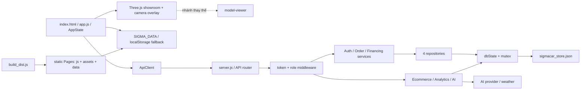
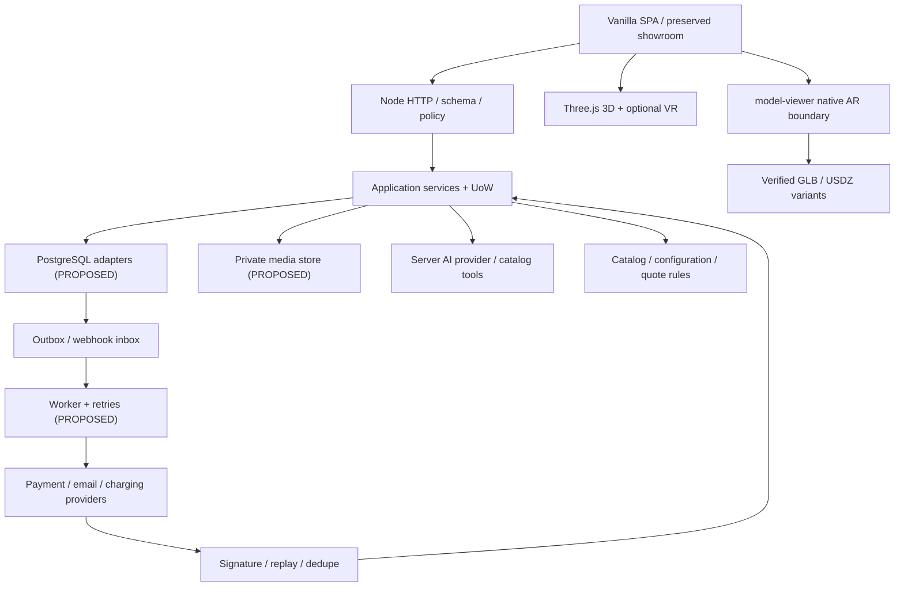

# SIGMA CAR — FULL-STACK AUDIT & IMPLEMENTATION PLAN

> Ngày audit: 13/11/2026 (Asia/Bangkok). Phạm vi: checkout hiện tại tại `C:/Users/Le An/Documents/vibe/sigmacar/sigma-car`. Đây là tài liệu phân tích và kế hoạch; không triển khai tính năng, không thay schema, không cài dependency.
>
> Yêu cầu ghi “26 tính năng”, nhưng danh sách A1–E7 thực tế có **27**: A=5, B=3, C=5, D=7, E=7. Tài liệu bao phủ cả 27 và 15 luồng tích hợp. Không có `PLAN.md` trước audit. Các tài liệu AR và database cũ được giữ nguyên; những nhận định không còn đúng được đối chiếu bên dưới.

## 1. Executive Summary

SIGMA CAR là SPA Vanilla JavaScript và backend Node HTTP có phân lớp API/application/domain/infrastructure, lưu bằng JSON. Dự án có nhiều chức năng thực, nhưng **chưa đủ điều kiện xử lý giao dịch sản xuất**. Không cần thay framework hoặc viết lại showroom. Cần khóa các đường rò dữ liệu và cập nhật trái quyền, sửa giao dịch tồn kho/thanh toán, rồi nối UI hiện có vào hợp đồng API thống nhất.

**Có bằng chứng triển khai:** danh mục 24 xe mới + 5 xe certified; lọc/sắp xếp; gallery; showroom Three.js, vật liệu sơn/mâm, hotspots; API đăng nhập scrypt và token HMAC; đăng ký public ép vai trò buyer; tính vay niên kim; tạo đơn có lấy giá server; lịch lái thử có kiểm tra trùng slot trong mutex; returns/warranty/service/review/support/campaign có collection và handler. Các kiểm thử thuần và mock chạy được nêu tại mục 16. Điều này không đồng nghĩa các feature đã COMPLETE end-to-end.

**Khoảng trống chính:** chưa có cart/checkout nhiều dòng, TCO, hồ sơ đăng ký xe; phụ kiện chỉ có catalog/toast; chưa có provider thanh toán/hoàn tiền/email, worker, DB quan hệ, media upload thật, charging map hoặc notification delivery. Cấu hình xe và AI history chủ yếu nằm trong phiên trình duyệt. Quy trình người bán và thống kê có phần giả lập, sai contract hoặc sai chỉ số.

**6 nhóm rủi ro Critical:** CR-01 phát hành dữ liệu riêng qua static/build; CR-02 tự xác nhận tiền và giao xe; CR-03 ownership/branch isolation; CR-04 tăng kho trước khi từ chối hủy; CR-05 lỗi durability/reseed; CR-06 cấu hình khóa token và tài khoản demo không có chốt production. Mức Critical phản ánh khả năng tác động của mã, không khẳng định đã bị khai thác trên hệ thống đang chạy.

Kết quả phân loại: **COMPLETE 0, PARTIAL 10, UI_ONLY 2, BACKEND_ONLY 0, MOCK 1, BROKEN 11, MISSING 3, UNVERIFIED 0**. Một feature PARTIAL/BROKEN vẫn có những phần chưa kiểm chứng trên thiết bị/provider thật. Có **65 kiểm tra do các suite đã chọn báo cáo: 62 pass, 3 fail**; thêm kiểm tra parse 73 file JS không có syntax error và 6 probe in-memory tái hiện vấn đề. Không chạy toàn bộ integration suite vì có thao tác seed/ghi kho dữ liệu chung.

Chiến lược: P0 sửa an toàn và dựng harness cách ly; P1 catalog → inventory → quote/cart → payment/order; P2 dịch vụ sau mua và policy; P3 mở rộng AI/3D/AR trên dữ liệu tin cậy; P4 vận hành/growth. Hạ tầng upload/outbox đi sớm hơn các feature sử dụng chúng.

## 2. Repository Inspection Coverage

### 2.1. Kiểm kê và phạm vi đã xem

Không tìm thấy `AGENTS.md` trong repository hoặc các thư mục cha đã kiểm tra. Working tree sạch khi bắt đầu. Kiểm kê **2.057 file** ngoài `.git`, `node_modules`, `dist`; đây là số file được liệt kê, không phải số file đã đọc từng dòng.

| Khu vực | Phạm vi và bằng chứng |
|---|---|
| Frontend | Một entry `index.html`; `js/app.js` (10.527 dòng, khoảng 651 KB), `css/style.css`; đọc router/state và truy vết renderer/event/API theo từng tính năng, tìm toàn cục các placeholder, state, tài nguyên và lỗi. Không có React/Vue, app/mobile riêng, shared-package workspace. |
| JS ứng dụng | `js/api-client.js`, `data.js`, `ai-engine.js`, `automotive-llm.js`, `ar-manifest.js`, `ar-adapter.js`, `car-3d-viewer.js`: kiểm tra hợp đồng, fallback, vòng đời, capability và các đường gọi liên quan. |
| Backend | Toàn bộ 18 file: router/middleware; 7 application services/tools; config; constants/state-machines; security/storage-engine; 4 repository. Seed dài được kiểm kê schema/dữ liệu có chọn lọc; không in dữ liệu cá nhân hay hash. |
| Dữ liệu | `data/sigmacar_store.json`: chỉ trích schema, số bản ghi, tính toàn vẹn tham chiếu; `data/ar-manifest.json` đối chiếu manifest JS. Không dump user/secret records. |
| Assets/template | 1.199 file dưới assets; 637 dưới vehicle-template. Parse cả 49 `vehicle.json` (24 bản nguồn + 24 bản public + 1 template). Kiểm 187 tham chiếu assets trong catalog: đều tồn tại. Kiểm metadata/header/PBR/path 24 GLB showroom + 4 GLB AR; không render trực quan toàn bộ asset. Không có USDZ tĩnh. |
| Scripts | 32 script JS/PowerShell trong `scripts/`; 4 JS ở root gồm server và 3 utility; 2 batch deploy. Kiểm entry/dependency, điểm đọc/ghi, import/upsert, build, reset và các path cũ. Không thực thi importer/reset/compression/deploy. |
| Test | 16 file: 4 unit, 3 integration, 1 security, 2 AI ở root tests, 6 suite AR/model/camera/gyro. Đọc setup/đường side effect, các assertion chủ chốt; thực thi subset an toàn tại mục 16. |
| Tài liệu | `README.md`, `docs/database_integration.md`, `AR_IMPLEMENTATION_PLAN.md`, `docs/AR_IMPLEMENTATION_REPORT.md`, template README/schema mẫu. Đối chiếu phần kiến trúc, acceptance và kết quả cũ với code; không dùng tuyên bố “100%” làm chứng nhận hiện tại. |
| Infra | `package.json`, lockfile, `server.js`, config, `_headers`, `_redirects`, `.gitignore`, `.wranglerignore`, build/deploy scripts. Không có workflow CI, Dockerfile, migration directory, ORM, queue hoặc monitor được phát hiện. |

Nhóm scripts đã kiểm kê: `analyze_all_cars.js`, `audit_images.js`, `audit_unpacked.js`, `build_dist.js`, `build_full_inventory.js`, `clear_all_cars.js`, `compare_inventory.js`, `complete_vehicle_templates.js`, `compress_all_models.js`, `compress_large_glb.js`, `convert_all_gltf.js`, `deploy_assets.js`, `detail_comp_db.js`, `extract_project2_assets.js`, `import_all_xe.js`, `import_missing_cars.js`, `import_vehicle.js`, `inspect_all_data_txt.js`, `inspect_empty_inner.ps1`, `inspect_excel.js`, `inspect_inner_zips.ps1`, `inspect_triple_nested.ps1`, `inspect_xe.ps1`, `make_catalog.js`, `map_project2_assets.js`, `normalize_cybertruck_ar.js`, `reset_test_state.js`, `sync_all_inventory.js`, `test_dirs.js`, `test_routes_render.js`, `unpack_all_xe.ps1`, `update_fuel.js`. Scripts import lớn chứa registry hardcoded, không phải service runtime khác.

### 2.2. Loại trừ và giới hạn

- Không đọc giá trị `.env`/credentials; chỉ tên biến từ code. Không thử khóa AI, thanh toán, SMTP hoặc endpoint production.
- Không giải nén hoặc xem nội dung nhị phân của 42 PDF thiết kế trong 3 thư mục `Dự án thương mại điện tử*`, 2 XLSX trong `about car/`, ảnh/video. Chỉ kiểm kê, tham chiếu và metadata GLB; tính chính xác thương mại của thông số, bản quyền model, nội dung PDF bảo hành chưa được chứng thực.
- Vendor `js/libs/*` chỉ kiểm version/export/loader dependency cần thiết, không audit từng dòng mã minified/WASM.
- Không có browser/device session thực; responsive, focus, render WebGL, camera thật, WebXR, Scene Viewer, Quick Look và VR headset chưa được nghiệm thu.
- Không chạy server: import router kéo theo storage có khởi tạo/ghi, và môi trường không có `node_modules` cục bộ. Không cài gói. Node dùng kiểm tra là **v23.11.0**, không phải cam kết phiên bản deploy.
- Đọc nhiều lượt theo luồng và symbol đối với file lớn; không tuyên bố đã audit từng dòng HTML/CSS/seed/registry cũ hoặc đạt coverage test 100%.
- `Xe/`, `Xe_unpacked/`, `3Dmodel/` và một số path scratch máy tác giả được script/tài liệu nhắc tới nhưng không có trong checkout. Các input lịch sử này không được kiểm tra.
- Không có `dist/`; không build vì build tạo/xóa file ngoài `PLAN.md`. Việc phát hành công khai thực tế và trạng thái purge CDN chưa xác minh.

### 2.3. Những điểm cần hòa giải tài liệu cũ

`docs/database_integration.md` gọi engine “ACID” và chuyển DB “zero changes” ở service: chưa đúng vì save nuốt lỗi, file không atomic và EcommerceService/AnalyticsService/AIService truy cập `dbState` trực tiếp. `DATABASE_URL` chưa điều khiển storage. Script migration được tài liệu nhắc chưa tồn tại.

`AR_IMPLEMENTATION_PLAN.md` nói 38 xe, path ổ D:, file `backend/config.js`, targetSize 4.3 và `tests/run-tests.js`: checkout hiện tại là 29 xe tổng, config nằm ở `backend/config/index.js`, targetMaxDim 4.4, npm test là Node test glob. Giữ các nguyên tắc đúng: bảo toàn GLB/hotspots, scale có kiểm chứng, fallback, kiểm thiết bị và pipeline không tạo trùng. Các Phase “đã hoàn thành” trong AR report được giữ như lịch sử, **không chuyển sang completed task trong kế hoạch mới** vì code/manifest đã đổi.

## 3. Current Architecture

### Frontend

Vanilla HTML/CSS/JS, không framework phiên bản riêng. `index.html` nạp global scripts theo thứ tự Three.js/controls/loaders → viewer → data/manifest/adapter → API/AI → app. Three.js **r128** xác minh từ export; model-viewer là bundle tự lưu, phiên bản chính xác chưa xác minh từ artifact, không coi “v3.5+” trong report là version lock.

Hash routes: `home,new-cars,certified,accessories,detail,compare,ai-advisor,test-drive,vr-ar,ar-live,ar-home,support,seller-dashboard,profile`; profile/seller có `?tab=`, các viewer có `?carId=`. `vehicle-detail` được nhắc khi tạo hash nhưng không có case render. UI là template strings và DOM listeners trong app.js, CSS global, inline styles khá nhiều. State `AppState`; token/user và một số fallback lưu localStorage; config xe trong RAM; session AI trong `SigmaAIEngine.historySessions`.

Form dùng HTML required/type và validation thủ công. API fetch trung tâm, không schema chung. Loading/error/empty có ở nhiều renderer nhưng catch thường đổi lỗi thành mảng rỗng hoặc dữ liệu mẫu; detail/comparison tự thay ID lạ bằng xe đầu. CSS có breakpoints 1100/1024/768/640, bảng overflow và drawer mobile; grid inline/min-width cần test thật.

### Backend

Một ứng dụng CommonJS Node `http.createServer`; không Express. `server.js` dispatch `/api/v1/*` tới `handleApiRequest`. `package.json` phiên bản ứng dụng 1.0.0; dependency runtime duy nhất `@google/genai ^2.31.0`, lock 2.31.0. Không version Node engines.

Middleware token bearer HMAC-SHA256, scrypt async, rate-limit RAM theo IP, body JSON khoảng 1 MB. Không session revocation. Role check lấy từ token, chưa kiểm user hiện tại/branch ở nhiều mutation. Lỗi tổng quát bị chuyển 400; payload lớn không dừng nhận body; lỗi decode URL/static stream ngoài API chưa bao bọc tốt.

API gồm auth/catalog/financing/orders/appointments/analytics/AI/users và returns/warranty/maintenance/reviews/questions/support/campaigns/unsubscribe. Services dùng repository cho phần core, nhưng phần extended đọc/ghi dbState trực tiếp. Chưa có upload binary, payment webhook, queue/worker, notifications provider.

### Database

**Engine thực: JSON file**, `data/sigmacar_store.json`, giữ toàn bộ object trong RAM. Mutex trong một process, snapshot JSON rollback, writeFileSync cả file. Không FK/index/schema migration/transaction đa-process. Những kiểm tra unique email/VIN, duplicate order và slot là code ứng dụng, không constraint storage.

Collection và số bản ghi hiện tại: users 4; vehicles 24; certifiedVehicles 5; orders 4; appointments 0; returnRequests 2; warranties 1; serviceRecords 2; serviceAppointments 1; reviews 2; questions 1; supportTickets 2; faqs 7; emailCampaigns 3; auditLogs 1; meta object. Branch/service-center lấy từ constants, dữ liệu frontend có bản riêng.

Quan hệ bằng string: order.userId/vehicleId/branchId; return.orderId; warranty.orderId/vin/userId; serviceRecord.warrantyId; review.userId/vehicleId/orderId; question.answers; ticket.messages/internalNotes; campaign.createdBy. History lồng trong order/return. **Cả 4 orders, 1 warranty, 2 serviceRecords, 1 serviceAppointment, 2 reviews, 1 question có vehicleId không còn trong catalog**. Không tự đổi chúng sang xe khác khi migrate.

### Integrations và Infrastructure

- AI: Gemini SDK/REST, Groq/OpenAI-compatible, Ollama; AITools tìm catalog, so sánh, giờ, weather HTTP. “Live RAG” là catalog RAM và lọc/rule, không vector DB hay training model.
- 3D: GLTFLoader + DRACOLoader local, OrbitControls, RoomEnvironment. AR có code model-viewer và Three camera overlay; VR có requestSession nhưng thiếu bằng chứng vòng render XR hoàn chỉnh.
- Hosting: Node full stack hoặc Cloudflare Pages static. `build_dist.js` copy index/headers/redirects + css/js/assets/**data**; không đóng gói backend. `_redirects` rewrite mọi path sang HTML làm client đi fallback. Tunnel batch public hóa Node; không reverse-proxy production config.
- Không cache nghiệp vụ; asset cache có immutable một năm nhưng filename không fingerprint. Không monitoring/tracing/backup job/CI. `console.error` là logging chính.

Tên biến môi trường tìm thấy: `PORT,NODE_ENV,JWT_SECRET,SESSION_EXPIRY_HOURS,RATE_LIMIT_MAX_REQUESTS_PER_MINUTE,DATABASE_URL,DATABASE_DIALECT,AI_PROVIDER,ALLOW_LOCAL_FALLBACK,GEMINI_API_KEY,GEMINI_MODEL,GROQ_API_KEY,GROQ_MODEL,AI_API_KEY,OPENAI_API_KEY,OPENAI_MODEL,OLLAMA_ENDPOINT,OLLAMA_MODEL,SMTP_HOST,SMTP_USER,SMS_API_KEY,TEST_API_URL`. SMTP/SMS flags không chứng minh provider đã tích hợp.

## 4. Existing Feature Inventory

Trạng thái là cho **toàn bộ yêu cầu feature**, không chỉ route. COMPLETE cần E2E và test đủ; PARTIAL có phần thật; UI_ONLY thiếu backend cho hành vi yêu cầu; MOCK hành vi cốt lõi mô phỏng; BROKEN có defect cụ thể. Các API dưới bảng và mục sau mặc định prefix `/api/v1`. Evidence dùng path + symbol để không lệ thuộc line number sau sửa.

| Feature ID | Feature | Status | Frontend | Backend | Database | Evidence | Priority |
 
|---|---|---|---|---|---|---|---|
| A1 | Tư vấn AI cá nhân hóa | PARTIAL | Chat, history RAM, recommendation cards | AIService + AITools, đa provider | Chỉ catalog/meta.aiConfig | js/app.js:renderAIAdvisor; js/automotive-llm.js:queryLLM; backend/application/ai-service.js:chat,updateConfig,syncKnowledgeBase; backend/application/ai-tools.js; js/ai-engine.js:simulateGarageAnalysis | P3 |
| A2 | Ma trận so sánh thông minh | BROKEN | renderCompare, chọn/xóa slot | Catalog API; AITools.compareVehicles | vehicles/certifiedVehicles | js/app.js:renderCompare,addCarToCompare; css/style.css:.compare-row; backend/application/ai-tools.js:compareVehicles | P3 |
| A3 | Tính tổng chi phí sở hữu | MISSING | Không có calculator TCO | Không có endpoint TCO | Chưa có assumption/rate version | js/app.js:router,openLoanCalculatorModal; backend/application/financing-service.js; js/data.js:components | P3 |
| A4 | Khám phá xe thông minh | PARTIAL | Lọc giá/hãng/category/fuel, search/sort | findAll/findCertified | 24+5 catalog, không index | js/app.js:filterAndSortVehicles,performLiveSearch,loadBackendData; backend/infrastructure/repositories/vehicle-repository.js:findAll,findCertified | P1 |
| A5 | Trang chi tiết sản phẩm | PARTIAL | Gallery/lightbox/3D, compare, test drive, cọc/vay | Catalog detail + deposit | vehicles, chưa fee/availability branch DTO | js/app.js:renderVehicleDetail,openInline3DStage; backend/api/router.js:vehicles; js/data.js:model3d,documents | P1 |
| B1 | Cấu hình xe 3D | PARTIAL | GLB, xoay, sơn, mâm, hotspots | Chưa config/quote service | vehicleConfigs chỉ RAM | js/car-3d-viewer.js:loadModel,setupLoadedModel,setBodyColor,setWheelType,focusHotspot,dispose; js/app.js:getVehicleConfig,setVehicleConfig,renderVrArShowroomPage | P3 |
| B2 | AR/VR thực | BROKEN | Camera overlay, native launcher, studio/VR, ar-home timer | Static GLB/manifest | 24 entries verified theo metadata | js/ar-adapter.js:mountViewer,activateAR; js/car-3d-viewer.js:enterWebXR,animate,setupLoadedModel; js/ar-manifest.js:getVehicleArConfig; js/app.js:renderArAtHomePage | P3 |
| B3 | Gói phụ kiện thông minh | UI_ONLY | 8 phụ kiện, 11 linh kiện; mua chỉ toast | Chưa accessories/bundles API | SIGMA_DATA tĩnh, compatibleModels text | js/app.js:renderAccessories; js/data.js:accessories,components; backend/api/router.js | P3 |
| C1 | Đặt lịch lái thử | BROKEN | Form, profile lịch hẹn, seller list | create/list/status có collision mutex | appointments | js/app.js:renderTestDrivePage,bindSellerDashboardActions; backend/infrastructure/repositories/appointment-repository.js:create,transitionStatus | P2 |
| C2 | Đặt hàng và thanh toán linh hoạt | BROKEN | Modal đặt cọc, nút thanh toán hoàn tất | Deposit/complete-payment/status | orders, paymentStatus không có ledger | backend/application/order-service.js; backend/infrastructure/repositories/order-repository.js:create,markPaymentComplete; js/app.js:form-deposit,renderProfile | P1 |
| C3 | Dịch vụ đăng ký xe | MISSING | Chưa workflow chọn tự làm/đại lý | Chưa endpoint registration | Chưa hồ sơ/fee schedule/documents | js/app.js:renderVehicleDetail,renderProfileSubView; backend/api/router.js; backend/infrastructure/storage-engine.js:dbState | P2 |
| C4 | Giỏ hàng và checkout | MISSING | Không route cart/checkout; deposit modal có sẵn | Không cart/coupon/checkout API | Không cart/order_items | js/app.js:renderCurrentRoute,renderAccessories; js/api-client.js; backend/api/router.js | P1 |
| C5 | Tài chính thông minh | PARTIAL | Loan modal tính gốc đều tháng đầu | FinancingService tính niên kim | Không lưu loan quote/lender request | js/app.js:openLoanCalculatorModal; backend/application/financing-service.js:calculateLoan; backend/api/router.js:financing/calculate; tests/unit/financing.test.js | P2 |
| D1 | Theo dõi đơn hàng | BROKEN | Profile orders, seller action | Status/history, không push stream | orders.history | js/app.js:bindSellerDashboardActions,renderProfileSubView; backend/domain/state-machines.js:ORDER_TRANSITIONS; backend/application/order-service.js | P2 |
| D2 | Trung tâm đổi trả tự động | PARTIAL | Form, timeline, seller handling | Eligibility, pickup, supplement, refund status | returnRequests + auditLogs | backend/application/ecommerce-service.js:computeOrderReturnEligibility,createReturnRequest,updateReturnStatus; js/api-client.js:returns.estimate,processRefund; js/app.js:bindProfileInteractiveEvents | P2 |
| D3 | Bảo hành số và bảo dưỡng | BROKEN | Garage activation/service forms | VIN match/duplicate check, service records | warranties/serviceAppointments/serviceRecords | backend/application/ecommerce-service.js:activateElectronicWarranty,createServiceAppointment,createServiceRecord; js/api-client.js:warranties | P2 |
| D4 | Hệ sinh thái pin và trạm sạc | UI_ONLY | Thông tin pin/sạc catalog, AI, components | AITools.explainTechnology; không station API | Specs tĩnh, không station cache | js/data.js:evSpecs,components; js/app.js:renderVehicleDetail,renderAccessories; backend/application/ai-tools.js:explainTechnology | P4 |
| D5 | Gara của tôi | PARTIAL | Saved cars, garage, purchased orders | saved-cars, warranties aggregate | users.savedCars + orders/warranties | js/app.js:renderProfile,renderProfileSubView; js/api-client.js:warranties.getMyGarage; backend/application/auth-service.js:toggleSavedCar | P2 |
| D6 | Đánh giá và cộng đồng | PARTIAL | Ratings/criteria/Q&A, moderation | CRUD, verified purchase, report/helpful | reviews/questions | backend/application/ecommerce-service.js:createReview,getReviewsAndQuestions,moderateReview; js/app.js:loadAndRenderVehicleReviews; js/api-client.js:reviews | P4 |
| D7 | Chăm sóc khách hàng | BROKEN | FAQ, ticket create/lookup/reply, seller assignment | Ticket service, internal notes stripping | supportTickets/faqs/auditLogs | backend/application/ecommerce-service.js:lookupTicketByCode,sanitizeTicketForUser,replyToSupportTicket,updateSupportTicketAdmin; js/app.js:renderSupportCenterPage | P2 |
| E1 | Sản phẩm và tồn kho | BROKEN | Add car/adjust stock UI chỉ RAM | Vehicle CRUD có thật, thiếu scope/schema | stock toàn cục, không branch ledger | js/app.js:openAddVehicleModal,addNewCarToWebsite,bindSellerDashboardActions; backend/infrastructure/repositories/vehicle-repository.js:create,update,reserveInventory | P1 |
| E2 | Đơn hàng và khách hàng | BROKEN | Seller orders/CRM/admin users | Orders/users APIs | orders/users, không contracts | js/app.js:renderSellerSubView,bindSellerDashboardActions; backend/api/router.js:admin/users; backend/infrastructure/repositories/user-repository.js:create | P1 |
| E3 | Vận hành dịch vụ hậu mãi | PARTIAL | Seller service appointments/history | Service APIs có thật | warranties/service*; workshop/parts hardcoded | backend/application/ecommerce-service.js:getWarrantyAndMaintenanceData,createServiceRecord; js/api-client.js:warranties.getAdminOverview; js/app.js:renderSellerSubView | P4 |
| E4 | Dashboard phân tích | BROKEN | KPI, charts, seller overview | AnalyticsService | orders/appointments/supportTickets | backend/application/analytics-service.js:getSellerOverview; js/app.js:renderSellerDashboard,renderSellerSubView; js/data.js:dashboard | P4 |
| E5 | CMS và bảo mật nội dung | PARTIAL | Banner/article-like blocks hardcoded; admin/security UI | Auth/audit một phần, không CMS | auditLogs; không banners/articles | js/app.js:renderHome,renderSellerSubView; backend/application/ecommerce-service.js:appendAuditLog; backend/infrastructure/security.js; server.js | P4 |
| E6 | Email marketing và notifications | MOCK | Campaign editor/preview/segments | save/status/execute/test trả thành công giả | emailCampaigns, không delivery attempts/queue | backend/application/ecommerce-service.js:sendTestCampaignEmail,executeCampaignSend,getRecipientListForSegment,unsubscribeMarketing; js/api-client.js:campaigns | P4 |
| E7 | Phân quyền Buyer/Seller/Admin | BROKEN | Route guard, user role management | Token/role gate, public register ép buyer | users.role; branch thiếu, không session version | backend/api/middleware.js:authorize; backend/infrastructure/security.js:verifyToken; repositories findByQuery/transition; backend/application/ecommerce-service.js:isStaff paths | P0 |

## 5. Detailed Gap Analysis

Mỗi feature dưới đây được truy vết UI/state → ApiClient → endpoint/service → persistence/policy; file thay đổi cụ thể được liệt kê trong task liên kết tại mục15, DB/API chung ở mục8–9. Với feature chưa có backend/DB, đó là khoảng trống xác nhận qua route/service/schema, không phải suy luận từ tên feature.

14 chiều audit: UI, state/interactions, API client, endpoint, business rule, persistence được ghi trong hiện trạng/evidence/gap; auth/validation/security được nối với mục6/12 và task liên quan. Error/loading/empty hiện có không đồng nhất do fallback/catch chung; responsive mới kiểm static CSS, **chưa test browser cho bất kỳ feature nào**. Mục10/16 áp dụng từng feature UI. Existing tests dưới đây phân biệt đã chạy/chưa chạy. **Không feature nào đủ bằng chứng production-ready**, kể cả khi unit/mock pass. Những lỗi nêu từ code/probe là xác nhận; các mục cần browser/provider/device được ghi là rủi ro hoặc chưa xác minh.

### A1. Tư vấn AI cá nhân hóa

**Status:** PARTIAL · **Priority:** P3 · **Complexity:** L. Priority là feature delivery; các lỗi security liên quan luôn xử lý ở P0.

**Hiện trạng:** Frontend: Chat, history RAM, recommendation cards. Backend: AIService + AITools, đa provider. Database: Chỉ catalog/meta.aiConfig.

**Evidence:** js/app.js:renderAIAdvisor; js/automotive-llm.js:queryLLM; backend/application/ai-service.js:chat,updateConfig,syncKnowledgeBase; backend/application/ai-tools.js; js/ai-engine.js:simulateGarageAnalysis.

**Thiếu chức năng / lỗi xác nhận:** Đã có hội thoại có context và fallback rule-based. Chưa có profile nhu cầu có cấu trúc, lịch sử server, top 2–3 có reasoning kiểm chứng, ràng buộc trả góp/hành vi lái, consent/retention ảnh hoặc phân tích ảnh thật. UI gửi config {model,apiKey,endpoint}, server đợi các field theo provider; lời báo lưu thành công có thể sai. RAG thêm hp/seats/dimensions mặc định; chat history title chèn HTML chưa escape. Nguy cơ prompt injection và gửi thừa PII tới provider cần test.

**Giải pháp và file/boundary thay đổi:** Mở rộng AIService/AITools và ApiClient.ai; PROPOSED backend/application/consultation-service.js, js/consultation-state.js. Lưu preference {budgetVnd,monthlyBudgetVnd,downPaymentVnd,passengers,dailyKm,usage,chargingAccess}; kết quả {vehicleId,reasons,missingData} tối đa 3 từ catalog đã lọc. Consent riêng cho ảnh, mediaId riêng tư, TTL, xóa conversation. Chỉ ước lượng không gian định tính; đo cần kích thước người dùng/hiệu chuẩn. Provider chỉ server, timeout cả SDK, không fake streaming là server stream.

**DB/API, dependencies, acceptance và tests cần bổ sung:** DB M6; API AI tại mục 9. Phụ thuộc catalog chuẩn, upload và P0. AC: hỏi ngân sách trả về tối đa 3 ID có thật và giá đúng; reload thấy history của chính user; provider timeout hiện fallback rõ; ảnh không consent bị từ chối, TTL xóa được. Test provider stub/timeout, XSS history, prompt injection, user A/B, consent/delete; provider thật chưa xác minh. Tasks SIG-P3-005/006.

**Test hiện hữu và độ tin cậy:** tests/automotive_llm.test.js:5/5 pass local; tests/unit/gemini_ai.test.js và tests/ai_service.test.js chưa chạy.

**Rủi ro/giả định chưa xác minh:** Chưa kiểm provider/ảnh thật; prompt injection và fit calibration cần QA; không suy từ rule-based tests thành AI E2E.

### A2. Ma trận so sánh thông minh

**Status:** BROKEN · **Priority:** P3 · **Complexity:** M. Priority là feature delivery; các lỗi security liên quan luôn xử lý ở P0.

**Hiện trạng:** Frontend: renderCompare, chọn/xóa slot. Backend: Catalog API; AITools.compareVehicles. Database: vehicles/certifiedVehicles.

**Evidence:** js/app.js:renderCompare,addCarToCompare; css/style.css:.compare-row; backend/application/ai-tools.js:compareVehicles.

**Thiếu chức năng / lỗi xác nhận:** Cho tối đa 4 xe trong khi yêu cầu 2–3; chỉ resolve xe mới và fallback xe đầu. Hai ID default đã mất: vinfast-vf8, mercedes-glc300. Thiếu trọng lượng, dimensions đầy đủ, warranty và financing tách dòng, highlight khác biệt; hp=200/range=450/acceleration=7.5s thay dữ liệu thiếu. Grid CSS cố định 3 cột không theo số slot. Nguy cơ người dùng quyết định dựa trên thông số suy diễn.

**Giải pháp và file/boundary thay đổi:** Sửa app.js renderCompare/resolver, CSS và spec DTO dùng chung từ catalog; không cần service comparison riêng khi dữ liệu public đã đủ. Xóa ID không còn hợp lệ bằng thông báo, hỗ trợ certified đúng identity; 2–3 slot distinct, unit kg/kWh/km/min/mm/VND, cycle WLTP/EPA và điều kiện sạc rõ; null là chưa có dữ liệu. Financing quote gắn ID/assumptions.

**DB/API, dependencies, acceptance và tests cần bổ sung:** DB M2 spec chuẩn, không table comparison bắt buộc; API catalog/financing. Phụ thuộc SIG-P1-001/002 và SIG-P2-002. AC: 2/3 xe đúng thứ tự, không tự thế xe, highlight chỉ so cùng đơn vị; mobile ngang scroll. Test default/unknown/CPO/null/duplicate, responsive 360px. Task SIG-P3-001.

**Test hiện hữu và độ tin cậy:** tests/automotive_llm.test.js có liên quan tool/context, không nghiệm thu matrix browser; chưa có E2E compare được chạy.

**Rủi ro/giả định chưa xác minh:** Độ đầy đủ specs/warranty có nguồn quyết định chất lượng so sánh; không tự điền giá trị còn thiếu.

### A3. Tính tổng chi phí sở hữu

**Status:** MISSING · **Priority:** P3 · **Complexity:** M. Priority là feature delivery; các lỗi security liên quan luôn xử lý ở P0.

**Hiện trạng:** Frontend: Không có calculator TCO. Backend: Không có endpoint TCO. Database: Chưa có assumption/rate version.

**Evidence:** js/app.js:router,openLoanCalculatorModal; backend/application/financing-service.js; js/data.js:components.

**Thiếu chức năng / lỗi xác nhận:** Không tìm thấy calculator điện/xăng/bảo trì theo tháng/năm sau khi truy vết route, công thức, services và dữ liệu. Loan calculator hiện có không phải TCO. Dữ liệu consumption còn thiếu/không chuẩn. Không coi nội dung AI về pin/sạc là phép tính chi phí.

**Giải pháp và file/boundary thay đổi:** PROPOSED backend/application/tco-service.js và js/tco-view.js; route #tco với 2 xe EV/ICE. Nhập monthlyKm, kWhPer100Km hoặc litersPer100Km, electricityVndPerKwh, fuelVndPerLiter, annualMaintenanceVnd, chargingLossPercent. Hiển thị từng công thức, nguồn/ngày/vùng assumption; optional chi phí cố định tách khỏi operating subtotal, không gọi subtotal là TCO đầy đủ.

**DB/API, dependencies, acceptance và tests cần bổ sung:** DB M6 assumptions có version; POST /cost-estimates/tco (PROPOSED). Phụ thuộc SIG-P1-001. AC: 1.000 km, 15 kWh/100km, 3.000 đ/kWh, loss=0 → 450.000 đ/tháng; ICE 7 l/100km ×25.000 →1.750.000. Annual=12×monthly+maintenance. Test zero/negative/null/nonfinite/unit và sửa input; giá ví dụ không phải giá thị trường. Task SIG-P3-002.

**Test hiện hữu và độ tin cậy:** Không tìm thấy suite chuyên TCO; financing.test.js không thay thế TCO.

**Rủi ro/giả định chưa xác minh:** Giá năng lượng/bảo trì và tổn hao là input/assumption có version, không dữ liệu giá hiện hành đã xác minh.

### A4. Khám phá xe thông minh

**Status:** PARTIAL · **Priority:** P1 · **Complexity:** M. Priority là feature delivery; các lỗi security liên quan luôn xử lý ở P0.

**Hiện trạng:** Frontend: Lọc giá/hãng/category/fuel, search/sort. Backend: findAll/findCertified. Database: 24+5 catalog, không index.

**Evidence:** js/app.js:filterAndSortVehicles,performLiveSearch,loadBackendData; backend/infrastructure/repositories/vehicle-repository.js:findAll,findCertified.

**Thiếu chức năng / lỗi xác nhận:** UI có lọc và empty result; backend hỗ trợ subset category/fuel/price/search/sort. Chưa brand/battery/range/usage/affordability query, pagination hoặc URL persistence. findCertified nhận maxOdo nhưng không áp dụng; catalog trống bị đổi thành seed, load toàn bộ. UI/backend có logic giá và fuel riêng. Query lớn sẽ quét toàn mảng.

**Giải pháp và file/boundary thay đổi:** Mở rộng repository/router/ApiClient.vehicles và AppState filters; query có whitelist, numeric bounds, cursor hoặc page/pageSize ổn định; lưu URL và reset filter có chủ ý. Chọn một spec/fuel normalizer; search debounce/abort; không hồi sinh catalog seed khi API trả [].

**DB/API, dependencies, acceptance và tests cần bổ sung:** DB M2, indexes category/brand/fuel/price/range; GET /vehicles mở rộng. Phụ thuộc SIG-P0-004/008 và SIG-P1-001. AC: query/URL reload giữ filter, 0 kết quả vẫn 0; frontend/backend parity, phân trang không trùng; limit <=100, performance dataset 10k. Test filter_sort hiện có sau cách ly + contract/pagination/invalid query. Task SIG-P1-002.

**Test hiện hữu và độ tin cậy:** tests/unit/filter_sort.test.js đã xem, chưa chạy do dependency/storage; chưa benchmark queries.

**Rủi ro/giả định chưa xác minh:** Hiệu năng10k bản ghi chưa đo; rule khả năng trả góp phải dùng cùng công thức C5.

### A5. Trang chi tiết sản phẩm

**Status:** PARTIAL · **Priority:** P1 · **Complexity:** M. Priority là feature delivery; các lỗi security liên quan luôn xử lý ở P0.

**Hiện trạng:** Frontend: Gallery/lightbox/3D, compare, test drive, cọc/vay. Backend: Catalog detail + deposit. Database: vehicles, chưa fee/availability branch DTO.

**Evidence:** js/app.js:renderVehicleDetail,openInline3DStage; backend/api/router.js:vehicles; js/data.js:model3d,documents.

**Thiếu chức năng / lỗi xác nhận:** Gallery phân loại, hotspots và CTA tồn tại. ID lạ fallback xe đầu; có spec defaults bịa; chưa registration fee estimate có nguồn, availability theo branch, related query, checkout thực, warranty theo từng sản phẩm đã xác nhận. Viewer detail chỉ dispose khi render detail tiếp, router rời detail chưa dispose. PDF import có thể chỉ là placeholder.

**Giải pháp và file/boundary thay đổi:** Sửa renderer/route resolver, đọc evSpecs/dimensionsDetail/warrantyDetail chuẩn; not-found thật; branch availability, fee estimate version và liên kết quote/cart/vay/lái thử/related. Giữ gallery/model/hotspots, lazy tải model, cleanup mỗi lần rời route. Không hiển thị PDF placeholder như tài liệu hãng.

**DB/API, dependencies, acceptance và tests cần bổ sung:** DB M2/M3/M5; API catalog, quotes, registration estimates. Phụ thuộc SIG-P1-001/002, phí C3 triển khai bổ sung P2. AC: đúng ID mọi CTA, mất asset có fallback, hết kho chặn checkout, spec thiếu là null; 10 lần ra/vào không tăng viewer/listener. Test router, CPO, gallery 187 refs, mobile/lightbox/keyboard. Task SIG-P1-003.

**Test hiện hữu và độ tin cậy:** tests/test_models.js:10/10 metadata, không gallery/CTA/browser.

**Rủi ro/giả định chưa xác minh:** Asset references tồn tại không chứng minh gallery/mobile/render đúng; phí đăng ký cần policy C3.

### B1. Cấu hình xe 3D

**Status:** PARTIAL · **Priority:** P3 · **Complexity:** L. Priority là feature delivery; các lỗi security liên quan luôn xử lý ở P0.

**Hiện trạng:** Frontend: GLB, xoay, sơn, mâm, hotspots. Backend: Chưa config/quote service. Database: vehicleConfigs chỉ RAM.

**Evidence:** js/car-3d-viewer.js:loadModel,setupLoadedModel,setBodyColor,setWheelType,focusHotspot,dispose; js/app.js:getVehicleConfig,setVehicleConfig,renderVrArShowroomPage.

**Thiếu chức năng / lỗi xác nhận:** 24 GLB và Draco/PBR có test metadata; mâm hiện đổi vật liệu, không đổi geometry. Chưa phụ kiện trên mesh, explode engine/battery/brakes, config server/cart, giá đồng bộ. setupLoadedModel scale về 4.4 dùng cho preview; không chứng minh kích thước thật. Risk dispose textures/load lỗi và chi phí ảnh/model trên mobile.

**Giải pháp và file/boundary thay đổi:** Giữ viewer và assets, thêm versioned configuration {vehicleId,trimId,colorId,wheelId,accessoryIds,assetVersion}; repository cấu hình riêng. PROPOSED backend/application/configuration-service.js, backend/infrastructure/repositories/configuration-repository.js. Material/mesh binding theo manifest, server quote kiểm option. Explode chỉ enable asset có named parts/pivots và metadata inspection; model khác dùng hotspot kỹ thuật, không tạo hình giả.

**DB/API, dependencies, acceptance và tests cần bổ sung:** DB M2 configurations/options/media; API /configurations và /quotes (PROPOSED). Phụ thuộc SIG-P1-001/004/005. AC: lưu/reload/cross-view đúng màu/mâm, cart đúng config version và giá; không làm đổi kính/lốp; unsupported WebGL có ảnh. Test model regression, dispose, unknown options, price tamper, one asset explode golden path. Tasks SIG-P3-003/004.

**Test hiện hữu và độ tin cậy:** tests/test_models.js:10/10 và tests/test_viewer_camera_integration.js:8/8 mock; không visual explosion/customization E2E.

**Rủi ro/giả định chưa xác minh:** Không phải model nào cũng có mesh cho explosion hoặc wheel geometry; chất lượng GPU/visual cần thiết bị.

### B2. AR/VR thực

**Status:** BROKEN · **Priority:** P3 · **Complexity:** L. Priority là feature delivery; các lỗi security liên quan luôn xử lý ở P0.

**Hiện trạng:** Frontend: Camera overlay, native launcher, studio/VR, ar-home timer. Backend: Static GLB/manifest. Database: 24 entries verified theo metadata.

**Evidence:** js/ar-adapter.js:mountViewer,activateAR; js/car-3d-viewer.js:enterWebXR,animate,setupLoadedModel; js/ar-manifest.js:getVehicleArConfig; js/app.js:renderArAtHomePage.

**Thiếu chức năng / lỗi xác nhận:** Browser ưu tiên Car3DViewer, không mount modelViewer; activateAR đòi modelViewer. Camera overlay/gyro không có positional tracking/hit-test placement, nhưng nhãn nói 1:1/AR thực. enterWebXR xin optional hit-test nhưng không requestHitTestSource/getHitTestResults; loop requestAnimationFrame, chưa setAnimationLoop. Manifest ID lạ trả Honda đầu; readiness chỉ membership. 4 GLB Cybertruck calibrated còn trên đĩa nhưng manifest trỏ GLB showroom; ar-home “AI tạo ảnh” là setTimeout. Không có USDZ tĩnh.

**Giải pháp và file/boundary thay đổi:** Tách explicit modes studio/camera-preview/real-ar/immersive-vr; chọn model-viewer làm native AR boundary như mục 11, giữ Three showroom/gyro. Capability detection + user gesture, scale/pivot verified per asset, static color variants hoặc export đã kiểm; cleanup camera trước XR. Fallback desktop là 3D/QR tới exact vehicle/config; ảnh ar-home phải ghi mô phỏng hoặc implement riêng, không nhận diện độ sâu giả.

**DB/API, dependencies, acceptance và tests cần bổ sung:** DB M2 asset capabilities/version; không cần API camera upload mặc định. Phụ thuộc SIG-P3-003, privacy upload chỉ khi lưu ảnh. AC: Android đặt sàn và đi quanh; iOS Quick Look đúng xe/tỉ lệ; unsupported không xin camera sai và không báo AR ready; VR headset render stereo/frame loop; chuyển route dừng tracks/session. Tests mock hiện có + thiết bị mục 16. Tasks SIG-P3-007/008/009.

**Test hiện hữu và độ tin cậy:** 6 suite AR/model/camera/gyro tổng47/50 pass; ba fail schema/export/dist; không device.

**Rủi ro/giả định chưa xác minh:** Support theo device/browser/version; native customization không tự nhận state Three; scale cần đo thật.

### B3. Gói phụ kiện thông minh

**Status:** UI_ONLY · **Priority:** P3 · **Complexity:** L. Priority là feature delivery; các lỗi security liên quan luôn xử lý ở P0.

**Hiện trạng:** Frontend: 8 phụ kiện, 11 linh kiện; mua chỉ toast. Backend: Chưa accessories/bundles API. Database: SIGMA_DATA tĩnh, compatibleModels text.

**Evidence:** js/app.js:renderAccessories; js/data.js:accessories,components; backend/api/router.js.

**Thiếu chức năng / lỗi xác nhận:** Có danh mục, giá, quantity và chuỗi tương thích; không có bundle generation/edit, compatibility chuẩn, inventory reservation, discount hoặc cart. Toast đặt thành công không lưu gì. Không thể xác nhận tương thích lắp đặt từ tên model dạng text.

**Giải pháp và file/boundary thay đổi:** Đưa accessories/components vào catalog có SKU, compatibility relation vehicle/trim/year, giá/stock thật; PROPOSED backend/application/bundle-service.js. Gợi ý bundle có lý do, sửa số lượng, báo xung đột và tính lại bằng quote server; discount policy có version, không client tính quyết định.

**DB/API, dependencies, acceptance và tests cần bổ sung:** DB M2/M3 accessories/compatibility/bundles; API /accessories,/bundles/quote, cart (PROPOSED). Phụ thuộc SIG-P1-004/005/006. AC: incompatible bị chặn server; xóa món cập nhật giá; concurrent last item chỉ một checkout thắng; reload cart còn bundle. Test compatibility matrix, discount, stock/idempotency, mobile editing. Tasks SIG-P3-010/011.

**Test hiện hữu và độ tin cậy:** Không tìm thấy suite bundle/cart chuyên biệt đã xác minh.

**Rủi ro/giả định chưa xác minh:** Danh sách compatibility text hiện tại không đủ để xác nhận fit; cần manufacturer SKU/variant metadata.

### C1. Đặt lịch lái thử

**Status:** BROKEN · **Priority:** P2 · **Complexity:** L. Priority là feature delivery; các lỗi security liên quan luôn xử lý ở P0.

**Hiện trạng:** Frontend: Form, profile lịch hẹn, seller list. Backend: create/list/status có collision mutex. Database: appointments.

**Evidence:** js/app.js:renderTestDrivePage,bindSellerDashboardActions; backend/infrastructure/repositories/appointment-repository.js:create,transitionStatus.

**Thiếu chức năng / lỗi xác nhận:** Backend thật có chống trùng branch/date/time nhưng form chốt timeSlot 14:30, thiếu chọn slot thật và home-address workflow. Seller complete chỉ toast. Buyer có thể cancel appointment người khác vì transition không check userId; seller không check branch. Ngày/xe/phone không được kiểm đủ; id cắt 4 số timestamp có thể trùng. Chưa reschedule/notification và thời lượng/capacity thực.

**Giải pháp và file/boundary thay đổi:** Sửa repository/router/UI; PROPOSED backend/application/appointment-service.js. Slot gắn resource/demo vehicle/branch, date-time-zone và duration; home request có service area/address/consent; reschedule atomic giữ slot mới rồi nhả cũ, cancellation audit + outbox.

**DB/API, dependencies, acceptance và tests cần bổ sung:** DB M5 appointments/booking_slots/resources; API slots, PATCH reschedule, status. Phụ thuộc SIG-P0-003/005, SIG-P2-001. AC: chọn 2 slot khác nhau được; 20 request cùng slot chỉ một success; buyer khác/seller khác branch 403/404; outbox tạo đúng một. Test API concurrent/date invalid/reload, home eligible/unavailable. Tasks SIG-P2-003/004.

**Test hiện hữu và độ tin cậy:** tests/integration/api.test.js, tests/integration/e2e-workflow.test.js, tests/security/rbac.test.js:đã xem/chưa chạy; probe foreign buyer cancel xác nhận lỗi.

**Rủi ro/giả định chưa xác minh:** Capacity/resource/home-service area/giờ làm việc cần operations xác nhận; API tests không chứng minh UI.

### C2. Đặt hàng và thanh toán linh hoạt

**Status:** BROKEN · **Priority:** P1 · **Complexity:** XL. Priority là feature delivery; các lỗi security liên quan luôn xử lý ở P0.

**Hiện trạng:** Frontend: Modal đặt cọc, nút thanh toán hoàn tất. Backend: Deposit/complete-payment/status. Database: orders, paymentStatus không có ledger.

**Evidence:** backend/application/order-service.js; backend/infrastructure/repositories/order-repository.js:create,markPaymentComplete; js/app.js:form-deposit,renderProfile.

**Thiếu chức năng / lỗi xác nhận:** Đơn mới ghi Deposit_Paid chưa nhận tiền. Bất kỳ user đăng nhập có thể complete-payment đơn khác, nhảy Delivered/Fully_Paid; không gateway, webhook/signature/amount validation. Cọc 50 triệu cứng; giả định hoàn 100% không policy version. Reserve/create hai transaction riêng, idempotency 30 giây không bền và guest userId thay mỗi request. Refund chỉ đổi trạng thái.

**Giải pháp và file/boundary thay đổi:** Chặn client settlement trước; xây payments/order state tách rời và gateway adapter server, full/deposit/installment intents. Quote server + idempotency + reservation TTL + payment attempt + webhook inbox; refund eligibility theo policy được duyệt và ledger/refund attempt. Lender approval riêng, không dùng calculator để approve. PROPOSED backend/application/payment-service.js, backend/infrastructure/payment-gateway.js.

**DB/API, dependencies, acceptance và tests cần bổ sung:** DB M3/M4; API /checkout,/payments/intents,/webhooks/payments/:provider,/refunds (PROPOSED), adapter deprecate /orders/deposit. Phụ thuộc P0 integrity + SIG-P1-005/006/007; sandbox credentials là open decision. AC: chỉ webhook hợp lệ đổi paid, amount/currency/order match, duplicate/reorder không double-charge, payment không tự giao xe, refund failed giữ đúng số dư. Tests signature/replay/idempotency/concurrency/provider sandbox. Tasks SIG-P1-007/008/009 và SIG-P2-006.

**Test hiện hữu và độ tin cậy:** tests/unit/state-machines.test.js pass trong nhóm10tests; integration chưa chạy; probes foreign payment và rejected cancellation xác nhận lỗi.

**Rủi ro/giả định chưa xác minh:** Chưa có gateway credentials/merchant policy được xác minh; không dùng tiền thật trước sandbox và reconciliation.

### C3. Dịch vụ đăng ký xe

**Status:** MISSING · **Priority:** P2 · **Complexity:** L. Priority là feature delivery; các lỗi security liên quan luôn xử lý ở P0.

**Hiện trạng:** Frontend: Chưa workflow chọn tự làm/đại lý. Backend: Chưa endpoint registration. Database: Chưa hồ sơ/fee schedule/documents.

**Evidence:** js/app.js:renderVehicleDetail,renderProfileSubView; backend/api/router.js; backend/infrastructure/storage-engine.js:dbState.

**Thiếu chức năng / lỗi xác nhận:** Chưa phát hiện workflow lưu lựa chọn dịch vụ, hồ sơ giấy tờ, estimated fees theo khu vực, seller assignment và status. Nội dung hóa đơn/biển số trong warranty/return không phải registration service. Thuế/phí và người được xử lý giấy tờ cần quyết định nghiệp vụ có nguồn hiện hành.

**Giải pháp và file/boundary thay đổi:** PROPOSED backend/application/registration-service.js, js/registration-view.js; nối lựa chọn vào quote/checkout; tự đăng ký có checklist, seller-assisted có consent, required document types, assigned branch và status history. Fee schedule theo region/vehicle/effective date do người có quyền duyệt.

**DB/API, dependencies, acceptance và tests cần bổ sung:** DB M5 registration_cases/fee_rules/document links; API estimate/case/documents/status (PROPOSED). Phụ thuộc SIG-P1-007, SIG-P2-001/005. AC: phí hiển thị là dự toán có version; thiếu giấy tờ không chuyển submitted; seller ngoài scope không xem giấy tờ; self-registration không tự tính service fee. Test policy dates, private files, state transitions. Tasks SIG-P2-007/008.

**Test hiện hữu và độ tin cậy:** Không tìm thấy suite đăng ký xe chuyên biệt.

**Rủi ro/giả định chưa xác minh:** Phí/quy trình theo vùng phải được business owner xác nhận; giấy tờ là media riêng tư nhạy cảm.

### C4. Giỏ hàng và checkout

**Status:** MISSING · **Priority:** P1 · **Complexity:** XL. Priority là feature delivery; các lỗi security liên quan luôn xử lý ở P0.

**Hiện trạng:** Frontend: Không route cart/checkout; deposit modal có sẵn. Backend: Không cart/coupon/checkout API. Database: Không cart/order_items.

**Evidence:** js/app.js:renderCurrentRoute,renderAccessories; js/api-client.js; backend/api/router.js.

**Thiếu chức năng / lỗi xác nhận:** Không tìm thấy giỏ hàng persistent, cấu hình line items, coupons, giao nhận, checkout transaction/history confirmation. Modal cọc một xe và danh sách orders không thỏa cart. Phụ kiện chỉ toast nên không tồn tại luồng phụ kiện → tiền → đơn.

**Giải pháp và file/boundary thay đổi:** PROPOSED js/cart-view.js, js/checkout-view.js, backend/application/cart-service.js, backend/application/checkout-service.js; mở rộng router/ApiClient, không thay các route cũ. Cart owner, revision, vehicle configuration/accessory lines; quote snapshot/tax/service/delivery/coupon, server validate eligibility và reservations trong cùng transaction; guest merge chỉ khi xác nhận account.

**DB/API, dependencies, acceptance và tests cần bổ sung:** DB M3/M4 carts/items/quotes/coupons/orders/items/reservations; API mục 9. Phụ thuộc catalog/inventory/pricing/auth. AC: reload/switch device cart đúng user; sửa giá client bị bỏ qua; giá đổi cần reconfirm; stock conflict trả 409; refresh/retry trả cùng orderId; payment pending không báo đã trả. Test merge/price changes/coupon limits/concurrent checkout/rollback. Tasks SIG-P1-005/006/007.

**Test hiện hữu và độ tin cậy:** Không tìm thấy suite cart/checkout chuyên biệt.

**Rủi ro/giả định chưa xác minh:** Guest merge, quantity xe/CPO và delivery coverage cần quyết định; stale quote phải yêu cầu xác nhận lại.

### C5. Tài chính thông minh

**Status:** PARTIAL · **Priority:** P2 · **Complexity:** M. Priority là feature delivery; các lỗi security liên quan luôn xử lý ở P0.

**Hiện trạng:** Frontend: Loan modal tính gốc đều tháng đầu. Backend: FinancingService tính niên kim. Database: Không lưu loan quote/lender request.

**Evidence:** js/app.js:openLoanCalculatorModal; backend/application/financing-service.js:calculateLoan; backend/api/router.js:financing/calculate; tests/unit/financing.test.js.

**Thiếu chức năng / lỗi xác nhận:** Backend 5 unit tests pass cho nominal/zero rate/basic invalid. UI dùng công thức khác và không gọi ApiClient.financing.calculate; backend thiếu finite/rate>=0/integer term checks. Router dùng || làm mất số 0; UI bank offers và hứa duyệt nhanh là hardcoded. Chưa total interest/payable đầy đủ ở UI, affordability search và lead thật.

**Giải pháp và file/boundary thay đổi:** Thống nhất lựa chọn repaymentMethod=annuity hoặc equal_principal có nhãn; dùng API cho bảng trả, principal/down/rate/term/monthly/interest/total. Chuẩn rounding VND, schedule sum exact; promo-rate period chỉ hiện nếu có rate schedule thật. Lưu estimate/version gắn quote; request advisor thành lead/notification, không hứa approval.

**DB/API, dependencies, acceptance và tests cần bổ sung:** DB M3 quote financing snapshot, M5 finance_leads nếu bật workflow; API financing mở rộng. Phụ thuộc SIG-P1-005. AC: same input UI/API cùng kết quả; 0% không bị default; NaN/infinity/âm/term lẻ trả422; estimated được phân biệt lender approval. Test 5 cũ + golden schedule/property sum/affordability boundary. Task SIG-P2-002.

**Test hiện hữu và độ tin cậy:** tests/unit/financing.test.js pass trong nhóm10tests; probe rate âm xác nhận gap.

**Rủi ro/giả định chưa xác minh:** Không phải lender approval; công thức repayment và rounding cần được thống nhất.

### D1. Theo dõi đơn hàng

**Status:** BROKEN · **Priority:** P2 · **Complexity:** M. Priority là feature delivery; các lỗi security liên quan luôn xử lý ở P0.

**Hiện trạng:** Frontend: Profile orders, seller action. Backend: Status/history, không push stream. Database: orders.history.

**Evidence:** js/app.js:bindSellerDashboardActions,renderProfileSubView; backend/domain/state-machines.js:ORDER_TRANSITIONS; backend/application/order-service.js.

**Thiếu chức năng / lỗi xác nhận:** History có persistence nhưng seller gửi lowercase confirmed/delivered trong khi machine dùng TitleCase; catch vẫn báo thành công. Không assembly/PDI/handover chuẩn, shipping proof, customer notification hoặc SSE/WebSocket. Payment completion tự gán Delivered phá timeline; seller không có quyền Delivered theo machine hiện tại. Chưa có real-time.

**Giải pháp và file/boundary thay đổi:** Canonical status codes và label mapping ở một chỗ; tách payment/shipping/fulfillment, thêm assembly/PDI theo policy loại xe; order_events immutable có actor/source/note/proof. UI timeline tải từ API, polling có updatedAt hoặc SSE được auth nếu cần; trước đó ghi thời điểm cập nhật, không nhãn realtime.

**DB/API, dependencies, acceptance và tests cần bổ sung:** DB M3/M5 order_events/fulfillments; API /orders/:id/timeline,status, handovers (PROPOSED mở rộng). Phụ thuộc SIG-P1-008 và SIG-P2-001. AC: seller đúng scope cập nhật, buyer reload thấy event; state invalid không đổi kho; PDI bắt buộc theo rule; delivered cần proof/handover. Test transition graph, lowercase contract, repeat update, polling unsubscribe. Tasks SIG-P2-009/010.

**Test hiện hữu và độ tin cậy:** State-machine unit pass, chưa browser tracking; integration chưa chạy.

**Rủi ro/giả định chưa xác minh:** Polling chỉ là cập nhật định kỳ; không gọi real-time nếu chưa triển khai và đo push latency.

### D2. Trung tâm đổi trả tự động

**Status:** PARTIAL · **Priority:** P2 · **Complexity:** L. Priority là feature delivery; các lỗi security liên quan luôn xử lý ở P0.

**Hiện trạng:** Frontend: Form, timeline, seller handling. Backend: Eligibility, pickup, supplement, refund status. Database: returnRequests + auditLogs.

**Evidence:** backend/application/ecommerce-service.js:computeOrderReturnEligibility,createReturnRequest,updateReturnStatus; js/api-client.js:returns.estimate,processRefund; js/app.js:bindProfileInteractiveEvents.

**Thiếu chức năng / lỗi xác nhận:** Có quy trình và owner check buyer, nhưng staff toàn cục; eligibility chấp nhận Confirmed và fallback createdAt, ODO coi input là delta không có handover baseline. Ảnh chỉ metadata/url placeholder, không evidence thật. Client tự ước phí và default consent=true. Admin transition return bỏ qua graph; hoàn tất tự đánh Refunded chưa chuyển tiền.

**Giải pháp và file/boundary thay đổi:** Tách quyết định eligibility/policy version khỏi payment refund; bắt deliveredAt và odoDelta=current-handover, 7 ngày theo timezone được duyệt; evidence mediaId có ODO photo bắt buộc và hạn retention. Pickup capacity/assigned staff, anti-duplicate/fraud review, approval audit, refund ledger/provider callback.

**DB/API, dependencies, acceptance và tests cần bổ sung:** DB M4/M5 returns/evidence/pickup/refunds; API return estimate/media/status/refund. Phụ thuộc upload/payment/handover/policy. AC: boundary 7 ngày và 500km theo policy snapshot, thiếu ODO photo bị chặn, approved không đồng nghĩa refunded, repeat refund một giao dịch. Test abuse/ownership/branch/status skip/partial refund. Tasks SIG-P2-011/012.

**Test hiện hữu và độ tin cậy:** tests/integration/ecommerce_subsystems.test.js có returns, chưa chạy vì seed/save; unit graph không chứng minh refund provider.

**Rủi ro/giả định chưa xác minh:** 7ngày/ODO/refund100% là business policy cần duyệt; unknown handover không được dùng createdAt lấp chỗ trống.

### D3. Bảo hành số và bảo dưỡng

**Status:** BROKEN · **Priority:** P2 · **Complexity:** L. Priority là feature delivery; các lỗi security liên quan luôn xử lý ở P0.

**Hiện trạng:** Frontend: Garage activation/service forms. Backend: VIN match/duplicate check, service records. Database: warranties/serviceAppointments/serviceRecords.

**Evidence:** backend/application/ecommerce-service.js:activateElectronicWarranty,createServiceAppointment,createServiceRecord; js/api-client.js:warranties.

**Thiếu chức năng / lỗi xác nhận:** VIN uniqueness trong RAM và đối chiếu order đã có; không validate VIN 17 ký tự hoặc trạng thái đã bàn giao trong activate. Buyer nhập purchaseDate để thay hạn; thiếu motor gốc thì không xác minh; VIN giả sinh từ orderId. Warranty 5/8 năm cứng kể cả xe xăng. Service booking không collision; unknown VIN ghi vào buyer/model mặc định. Reminders/SMS/PDF có toast hoặc flags chưa delivery.

**Giải pháp và file/boundary thay đổi:** Migrate vehicle_unit VIN có nguồn và ownership; activation từ handover server + warranty policy version sản phẩm, unique order/VIN. Không tự chế VIN/certificates. Service slots theo bay/technician, record gắn job/vehicle thật, odometer tăng, warranty claim lifecycle và reminders outbox.

**DB/API, dependencies, acceptance và tests cần bổ sung:** DB M2/M5 units/warranties/policies/service jobs/records; API warranties/maintenance/claims mở rộng. Phụ thuộc SIG-P2-001/005/010. AC: pending/unpaid order không activate; VIN invalid/foreign/date tamper bị reject; duplicate unique; unknown VIN không tạo record; slot race chỉ một success. Test VIN/ownership/policy/leap year/odo/capacity. Tasks SIG-P2-013/014 và SIG-P4-003.

**Test hiện hữu và độ tin cậy:** tests/integration/ecommerce_subsystems.test.js có warranty/service, chưa chạy; chưa capacity/provider/device tests.

**Rủi ro/giả định chưa xác minh:** VIN nguồn/policy EV/ICE và lịch center cần dữ liệu có trách nhiệm; không áp 8năm cho mọi sản phẩm.

### D4. Hệ sinh thái pin và trạm sạc

**Status:** UI_ONLY · **Priority:** P4 · **Complexity:** L. Priority là feature delivery; các lỗi security liên quan luôn xử lý ở P0.

**Hiện trạng:** Frontend: Thông tin pin/sạc catalog, AI, components. Backend: AITools.explainTechnology; không station API. Database: Specs tĩnh, không station cache.

**Evidence:** js/data.js:evSpecs,components; js/app.js:renderVehicleDetail,renderAccessories; backend/application/ai-tools.js:explainTechnology.

**Thiếu chức năng / lỗi xác nhận:** Có nội dung thông số/linh kiện; chưa map/discovery/station detail, connector/status/provider freshness, giá sạc so sánh hoặc cost estimator thực. Không lấy các câu trả lời AI chung như 'mạng lưới SIGMACAR' làm dữ liệu vận hành. Provider/coverage/terms chưa xác minh.

**Giải pháp và file/boundary thay đổi:** PROPOSED backend/application/charging-service.js, backend/infrastructure/charging-provider.js, js/charging-view.js. Provider adapter server, normalize station/connector/power/tariff/lastUpdated; cache TTL và stale label; map permission opt-in, manual location fallback; cost dùng TCO service và tariff có timestamp, không hứa availability realtime.

**DB/API, dependencies, acceptance và tests cần bổ sung:** DB M7 stations/tariffs/cache metadata; API /charging/stations,/charging/stations/:id (PROPOSED). Phụ thuộc SIG-P3-002; map/provider là quyết định mở. AC: lọc connector, distance/power/tariff đúng fixture; stale/outage không hiện 'available'; EV/ICE assumptions đồng nhất. Test cache/freshness/map mobile/geolocation deny/provider contract. Tasks SIG-P4-009/010.

**Test hiện hữu và độ tin cậy:** Không tìm thấy suite charging/provider/map chuyên biệt.

**Rủi ro/giả định chưa xác minh:** Nguồn charger/tariff/availability/quota chưa chọn; stale POI không chứng minh trạm đang sẵn dùng.

### D5. Gara của tôi

**Status:** PARTIAL · **Priority:** P2 · **Complexity:** M. Priority là feature delivery; các lỗi security liên quan luôn xử lý ở P0.

**Hiện trạng:** Frontend: Saved cars, garage, purchased orders. Backend: saved-cars, warranties aggregate. Database: users.savedCars + orders/warranties.

**Evidence:** js/app.js:renderProfile,renderProfileSubView; js/api-client.js:warranties.getMyGarage; backend/application/auth-service.js:toggleSavedCar.

**Thiếu chức năng / lỗi xác nhận:** Có favorite server và garage projection. Card favorite bindCardEvents chỉ state ở một số đường; config RAM không lưu; garage cho Confirmed order là xe sở hữu chưa bàn giao. Nhiều health/VIN defaults và dữ liệu orders orphan. Chưa ownership transfer proof và user-scoped saved configurations.

**Giải pháp và file/boundary thay đổi:** Thống nhất favorite mutations mọi entrypoint, merge response user state và clear khi logout; garage từ owned vehicle units sau handover, không từ confirmed đơn. Saved configurations có owner/version, liên kết order/warranty/service history; empty state thật và không tạo VIN/health mặc định.

**DB/API, dependencies, acceptance và tests cần bổ sung:** DB M2/M5 configurations/ownership/favorites; API /garage,/configurations và existing saved-cars. Phụ thuộc SIG-P2-010/013, SIG-P3-003. AC: A/B không thấy config/xe của nhau; favourite reload còn; chưa handover không sở hữu; history đúng VIN. Test account switch/offline/error/foreign config/order reconciliation. Task SIG-P2-015.

**Test hiện hữu và độ tin cậy:** Extended integration có garage/warranty liên quan, chưa chạy; chưa config/favorite browser persistence.

**Rủi ro/giả định chưa xác minh:** Orders lịch sử orphan cần mapping; chỉ handover mới được coi ownership theo policy đề xuất.

### D6. Đánh giá và cộng đồng

**Status:** PARTIAL · **Priority:** P4 · **Complexity:** L. Priority là feature delivery; các lỗi security liên quan luôn xử lý ở P0.

**Hiện trạng:** Frontend: Ratings/criteria/Q&A, moderation. Backend: CRUD, verified purchase, report/helpful. Database: reviews/questions.

**Evidence:** backend/application/ecommerce-service.js:createReview,getReviewsAndQuestions,moderateReview; js/app.js:loadAndRenderVehicleReviews; js/api-client.js:reviews.

**Thiếu chức năng / lỗi xác nhận:** Có owner edit/delete, verified flag server, anti duplicate và moderation. UI eligibility dùng Confirmed khác createReview paid/delivered. Payment bug có thể biến mua giả thành verified. Upload đổi file thành ảnh xe placeholder. Rating NaN không reject chặt; reviewer/report/voter IDs và moderation metadata trả public; Q&A thiếu report/moderation lifecycle.

**Giải pháp và file/boundary thay đổi:** Mở rộng module hiện có: DTO public tối thiểu, verified từ settlement+handover theo quyết định policy; media upload thật, pending moderation phù hợp, rate limits per user/resource, report queue, Q&A edit/delete/report theo ownership và staff scope. Giữ multicriteria và helpful unique.

**DB/API, dependencies, acceptance và tests cần bổ sung:** DB M5 reviews/media/votes/reports/questions/answers; API reviews hiện có + question moderation (PROPOSED). Phụ thuộc SIG-P1-008,SIG-P2-005/010. AC: buyer không tự set verified, 1 review hợp lệ/user/product, hidden không public, chỉ owner sửa, ảnh/video scan xong mới hiện. Test NaN/rating boundaries/spam/abuse/visibility. Tasks SIG-P4-004/005.

**Test hiện hữu và độ tin cậy:** tests/integration/ecommerce_subsystems.test.js có reviews/Q&A, chưa chạy; chưa upload/moderation browser.

**Rủi ro/giả định chưa xác minh:** Verified-purchase phụ thuộc settlement/handover policy; spam/moderation và media thực chưa được E2E thử.

### D7. Chăm sóc khách hàng

**Status:** BROKEN · **Priority:** P2 · **Complexity:** L. Priority là feature delivery; các lỗi security liên quan luôn xử lý ở P0.

**Hiện trạng:** Frontend: FAQ, ticket create/lookup/reply, seller assignment. Backend: Ticket service, internal notes stripping. Database: supportTickets/faqs/auditLogs.

**Evidence:** backend/application/ecommerce-service.js:lookupTicketByCode,sanitizeTicketForUser,replyToSupportTicket,updateSupportTicketAdmin; js/app.js:renderSupportCenterPage.

**Thiếu chức năng / lỗi xác nhận:** Có workflow persistence và tách internal notes cho buyer. Nhưng lookup chỉ cần mã đoán được, không owner check, guest đọc PII/messages; staff thấy mọi ticket. Assignment cứng staff ID, status/priority update không enum đầy đủ. 24/7 rescue/call là copy/toast chưa channel integration; KPI response 18 phút cứng. Attachment chưa thật.

**Giải pháp và file/boundary thay đổi:** Owner/scope gate cả lookup/list/reply, guest dùng token bí mật TTL hoặc xác minh contact; tracking code không làm credential. Assignment bằng userId/department thật + audit, status graph, notification history; FAQ publish. Channel support và giờ hoạt động lấy config được duyệt; không quảng cáo 24/7 nếu không có vận hành.

**DB/API, dependencies, acceptance và tests cần bổ sung:** DB M5 tickets/messages/assignments + M4 notifications; API ticket lookup/token/status mở rộng. Phụ thuộc SIG-P0-003,SIG-P2-001/005. AC: guest không có proof không xem ticket, owner không thấy note nội bộ, reply đến assigned staff qua outbox, SLA tính dữ liệu thật. Test enumeration/IDOR/note leakage/status/reassignment. Tasks SIG-P2-016/017.

**Test hiện hữu và độ tin cậy:** Extended integration có support, chưa chạy; probe guest ticket message xác nhận privacy gap.

**Rủi ro/giả định chưa xác minh:** Chưa chứng minh kênh24h/notification provider; tracking code ngắn không phải yếu tố xác thực.

### E1. Sản phẩm và tồn kho

**Status:** BROKEN · **Priority:** P1 · **Complexity:** L. Priority là feature delivery; các lỗi security liên quan luôn xử lý ở P0.

**Hiện trạng:** Frontend: Add car/adjust stock UI chỉ RAM. Backend: Vehicle CRUD có thật, thiếu scope/schema. Database: stock toàn cục, không branch ledger.

**Evidence:** js/app.js:openAddVehicleModal,addNewCarToWebsite,bindSellerDashboardActions; backend/infrastructure/repositories/vehicle-repository.js:create,update,reserveInventory.

**Thiếu chức năng / lỗi xác nhận:** UI không gọi CRUD; reload mất thay đổi. Server create/update cho seller toàn catalog và spread body cho đổi ID/giá bất kỳ. Không unique ID, stock finite/int/range chặt; stock undefined trừ thành NaN. Không branch stock/promotions/reservation expiry. Importer ghi 3 nguồn độc lập, có script reset dữ liệu.

**Giải pháp và file/boundary thay đổi:** Nối UI vào API, quản lý media/3D qua asset gate riêng; whitelist product updates, canonical ID immutable, product archive thay delete có references. Branch stock ledger/adjustment reason, transaction reserve/release, optimistic version, promotion schedule/limits. Chốt product-authority so với inventory-authority cho seller.

**DB/API, dependencies, acceptance và tests cần bổ sung:** DB M2/M3 products/branch_inventory/adjustments/reservations/promotions; API catalog/inventory/promotions. Phụ thuộc P0, SIG-P1-001. AC: reload tồn tại, branch isolation, 100 checkout stock=1 chỉ 1 success; rejected cancellation không tăng stock; archive giữ lịch sử order. Test CRUD tamper/stock bounds/race/import dry-run. Tasks SIG-P1-001/004/010.

**Test hiện hữu và độ tin cậy:** tests/integration/api.test.js và commerce tests chưa chạy; rejected cancellation/disk probes xác nhận integrity gaps.

**Rủi ro/giả định chưa xác minh:** JSON một process không đủ nhiều worker; importer dry-run hiện có side effects nên chưa chạy.

### E2. Đơn hàng và khách hàng

**Status:** BROKEN · **Priority:** P1 · **Complexity:** L. Priority là feature delivery; các lỗi security liên quan luôn xử lý ở P0.

**Hiện trạng:** Frontend: Seller orders/CRM/admin users. Backend: Orders/users APIs. Database: orders/users, không contracts.

**Evidence:** js/app.js:renderSellerSubView,bindSellerDashboardActions; backend/api/router.js:admin/users; backend/infrastructure/repositories/user-repository.js:create.

**Thiếu chức năng / lỗi xác nhận:** Order status UI sai case và fake success; seller list users toàn platform. POST staff gọi Security.generateSalt không tồn tại, hashPassword async không await; UserRepository.create bỏ branchId. Seed seller hiện không branchId nên list order/appointment trả tất cả. Chưa contract versions/signing/audit và assigned-order customer minimization.

**Giải pháp và file/boundary thay đổi:** Sửa staff creation/password/branch validation và API DTO trước; CRM projection chỉ khách liên quan assignment, contact access audit; orders có payment/deposit/refund ledger, seller actions theo state, contracts version có acknowledgment/sign provider theo quyết định, bookings dùng chung C1.

**DB/API, dependencies, acceptance và tests cần bổ sung:** DB M1/M3/M5 memberships/assignment/contracts; API existing admin/users/orders + /orders/:id/contracts (PROPOSED). Phụ thuộc SIG-P0-002/003,SIG-P1-008,SIG-P2-003. AC: staff login được và đúng branch; seller B không xem khách/order A; contract immutable after signing; lỗi update hiện error. Test staff/hash/role revoke/CRM scopes/contracts. Tasks SIG-P1-011, SIG-P2-018.

**Test hiện hữu và độ tin cậy:** API/workflow/security suites đã xem chưa chạy; server user-creation error xác nhận bằng symbol không tồn tại.

**Rủi ro/giả định chưa xác minh:** CRM phải giảm PII theo assignment; contract acknowledgment không mặc nhiên là chữ ký số pháp lý.

### E3. Vận hành dịch vụ hậu mãi

**Status:** PARTIAL · **Priority:** P4 · **Complexity:** L. Priority là feature delivery; các lỗi security liên quan luôn xử lý ở P0.

**Hiện trạng:** Frontend: Seller service appointments/history. Backend: Service APIs có thật. Database: warranties/service*; workshop/parts hardcoded.

**Evidence:** backend/application/ecommerce-service.js:getWarrantyAndMaintenanceData,createServiceRecord; js/api-client.js:warranties.getAdminOverview; js/app.js:renderSellerSubView.

**Thiếu chức năng / lỗi xác nhận:** Đặt lịch/record có persistence nhưng bay progress/parts inventory hardcoded; stats 14 xe/4.9 CSAT giả. Không capacity calendar, parts reservation/consumption, claim case hoặc center CRUD thật; seller/service_staff không center scope. Billing/cost input thiếu finite validation.

**Giải pháp và file/boundary thay đổi:** Giữ service UI, thêm service center/resources/job assignments, reservation phụ tùng/labor actual, warranty claim approval và coverage; complete job ghi service history + stock movement + notification cùng UoW. Chỉ center assigned được thao tác, technician account mapping theo capability.

**DB/API, dependencies, acceptance và tests cần bổ sung:** DB M5/M7 service_centers/bays/jobs/parts/claims; API service centers management/jobs/claims (PROPOSED). Phụ thuộc SIG-P1-004,SIG-P2-014. AC: không overlap bay/technician, parts shortage chặn job, claim approve có policy/evidence/audit, aggregate dùng data thật. Test capacity concurrency/parts rollback/center scope/claim reject. Tasks SIG-P4-001/002/003.

**Test hiện hữu và độ tin cậy:** Extended integration có service, chưa chạy; không workshop/parts/claim E2E.

**Rủi ro/giả định chưa xác minh:** Workshop capacity/parts/claims hiện có dữ liệu hardcoded; cần master data và phân quyền center.

### E4. Dashboard phân tích

**Status:** BROKEN · **Priority:** P4 · **Complexity:** M. Priority là feature delivery; các lỗi security liên quan luôn xử lý ở P0.

**Hiện trạng:** Frontend: KPI, charts, seller overview. Backend: AnalyticsService. Database: orders/appointments/supportTickets.

**Evidence:** backend/application/analytics-service.js:getSellerOverview; js/app.js:renderSellerDashboard,renderSellerSubView; js/data.js:dashboard.

**Thiếu chức năng / lỗi xác nhận:** Có aggregate record nhưng revenue cộng toàn unitPrice của Confirmed dù chỉ cọc; monthlyRevenue không date filter, todayTestDrives đếm mọi ngày; support so 'Open' khác enum, scope toàn cục. Segments đếm cả canceled, unknown thành SUV. Không conversion funnel/promo attribution/date ranges đáng tin; chart và một số KPI từ seed.

**Giải pháp và file/boundary thay đổi:** Định nghĩa revenue recognized/cash received/refunds/units handed over riêng; date-range/timezone + branch scope bắt buộc; attribution consent/dedupe events, promotion snapshot, real aggregates từ ledger/events; chart cùng query. Không cộng giá niêm yết thành tiền đã thu.

**DB/API, dependencies, acceptance và tests cần bổ sung:** DB M4/M7 payment ledger + analytics_events/materialized aggregate nếu cần; API /analytics/overview?from&to&branchId + funnels (PROPOSED). Phụ thuộc SIG-P1-008,SIG-P2-010,SIG-P1-010. AC: golden dataset có refund/partial/deposit cho tổng đúng, seller scope fail-closed, filter đối chiếu CSV. Test timezone/endpoints/attribution/empty charts. Tasks SIG-P4-006/007.

**Test hiện hữu và độ tin cậy:** Không tìm thấy suite aggregates/date-scoped golden chuyên biệt; chưa benchmark.

**Rủi ro/giả định chưa xác minh:** Doanh thu tiền thu/ghi nhận khác nhau; date/timezone và attribution cần định nghĩa trước báo cáo.

### E5. CMS và bảo mật nội dung

**Status:** PARTIAL · **Priority:** P4 · **Complexity:** L. Priority là feature delivery; các lỗi security liên quan luôn xử lý ở P0.

**Hiện trạng:** Frontend: Banner/article-like blocks hardcoded; admin/security UI. Backend: Auth/audit một phần, không CMS. Database: auditLogs; không banners/articles.

**Evidence:** js/app.js:renderHome,renderSellerSubView; backend/application/ecommerce-service.js:appendAuditLog; backend/infrastructure/security.js; server.js.

**Thiếu chức năng / lỗi xác nhận:** Có cấu trúc banner và audit extended operations nhưng không CMS CRUD/publish workflow/media pipeline; audit auth/catalog/roles còn thiếu. Preview email đưa renderedHtml vào innerHTML không sanitizer; catalog cho raw fields rồi render HTML; prefs toggle gửi flat fields không khớp auth service nested. Toggle 2FA chỉ lưu tùy chọn, không có challenge/MFA flow.

**Giải pháp và file/boundary thay đổi:** PROPOSED backend/application/content-service.js, js/content-admin.js; banners/articles draft/review/scheduled/published/version; sanitize rich text URL/HTML theo allowlist, private media staging/public published asset. Privileged audit central, security prefs thật; 2FA ẩn/ghi chưa hỗ trợ cho tới flow hoàn chỉnh. CSP triển khai tương thích inline handlers theo từng bước.

**DB/API, dependencies, acceptance và tests cần bổ sung:** DB M1/M5/M7 audit/media/content_versions; API /content,/admin/content (PROPOSED). Phụ thuộc SIG-P0-007,SIG-P2-005. AC: anonymous chỉ thấy published đúng thời gian; script/event URL bị loại; rollback version không mất record; quyền publish riêng. Test stored XSS/CSRF if cookies/role/publish scheduling/mobile. Tasks SIG-P4-008/011, P0 security.

**Test hiện hữu và độ tin cậy:** 73 file syntax parse pass không chứng minh security; chưa browser exploit/static server test.

**Rủi ro/giả định chưa xác minh:** XSS sinks xác nhận bằng code, browser exploit chưa chạy; static exposure thực tế phụ thuộc deployment chưa xác minh.

### E6. Email marketing và notifications

**Status:** MOCK · **Priority:** P4 · **Complexity:** L. Priority là feature delivery; các lỗi security liên quan luôn xử lý ở P0.

**Hiện trạng:** Frontend: Campaign editor/preview/segments. Backend: save/status/execute/test trả thành công giả. Database: emailCampaigns, không delivery attempts/queue.

**Evidence:** backend/application/ecommerce-service.js:sendTestCampaignEmail,executeCampaignSend,getRecipientListForSegment,unsubscribeMarketing; js/api-client.js:campaigns.

**Thiếu chức năng / lỗi xác nhận:** Campaign persistence thực nhưng SMTP flags chỉ đổi nhãn, không gửi thư: execute tự sent/delivered=count. Birthday segment chứa tháng 10/11 và người không có ngày sinh; owners gồm mọi đơn. Consent opt-out mặc định, unsubscribe guest tự chọn userId/email. Chưa scheduler/worker/delivery status và order/booking/warranty transactional emails.

**Giải pháp và file/boundary thay đổi:** Outbox transactional dùng chung, worker retry/backoff/dedupe/DLQ và provider adapter + signed delivery webhooks; queue status khác delivered. Segment có tiêu chí đúng và scope, personalization từ data thật, consent history/opt-in rõ, signed unsubscribe single purpose. Template version, preference transactional/marketing tách riêng.

**DB/API, dependencies, acceptance và tests cần bổ sung:** DB M4/M7 outbox/notifications/delivery_attempts/campaign_recipients/consents; API campaigns existing sửa semantics, /notification-preferences,/webhooks/email (PROPOSED). Phụ thuộc SIG-P2-001/005 và policy/contact provider. AC: không SMTP không báo gửi; timeout/retry không duplicate; opt-out trước send được lọc lại; bounce/webhook signature lưu; birthday month đúng. Tasks SIG-P4-012/013.

**Test hiện hữu và độ tin cậy:** Extended integration có campaigns, chưa chạy; không provider delivery proof.

**Rủi ro/giả định chưa xác minh:** Không có bằng chứng SMTP/SMS hoạt động; consent mặc định true không được dùng như consent đã thu thập.

### E7. Phân quyền Buyer/Seller/Admin

**Status:** BROKEN · **Priority:** P0 · **Complexity:** L. Priority là feature delivery; các lỗi security liên quan luôn xử lý ở P0.

**Hiện trạng:** Frontend: Route guard, user role management. Backend: Token/role gate, public register ép buyer. Database: users.role; branch thiếu, không session version.

**Evidence:** backend/api/middleware.js:authorize; backend/infrastructure/security.js:verifyToken; repositories findByQuery/transition; backend/application/ecommerce-service.js:isStaff paths.

**Thiếu chức năng / lỗi xác nhận:** Đăng ký server chống public escalation có thật. Ownership/branch mutation thiếu; staff đọc mọi returns/warranty/tickets, seller thiếu branch fail-open; role đổi/xóa/password không revoke token. Có thêm support_staff/service_staff nhưng core repositories không lọc các role này. Frontend fallback login bỏ qua password, cho role tự nhập; không phải server auth bypass nhưng gây giao dịch giả/UI privilege.

**Giải pháp và file/boundary thay đổi:** Policy server deny-by-default nhận actor được resolve từ account hiện hành + membership/resource; ba principal role giữ nguyên, support/service là capability thuộc seller hoặc role legacy map có migration. Token sessionVersion/revoke, no default secret/seed production; admin role change audit và bảo vệ last admin; UI guard chỉ UX. Matrix ở mục12.

**DB/API, dependencies, acceptance và tests cần bổ sung:** DB M1 memberships/sessions/audit; API auth/users và mọi resource gate. Phụ thuộc harness trước test negative, không cần chờ feature mới. AC: ma trận user A/B, branch A/B, missing branch, unknown role, revoked token đều đúng; rejected mutation không đổi state. Test security suite mở rộng từ role-only sang IDOR/scope. Tasks SIG-P0-002/003/004.

**Test hiện hữu và độ tin cậy:** tests/security/rbac.test.js đã xem/chưa chạy; probes foreign order/appointment/ticket cho bằng chứng lỗi; chưa full role×branch matrix.

**Rủi ro/giả định chưa xác minh:** Production deployment/secret thực chưa xem; role-only tests không đủ scope/ownership/session revoke.

## 6. Critical Bugs and Technical Debt

“Xác nhận” = đọc được đường thực thi, hoặc probe in-memory với fixture; không khẳng định đã thử khai thác production. “Nguy cơ” cần browser/provider/traffic để lượng hóa. Không ghi secret values.

| ID / Severity | Bằng chứng, tái hiện an toàn | Ảnh hưởng và hướng sửa |
|---|---|---|
| CR-01 / Critical / xác nhận | `server.js` serve mọi file trong root, không public allowlist; `scripts/build_dist.js` copy cả data. Request path `/data/sigmacar_store.json`, `/backend/config/index.js`, `/.git/config` đi qua static logic. AIService.updateConfig lưu key vào meta.aiConfig nếu được nhập. Không request/download secrets trong audit. | Lộ store chứa user hashes/PII và có thể AI keys nếu được cấu hình; thêm allowlist public, canonical path boundary, chặn dotfiles/source/store; build chỉ copy public AR manifest, catalog đã lọc. Nếu từng deploy, chủ hệ thống đánh giá exposure, purge/revoke/reset cần thiết. |
| CR-02 / Critical / xác nhận + probe | `OrderRepository.create` đặt Deposit_Paid; `markPaymentComplete` không verify ownership/tiền, gán Delivered. Probe buyerB đổi đơn buyerA thành Fully_Paid. Return completed cũng tự set Refunded. | Chặn endpoint settlement từ client, payment ledger + verified callback, ownership và state machine; không biến thanh toán thành bàn giao. |
| CR-03 / Critical / xác nhận + probe | `AppointmentRepository.transitionStatus` buyer khác hủy được; `OrderService.updateOrderStatus` thiếu branch; list role seller không branch trả toàn bộ; extended isStaff mở global; ticket lookup guest đọc message. | Resource policy tập trung, actor hiện hành, scope deny-by-default ở list/get/mutate/export; lookup token tách trackingCode; test ma trận negative. |
| CR-04 / Critical / xác nhận + probe | `OrderService.updateOrderStatus` restoreInventory trước transition permission. Probe seller xin Cancelled bị từ chối nhưng stock 2→3; lặp sẽ tăng tiếp. | Kiểm scope/state trong cùng UoW trước mutation; order/reservation/stock movement atomic và idempotent. |
| CR-05 / Critical / xác nhận + probe | `saveToDisk` catch chỉ log; probe disk failure vẫn resolve thành công. `ensureExtendedCollections` seedInitialData khi warranties/faqs rỗng hoặc thiếu collection và chỉ giữ lại catalog; nguy cơ ghi đè users/orders. | Save fail phải rollback/throw; atomic replace + recovery interim; bỏ auto-reseed khi runtime; migrate versioned/backups, adapter DB transactional. Không gọi reload/seed trong audit. |
| CR-06 / Critical / xác nhận cấu hình, production impact chưa xác minh | `backend/config/index.js` có JWT fallback cố định; `seedInitialData` tạo accounts demo không chốt NODE_ENV; token role giữ đến expiry dù account đổi/xóa. | Production fail-fast thiếu secret, bootstrap admin an toàn, không default accounts, revoke/sessionVersion và rotate quy trình. Không coi token decode là account authorization hiện hành. |
| H-01 / High / xác nhận | `ApiClient.request/handleStaticFallback` tự login theo email không password, register dùng role client, generic success []; backend mất thì đơn chỉ ở localStorage. | Demo mode opt-in rõ với store riêng; production mất API phải lỗi; không hiển thị success từ demo như tiền/đơn thật. |
| H-02 / High / xác nhận | `router.js` POST admin/users gọi generateSalt không tồn tại; hashPassword thiếu await; UserRepository.create không giữ branchId. | Dùng await hashPassword, allowlisted role/branch, sanitize response, staff invite/reset thay default password. |
| H-03 / High / xác nhận | `bindSellerDashboardActions` gửi lowercase, catch báo thành công; stock/add car/complete test drive chỉ RAM/toast. | Canonical contract, gọi API tương ứng; error giữ trạng thái cũ và retry, test UI→API→reload. |
| H-04 / High / xác nhận | Metadata store hiện có toàn bộ order vehicle refs mồ côi; default compare 2 ID mất; detail/compare/manifest tự thế xe đầu. | Mapping legacy/quarantine/archived product, không tự remap; resolver not-found, giữ snapshot lịch sử. |
| H-05 / High / xác nhận | AR mountViewer ưu tiên Three, activateAR đòi modelViewer; scale 4.4; no hit-test/frame placement; ar-home timer success. | Chọn mode đúng và kiểm thiết bị, asset readiness có bằng chứng; giữ camera-preview nhưng nhãn rõ. |
| H-06 / High / sink xác nhận, khai thác browser chưa chạy | Catalog raw spread → template innerHTML; AI session.title raw; campaign preview innerHTML và bodyHtml lưu raw; token ở localStorage. | Output encoding theo context, safe URL, sanitize rich HTML, sandbox preview, CSP khả thi; tests XSS stored/reflected không chỉ renderMarkdownSafe. |
| H-07 / High / xác nhận | validateAttachments tin name/sizeKb/url và placeholder. `rev-media` gửi URL ảnh xe thay bytes; returns thiếu ảnh vẫn tự thêm sample. | Upload thật private/quarantine/scan/sniff/MIME/size/hash; owner mediaId; không coi filename là evidence. |
| H-08 / High / xác nhận | activateElectronicWarranty tin purchaseDate, không kiểm delivered; VIN tự sinh; unknown VIN service record về user mẫu; service slots không conflict. | VIN/ownership/handover chuẩn và policy version; FK/constraints; capacity transaction. |
| H-09 / High / xác nhận | campaign test/execute không provider I/O, deliveredCount bằng recipients; birthday logic tháng10/11 và unknown birthday; consent defaults true. | Outbox/provider receipts + exact segments/consent, không fake delivery. |
| H-10 / High / xác nhận | Finance rate âm được nhận (probe trả totalInterest âm); UI equal principal vs API annuity; defaults || nuốt 0; thiếu finite/integer bounds. | Schema validation, chọn repayment method, decimal/rounding contract và golden tests. |
| H-11 / High / xác nhận | Analytics revenue giá xe chưa thanh toán, không date filter; support 'Open' khác enum; today đếm mọi lịch; thiếu branch dùng global. | Ledger metrics + date/timezone/scoped aggregations, golden dataset. |
| H-12 / High / xác nhận | IDs timestamp bị cắt 4/6 chữ số hoặc random ngắn không unique constraint; arbitrary product update thay id, stock nonfinite. | UUID/ULID server, unique public code, immutable IDs/schema/FK, conflict409. |
| M-01 / Medium / xác nhận | Router hashchange bỏ qua thay carId cùng route; route vehicle-detail không render case; detail viewer không cleanup khi rời detail; loan modal add listener mỗi lần mở. | Lifecycle unsubscribe/dispose và route identity bao gồm params; regression navigation/back-forward. |
| M-02 / Medium / xác nhận | Preference UI gửi {[key]:val}, service đợi notificationPrefs/securityPrefs; 2FA switch không enforcement. | DTO nested/allowlist và expose feature capability thật; không báo bật 2FA nếu chưa có challenge. |
| M-03 / Medium / xác nhận | parseBody quá lớn reject nhưng vẫn nhận chunks; malformed JSON trả400 chung; decodeURIComponent static có thể throw; legacy Ollama proxy dùng config.ai.ollamaEndpoint thay config.ai.ollama.endpoint, không body/auth limits. | Bounds theo bytes, abort/drain, typed errors/correlationId, legacy route tắt hoặc sửa dùng chung middleware. |
| M-04 / Medium / xác nhận | `import_vehicle.js` gọi ensureTemplateAssets trước xử lý --dry-run; unzip có thể chạy trong dry-run. sync/clear/reset ghi source/store; missing gltf-pipeline dependency, scratch paths máy cũ. | True dry-run, allowlist output roots, staged atomic import, dev-only reset, optional toolchain pinned khi được triển khai. |
| M-05 / Medium / xác nhận | Nhiều test chỉ tìm chuỗi/mock DOM; AR tests cũ expect export/schema cũ; suite GLTF parse callback không được await bởi runner sync. npm glob không chủ động liệt kê mọi root suite. | Test harness await async, explicit suite discovery, assert browser paths thật; không dùng tên “E2E” cho HTTP-only test. |
| M-06 / Medium / nguy cơ cần đo | app.js monolith, images trùng 17.454.816 byte/ảnh, GLB lớn nhất ~9,45 MiB, load 9 dataset khi vào seller, return getAll gọi overview lặp, immutable filename không hash. | Lazy view/model/image responsive sizes, caching DTO hợp lý, consolidate overview, versioned assets; đo CPU/GPU/network trước tối ưu. |

Chưa có SQL hiện tại nên không tuyên bố có SQL injection. Khi migrate dùng parameterized queries; hiện tại trọng tâm là mass assignment, XSS, IDOR và không validate schema. CSRF cổ điển ít hơn khi bearer chỉ qua header; nếu chuyển cookie phải bổ sung CSRF token/Origin/SameSite. CORS * không tự cấp quyền nhưng quá rộng và cần giảm theo deployment. Không có bằng chứng traffic bị khai thác, không khẳng định SLA/availability.

## 7. Target Architecture

Giữ Node HTTP router, cấu trúc application/domain/infrastructure, Vanilla SPA và Three r128 đồng bộ với loaders hiện có. Chỉ tách module ở điểm thêm tính năng; không big-bang rewrite app.js. Repositories nhận transaction context; application services không đọc dbState trực tiếp sau khi chuyển adapter. DTO JSON giữ envelope hiện có; thêm version/fields có kiểm soát.

**Đề xuất DB:** PostgreSQL với driver tối thiểu `pg` là lựa chọn cần xác nhận hạ tầng khi thực thi, không dependency đã cài. Lý do: FK/unique/check/row locking, durable transactions cho stock/payment/slots. Không thêm ORM/vector DB/Redis mặc định. JSON adapter chỉ dev/test hoặc interim một process; không production nhiều replica.

**Các boundary đề xuất:**

- Catalog/configuration/pricing: nguồn dữ liệu thương mại chuẩn, giá VND integer, spec nullable có unit/provenance; public snapshot được sinh từ DTO, không copy store.
- Commerce: cart → quote → reservation/order pending → payment intent → webhook inbox → ledger/events → fulfillment/handover. Payment/funding và fulfillment là state riêng.
- Services: appointments/registration/returns/warranty/service/garage/support giữ ownership tới tài nguyên gốc.
- Media: upload private theo purpose, signed short-lived access, scan/quarantine; public hóa chỉ media sản phẩm/nội dung đã duyệt.
- Async: outbox trong transaction, worker riêng chạy cùng codebase; claim/lease/idempotency; email/payment provider có retries riêng. Không gọi provider khi giữ DB row lock.
- AI: server provider adapter + catalog tools allowlisted; không giao công cụ mutation order/payment cho model. History/ảnh riêng tư tách khỏi catalog RAG.
- Frontend: explicit live/demo mode, ApiClient typed errors, state được hydrate từ server, mỗi view có mount/dispose. Public 3D fallback không được giả làm AR hay backend success.

Rollback chung: additive migration, feature flags theo module, giữ read-contract cũ trong cửa sổ chuyển đổi; không dual-write JSON và SQL thiếu đối soát. Snapshot/export trước cutover, tạm dừng writer, import có report/dry-run, compare counts/sums/refs, đổi adapter rồi smoke. Khi có tiền thật sau cutover không restore snapshot cũ tùy tiện: freeze writes/reconcile/replay event hoặc roll-forward. Asset URLs cũ được giữ hoặc redirect version; không xóa GLB/template gốc.

## 8. Database Migration Plan

**Tất cả entity/schema SQL dưới đây là PROPOSED**, không phải table hiện hữu. Migration files dự kiến `backend/infrastructure/migrations/M1_*.sql` … `M7_*.sql`; repository adapter dự kiến `backend/infrastructure/database.js`. File ETL `scripts/migrate-json-to-sql.js` là **PROPOSED** (tài liệu cũ nhắc tới nhưng chưa có). Mỗi bước có dry-run, backup hash/manifest, report rejects, forward/backward compatibility và integration test riêng.

| Đợt | Entity/quan hệ/constraint/index cụ thể | Dữ liệu chuyển và gate |
|---|---|---|
| M0 — kiểm kê trước DDL | Không đổi data. Báo trùng ID/email/VIN, invalid numeric/date/status, orphan user/product/order, role/branch; classify demo/real bằng người có trách nhiệm. | Giữ mọi original ID/snapshot. 4 order orphan không xóa hoặc gắn sang xe đầu; tạo archived reference có nguồn hoặc quarantine chờ mapping. Không nhập API secrets vào SQL/public dump. |
| M1 — identity và audit | users(id PK UUID, legacy_id UNIQUE, email_normalized UNIQUE, role CHECK buyer/seller/admin, disabled_at, session_version); branches; user_branch_memberships UNIQUE(user_id,branch_id); sessions(token_hash UNIQUE,expires_at,revoked_at); audit_events(actor,action,target,branch,request_id,occurred_at) append-only; indexes memberships(user_id), sessions expiry, audit(target,occurred_at). | Hash scrypt giữ tương thích, không rehash bằng dữ liệu không biết. Map support/service legacy sang capability có scope; seller thiếu branch bị disabled permissions cho tới assignment. Không seed default admin production. |
| M2 — catalog/asset/config | vehicles giữ canonical slug UNIQUE và internal UUID; variants(vehicle_id FK); specifications(value numeric/text,unit,source,cycle,updated_at); vehicle_units(vin UNIQUE nullable đến allocation,vehicle_id FK,branch_id FK); accessories, compatibility UNIQUE(accessory_id,variant_id/year-rule); vehicle_options; configurations(user_id FK,vehicle_id FK,version,selected_options); media_assets(owner,purpose,storage_key UNIQUE,state,sha256,expires_at); asset_manifests(vehicle/version UNIQUE,glb/usdz keys,dimensions,readiness,bindings). | Nullable unknown, không 0 mặc định cho missing; price BIGINT>=0; quantity INTEGER>=0; lengths/range numeric>=0. Index catalog(brand,category,fuel,price), range; tìm kiếm index theo kế hoạch query. 49 vehicle.json đối chiếu provenance; source → published snapshot một chiều. |
| M3 — commerce/inventory | branch_inventory UNIQUE(branch_id,sku_id), available/reserved nonnegative; inventory_movements, reservations(id,user,sku,qty,expires,status,order); carts UNIQUE active/user, cart_items UNIQUE(cart,line_key); quotes(id,owner,version,currency,total,expires,policy_versions); orders/order_items immutable pricing/config snapshot; order_events; coupons/promotions/redemptions UNIQUE(coupon,user/order theo policy); idempotency_records UNIQUE(actor,operation,key) + request_hash/result. | Lock stock rows hoặc conditional UPDATE qty>=requested; order+lines+reserve+outbox một transaction. Giữ legacy orderNumber UNIQUE, map TitleCase sang enum codes bằng adapter; không tin Deposit_Paid cũ là tiền thật nếu thiếu chứng từ. Index orders(user,created_at), orders(branch,status,created_at), reservations(status,expires). |
| M4 — payment và delivery events | payment_intents(order,amount,currency,status,provider_ref UNIQUE); payment_attempts; immutable payment_ledger; webhook_inbox UNIQUE(provider,event_id); refunds(payment,amount,status,policy_version,idempotency_key UNIQUE); outbox_events UNIQUE(event_type,aggregate_id,version); notifications/delivery_attempts; consent_events. | Amount VND integer, currency whitelist, refund<=settled minus refunded enforced trong lock transaction. Provider token/ref, không lưu PAN/CVV. Claim outbox lease/attemptCount/nextAttemptAt; webhook payload retention/minimization. Index retry status+nextAttemptAt. |
| M5 — customer/service core | appointment_resources, booking_slots/resource reservations chống overlap; appointments(owner,branch,vehicle_unit,mode,address,start_at,end_at,status); registration_cases/documents/fee_rules; fulfillments/handovers(actual_at,vin,odo,proof); vehicle_ownership(user,unit,from/to,order FK); return_cases UNIQUE active/order, evidence, pickup bookings, return_events; warranties UNIQUE(vehicle_unit,policy), policies; service_appointments/jobs/records; tickets/messages/assignments/guest_access_tokens(hash); FAQs; reviews UNIQUE active/user/vehicle, criteria CHECK1..5, helpful_votes UNIQUE(review,user), reports, questions/answers. | Không gộp lịch lái thử với service booking mất nghĩa; có chung slot engine. Timestamps UTC và zone nghiệp vụ. FK chính xác, private doc access, handover là mốc warranty/return. Index owner/status/date, branch/status/date, vin, ticket_code UNIQUE. Public code khác secret token. |
| M6 — intelligence | consultation_profiles/conversations/messages(owner FK,retention,consent); estimate_assumptions/version; TCO estimates optional; saved configuration linked order via snapshot. | Không lưu ảnh raw/base64 trong messages; media_id có owner; xóa conversation cascade metadata + async delete object, giữ audit tối thiểu. Không cần vector DB khi catalog nhỏ. |
| M7 — growth/ops | service_centers/bays/technicians/parts_inventory/parts_movements/warranty_claims; content_entries/versions/publication_jobs; campaigns/templates/campaign_recipients UNIQUE(campaign,user); unsubscribe_tokens(hash,purpose,expires); analytics_events dedupe key; charging_stations/connectors/tariffs(provider_id UNIQUE,observed_at,expires_at). | Campaign version và consent snapshot, kiểm opt-out lại khi worker chạy. Analytics không tự tạo conversion từ page load. Charging giữ nguồn/freshness. Service parts dùng ledger, không count hardcoded. |

Nhóm repo mới **PROPOSED** theo module: `backend/infrastructure/repositories/{cart,inventory,payment,configuration,service,support,content,notification}-repository.js`. Không tạo abstraction dàn trải trước khi feature cần. EcommerceService chuyển dần từng nhóm qua repo/UoW; giữ API compatibility adapters trong `js/api-client.js`.

ETL verification: counts từng collection, orphan report phải xử lý hoặc quarantined có chủ đích; unique email/VIN/IDs; tổng line/quote/order/payment theo fixtures; trạng thái không map được chặn cutover. Dữ liệu demo không được chuyển sang ledger settled. Re-run import không tạo bản ghi trùng. Backup/restore thử trên DB cách ly trước cutover; migrations down chỉ cho môi trường chưa nhận writes, production ưu tiên roll-forward.

Bổ sung M5 **PROPOSED** `financing_applications` (owner_id/order_id/quote_id FK, estimate_snapshot, lender_reference, status, approved_amount, expires_at, version), `financing_application_events` và document links tới private media. UNIQUE active application/order theo policy; index (owner_id,status), (branch_id,status,created_at). Trạng thái draft/submitted/under_review/approved/rejected/withdrawn; approved không đồng nghĩa disbursed hoặc order paid. Chứng từ giải ngân được đối soát vào payment ledger; không tự biến loan estimate thành khoản tiền đã nhận. File migration **PROPOSED** `backend/infrastructure/migrations/M5_financing.sql` thuộc SIG-P2-002.

## 9. API Implementation Plan

### 9.1. Quy ước contract

API hiện có prefix `/api/v1`, success `{success:true,data,...}`, error `{success:false,error:{code,message}}`. Giữ envelope, thêm `requestId`, `fieldErrors` và list `pageInfo:{page,pageSize,total,hasMore}` bằng thay đổi tương thích. Idempotency header **PROPOSED** `Idempotency-Key` cho checkout/payment/refund/booking; lưu hash request và response, key cùng payload trả kết quả cũ, khác payload409.

401 không xác thực, 403 thiếu quyền thao tác, 404 không tồn tại hoặc resource ngoài scope khi cần tránh enumeration, 409 state/stock/version/slot conflict, 413 vượt byte limit, 422 field invalid, 429 rate limit, 502/503 provider failure. Unexpected error500 có requestId, không trả stack/key/customer data. Money integer VND, datetime ISO8601/UTC + IANA zone; input schema cấm unknown privileged fields, finite numbers và bounded arrays/text. Không nhận userId/branch scope từ client thay actor.

### 9.2. API hiện có: giữ và sửa

| API hiện có | Contract cần sửa / mở rộng | Auth, validation, lỗi |
|---|---|---|
| POST /auth/register, /auth/login; GET /auth/me | Register {email,password,fullName,phone}, role buyer bất biến. Response sanitized user/token/expiry. POST /auth/logout, /auth/refresh là PROPOSED nếu chọn session flow. | Unique normalized email, password policy, login rate limit, session revoke/current-user lookup; không fallback demo trong live. |
| PUT /auth/profile,/auth/password,/auth/preferences; POST /auth/saved-cars | Preferences đúng {notificationPrefs:{...},securityPrefs:{...}}, allowlist boolean; favorite {vehicleId}; phản hồi canonical saved list. | Owner từ token; không role/branch mass assignment; đổi password revoke session theo policy, saved ID valid. |
| GET/POST /admin/users; DELETE /admin/users/:id; PATCH /admin/users/:id/role | Create {email,fullName,role,branchIds,invitationMode}; update role scoped/admin-only, response bỏ hashes. BranchIds mới có adapter field branchId cũ. | Admin, protect last admin, uniqueness409, hash async, deletion nên disable khi có FK; audit. Seller customer lookup chuyển DTO scoped riêng. |
| GET /vehicles,/vehicles/certified,/vehicles/:id; POST /vehicles; PUT/DELETE /vehicles/:id | Thêm brand,minBatteryKwh,minRangeKm,usage,maxMonthlyPayment,sort,page,pageSize. Response normalized nullable specs/asset capabilities; update {version,allowedFields}. | Public read; admin catalog write; seller chỉ capability được duyệt. Archive referenced product; reject ID change/negative stock, no seed on []. |
| POST /financing/calculate | {vehicleId hoặc vehiclePrice,downPaymentPercent,annualInterestRatePercent,termMonths,repaymentMethod}; trả financedPrincipal,monthlyPayment/schedule,totalInterest,totalPayable,assumptions,disclaimer. | Public bounded estimate; 0 được giữ; finite/bounds/integer. Quote checkout lấy giá catalog server. |
| POST /orders/deposit | Legacy request giữ vehicleId/buyer/branch/paymentMethod; response order pending + next payment action, không Deposit_Paid. | Auth hoặc guest verified flow được quyết định; idempotency, server amount/policy; reserve expiry. |
| GET /orders; PATCH /orders/:id/status; POST /orders/:id/complete-payment | list scoped DTO. Status {statusCode,expectedVersion,note,proofMediaIds?}. complete-payment deprecate hoặc chỉ khởi tạo intent, tuyệt đối không tự settle/deliver. | Owner GET, seller assigned branch status allowed, admin valid graph; audit/version409. |
| POST/GET /appointments; PATCH /appointments/:id/status | Create {vehicleId,branchId,slotId,mode,contact,address?,consent}; status code adapter từ tiếng Việt cũ. | Owner/scoped staff, slot exists/future/capacity; invalid422, slot409. |
| GET /analytics/overview,/analytics/summary | {from,to,timezone,branchId?}; data có cashReceived,refunds,recognizedRevenue,handovers,bookings,series. | Admin permitted global, seller authorized branches; no branch fail-open. |
| POST /ai/chat; GET/POST /config/llm; POST /ai/rag/sync,/ai/test-connection; GET /ai/rag/status | Chat {conversationId?,message,preferences?,mediaIds?}; response {messageId,text,recommendations:[{vehicleId,reasons,missingData}],mode}. Config một schema provider/model/secretRef/endpoint đã normalize server. | Chat owner/guest session scope và quotas; config admin, không trả key fragment; history server authoritative; endpoint allowlist cho Ollama. |
| GET/POST /returns; PATCH /returns/:id/status; POST /returns/:id/supplement | Create {orderId,reasonCode,description,currentOdoKm,photoMediaIds,pickup,policyVersion,confirmedPolicy}; status cần expectedVersion. | Owner/assigned returns staff; actual handover window; refund request riêng. Không tự điền photo/consent. |
| GET /warranties; POST /warranties/activate; GET /service-centers; POST /maintenance/appointments,/maintenance/records; PATCH /maintenance/appointments/:id/status | Activate {orderId,vehicleUnitId,acknowledgedPolicyVersion}; VIN/date lấy record đã verified. Record {jobId,odoKm,items,parts,cost,inspection,mediaIds}. | Owner lookup, staff scoped verify/record; unique VIN/order, finite money, capacity409, unknown VIN404. |
| GET/POST /reviews; PUT/DELETE /reviews/:id; POST helpful/report; PATCH moderate; POST /questions,/questions/:id/answer | DTO public bỏ voter IDs/reporter info; ratings finite1..5, mediaIds; status codes + moderation reason. | Owner edit/delete, scoped moderator, one review constraint; verified derives server. |
| GET /support/center,/support/tickets/lookup; POST /support/tickets,/support/tickets/:id/reply; PATCH /support/tickets/:id | lookup {code,accessToken?}, ticket create maps orderId→linkedOrderId có kiểm ownership. Internal notes không trộn public messages. | Guest proof hoặc owner, assigned staff; status/priority enum; no predictable-code authorization. |
| GET/POST /campaigns; PATCH /campaigns/:id/status; POST test-send/execute; POST /unsubscribe | Save versioned HTML template đã sanitize; execute {confirmed,expectedVersion} trả queued/jobId, không deliveredCount giả. Unsubscribe {signedToken}. | Scoped marketer/admin; recheck consent, idempotency, signed single-purpose token, generic response chống dò email. |

### 9.3. Endpoint mới — tất cả PROPOSED

| Nhóm / endpoints | Request → response tối thiểu | Quyền và quy tắc |
|---|---|---|
| GET/POST /configurations; GET/PATCH/DELETE /configurations/:id | {vehicleId,trimId,colorId,wheelId,accessoryIds,assetVersion,version?} → {id,version,normalizedOptions,preview,updatedAt} | Owner; options compatibility, asset validation; archive configs referenced orders. |
| GET /cart; PUT /cart/items/:lineKey; DELETE /cart/items/:lineKey | {skuId,configurationId?,quantity,cartVersion} → {cartId,version,items,estimatedTotal,needsRequote} | Owner or signed guest session; integer qty, cart limit, optimistic version. |
| POST /quotes | {cartId,branchId,delivery,registrationMode,couponCode?,financingEstimateId?} → {quoteId,version,lines,discounts,fees,totalVnd,currency,expiresAt,policyVersions} | Owner; authoritative price/compatibility; no inventory promise before reservation; quote expiry. |
| POST /checkout | {quoteId,quoteVersion,contact,acceptedPolicyVersions,paymentMode} + idempotency → {orderId,reservationExpiresAt,paymentStatus,nextAction} | Owner; atomic reservation/order; price-changed409 with requote; mode full/deposit/installment offer eligible. |
| POST /payments/intents; GET /payments/:id; POST /webhooks/payments/:provider | {orderId,paymentMode,returnUrlAlias} → {intentId,status,amountVnd,redirectUrl?}; webhook provider payload → acknowledgment | Owner initiate/read; webhook signature raw body + timestamp/event dedupe, strict order/amount/currency; server allowlisted return URL. |
| POST /orders/:id/refunds; GET /refunds/:id | {reasonCode,policyVersion,amountVnd?,evidenceMediaIds} → {refundId,status,eligibleAmount,providerRef?} | Buyer request; authorized approver executes; amount not arbitrary accepted, reserved balance, immutable audit. |
| GET /appointments/slots; PATCH /appointments/:id/reschedule | Query {branchId,vehicleId,mode,date}; {slotId,expectedVersion} → availability/new appointment | Future windows, business timezone, capacity, home service region; atomic move. |
| POST /registration/estimates; POST/GET /orders/:id/registration; PATCH /registration/:id/status | {vehicleId,region,mode} → fee breakdown/version; case {mode,documentMediaIds,consentVersion} → checklist/status/assignedBranch | Owner/staff scope, fees not final legal promise, private documents. |
| GET /orders/:id/timeline; POST /orders/:id/handovers; GET /garage | Timeline events; handover {unitId,odoKm,occurredAt,proofMediaIds,expectedVersion}; garage ownership/warranty/history | Staff assigned VIN/handover; actual transfer creates ownership; buyer own view. |
| POST /media/uploads; POST /media/:id/complete; GET/DELETE /media/:id | {purpose,filename,declaredMime,sizeBytes} → {mediaId,uploadUrl,expiresAt}; complete → scan state | Owner/purpose policy, actual bytes verification, quota, private signed read, scan pending not publishable. |
| GET/POST/DELETE /ai/conversations; GET /ai/conversations/:id/messages; PUT /ai/preferences | owner-scoped conversation/profile → paged messages/consent/retention | Explicit consent for images; delete jobs and provider retention policy documented. |
| POST /cost-estimates/tco | inputs tại A3 → {monthlyEnergy,monthlyFuel,annualMaintenance,annualOperating,assumptions,formulaVersion} | Public bounded numeric inputs; nullable unsupported metrics; label estimate. |
| GET /accessories; POST /bundles/quote | {vehicleId,configurationId,accessoryLines,coupon?} → compatibility warnings + quote lines | Public suggestions, authenticated cart, quantity/discount server validated. |
| POST/GET /service/jobs; PATCH /service/jobs/:id; POST /warranty-claims | job appointments/parts/time; claim {unitId,issue,evidenceMediaIds} → state/assignee/coverage | Service-center membership, resource capacity, no fake parts counts. |
| GET /content; CRUD /admin/content; POST /admin/content/:id/publish | {kind,title,body,mediaIds,startsAt,endsAt,version} → draft/version/publish job | Public published only; author/editor/publisher capabilities; sanitized HTML. |
| GET /notification-history; PUT /notification-preferences; POST /webhooks/email/:provider | owner delivery history/preferences; signed provider receipts → ack | Do not expose other recipients; classify transactional vs marketing, webhook dedupe. |
| GET /charging/stations,/charging/stations/:id; GET /analytics/funnel | charging lat/lon/radius/connector → station/tariff/freshness; funnel date/branch → counts | Public throttled cache; analytics restricted scoped data, location consent. |
| GET/POST /orders/:id/contracts; POST /contracts/:id/acknowledgments | {templateVersion,documentMediaId} → immutable contract; ack {version,consent} | Seller assigned creates, buyer owner acknowledges; e-sign integration optional decision, no fake signature. |

PROPOSED inventory endpoints `GET /inventory?branchId`, `POST /inventory/adjustments` {skuId,branchId,delta,reason,expectedVersion}, promotions CRUD `/promotions` có scope được duyệt; PROPOSED `/questions/:id/report`, `PATCH /questions/:id/moderation` và thao tác answer theo ownership. Dùng chung validation/audit/error contract trên; route cụ thể phải được match trước generic prefix.

Luồng trả góp **PROPOSED**: `POST /financing/applications` nhận {orderId,estimateSnapshot,consentVersion,documentMediaIds?} → {applicationId,status,nextAction}; `GET /financing/applications/:id` chỉ owner/assigned staff; `PATCH /financing/applications/:id/status` nhận {status,expectedVersion,lenderReference?,decisionProofMediaIds?}, chỉ nhân viên có capability và chứng từ lender theo policy. Chưa có lender API thì xử lý hồ sơ thủ công có audit, UI nói đang chờ duyệt. Không cho buyer tự approve; approved không tự paid, thiếu proof bị422, stale/invalid transition409. Checkout installment lưu application pending và deadline reservation theo policy, không hứa giữ xe vô hạn. SIG-P2-002 thực hiện phần hồ sơ cùng SIG-P1-008/009 cho ledger/reservation; upload giấy tờ triển khai sau SIG-P2-005.

## 10. Frontend Implementation Plan

Giữ route chính và bố cục hiện hữu; module mới ghi rõ PROPOSED, được include trong index theo dependency order. `app.js` tiếp tục router/orchestration; tránh đưa framework mới chỉ để chia file.

| Khu vực | Việc cụ thể / state / UX |
|---|---|
| ApiClient/live mode | Thêm timeout/AbortController, requestId, typed errors; 401 clears session và prompt login đúng action; 403 không fallback. Explicit demo banner + namespace riêng; generic success [] bị loại ở live. Không cache successful mutation trước server commit. |
| Router/lifecycle | So route+carId+tab+filters, encodeURIComponent, unknown route/vehicle có not-found; back/forward khôi phục query. Dispose detail/AR/VR/model/listeners/timers khi unmount; async render cũ không ghi đè view mới. |
| Catalog/detail/compare | Server paged filter; shareable URL; null spec; CPO resolver; image lazy/srcset và thumbnails; loading skeleton, empty filter reset, error retry. Compare cap3, selectable differences, horizontal scroll có labels. |
| Configuration/cart/checkout | PROPOSED #cart,#checkout,#configurations. Dirty/saved version rõ, quote expiry/price change yêu cầu xác nhận lại, disable double submit, preserve form on network error, pending payment chờ callback; không success toast khi chưa persist. |
| Buyer profile | Orders timeline và ownership thật; saved config/favorite theo user; returns upload progress/scan rejection/policy checkbox không prechecked; registration docs private; warranty derived server; cancel/reschedule đúng slot. |
| Seller/admin | Tab capability-scoped; action dùng canonical status, inventory API có reason/version, dialogs reset listeners; customer fields tối thiểu. Mỗi panel chỉ tải dữ liệu cần thiết; lỗi một panel không biến thành “không có dữ liệu” toàn dashboard. |
| AI | Profile prompts theo nhu cầu; recommendation cards dùng ID thực và gọi detail/test-drive helpers; history server; image consent/retention badge, fallback minh bạch, không tự đo người/gara từ ảnh. |
| Immersive | Mode label đúng; camera permission chỉ trong gesture; hướng dẫn denied/no camera; desktop 3D/QR, return from native AR khôi phục config. Không bỏ controls/color/hotspots hiện có. |
| New service pages | PROPOSED #tco,#registration,#charging; views trong js/{tco,registration,charging}-view.js, content-admin.js. Chỉ thêm khi API/mock fixture contract sẵn; không hardcoded “đã xử lý”. |
| Responsive/accessibility | 360/390/768/1024/1440px; form 1 cột mobile, touch targets≥44px mục tiêu, focus visible, keyboard dialogs/focus return, labels, aria-live status, reduced-motion, contrast. Tables có region scroll; canvas có alternative image/text. |

Loading/error/empty áp dụng cho **mọi** feature, kể cả các feature UI_ONLY/MISSING. Các tiêu chí chung này là một phần acceptance của tất cả task UI tại mục15; không được coi screenshot desktop là nghiệm thu responsive.

## 11. AI / 3D / AR / VR Technical Plan

### 11.1. AI

Tái sử dụng AIService, AITools, provider config và rule fallback. “Local automotive” là engine luật, không mô hình 0.5B được chứng minh chạy trong repo. Khuyến nghị phải lọc budget/funding/use-case bằng dữ liệu server trước khi sinh lời giải thích, top2–3 ID canonical; missing specs không bịa. Lưu tool inputs/versions tối thiểu cho debugging, không log prompts/ảnh/PII mặc định. Giới hạn history total tokens, message type/role, provider timeout/circuit breaker; avoid duplicate last user turn khi frontend history đã chứa message.

Ảnh: purpose consultation, explicit consent trước upload, private signed access, xóa EXIF/location, retention được duyệt, delete job; không đưa ảnh hỗ trợ/CCCD sang AI. Không suy đoán kích thước cơ thể hay xác nhận fit từ ảnh chưa calibration. Nếu cần kết luận chỗ đỗ, yêu cầu người dùng nhập chiều dài/rộng/cao đo được và khoảng mở cửa; ghi sai số và nguồn. Provider/model/version là cấu hình, không hardcode lời hứa hỗ trợ vĩnh viễn.

### 11.2. 3D và asset gate

Bảo toàn 24 GLB showroom, 4 Cybertruck AR variants, 49 vehicle.json, textures/hotspots và material controls. Kiểm hash trước/sau mọi pipeline. AR readiness phải dựa trên:
1. Đúng vehicle identity/license/provenance.
2. glTF validation, actual scene bounds sau node transforms, meters, forward/up axis, tire-floor pivot.
3. Material/paint/wheel bindings; không dựa tên mơ hồ đổi cả kính/lốp.
4. Scale kiểm bằng kích thước đã xác nhận, ghi sai số; không lấy chuỗi verified của importer làm kết quả đo.
5. Budget geometry/texture/network được đo trên thiết bị mục tiêu; phiên bản asset và fallback image.

Exploded view là option per asset có named meshes, hierarchy, bind/rest transforms và displacement paths; engine/battery/brakes chỉ hiện nếu hình học và thông tin có nguồn. Không bổ sung explosion toàn bộ bằng tách ngẫu nhiên meshes. Wheel geometry và accessory mounting cần asset tương ứng; existing rim color change vẫn được giữ với nhãn chính xác.

### 11.3. Phân biệt trải nghiệm

| Mode | Định nghĩa/nghiệm thu | Hiện trạng |
|---|---|---|
| 3D viewer / showroom 360° | Orbit camera quanh model trong scene dựng; không camera thế giới thật. | Đã có Three viewer và tests metadata/mock. |
| Camera preview mô phỏng | getUserMedia phía sau model; xoay gyro chỉ orientation, không xác nhận mặt sàn/kích thước ngoài đời. | Đây là đường mặc định hiện tại, cần sửa nhãn. |
| Real AR | WebXR/native tracking và placement trên môi trường thật, đúng model/scale; session lifecycle xác minh thiết bị. | Code launch một phần, đường mặc định không đáp ứng. |
| Immersive VR | Session immersive-vr, stereo views và XR frame loop/headset tracking. | Có requestSession, chưa nghiệm thu render/lifecycle headset. |
| Panorama 360° | Ảnh/video equirectangular toàn cảnh; không phải mesh showroom. | Không tìm thấy pipeline panorama riêng đã hoàn chỉnh; không cần gọi showroom mesh là panorama. |
| ar-home image simulation | Ghép ảnh hoặc illustration chỉ có nghĩa mô phỏng vị trí. | Timer hiện không tạo ảnh/độ sâu; không gọi là AI/AR thật. |

Ưu tiên dùng model-viewer cho native AR để tái sử dụng dependency đã vendor; đưa nhánh này thành explicit real-AR, không fallback chỉ khi không có Car3DViewer. Model-viewer hỗ trợ webxr/scene-viewer/quick-look; DOM/custom controls không tự chuyển sang native app. iOS có thể tự sinh USDZ khi không đặt ios-src, vì vậy **thiếu USDZ tĩnh không tự chứng minh Quick Look bất khả thi**; phải kiểm với bundle đã pin và vật liệu thực. Native color/accessory transfer chỉ qua variant/export được test. [Tài liệu model-viewer AR](https://modelviewer.dev/examples/augmentedreality/).

Android Scene Viewer dùng model URL truy cập được, capability/fallback rõ; đo file/render bằng công cụ validation của nền tảng khi triển khai. Desktop dùng image/3D và QR link có vehicle/config ID không kèm token bí mật. [Tài liệu Google Scene Viewer](https://developers.google.com/ar/develop/scene-viewer).

Nếu chọn native Three WebXR thay model-viewer cho feature cần custom interaction, phải dùng XR animation loop, reference space, hit-test source/results, reticle và select placement; xin optionalFeatures đơn thuần chưa làm placement. Cần device check/HTTPS/permission. [WebXR Hit Test specification](https://immersive-web.github.io/hit-test/). Đây là phương án bổ sung có chi phí, không thực hiện song song hai engine real-AR trùng chức năng khi chưa có lý do.

Lifecycle bắt buộc: stop preview tracks trước handoff; end session khi rời view nếu sở hữu session; cancel hit-test source, animation loop, listeners, RAF, timers, dispose geometry/material/textures/decoder khi hết dùng; xử lý native return/visibilitychange/denied/timeout. Screenshot canvas composite không tự là screenshot native AR; hiển thị đúng loại ảnh và privacy.

## 12. Security and RBAC Plan

Principal roles Buyer/Seller/Admin; legacy support_staff/service_staff được map thành capabilities có scope, không mặc nhiên global. Authorization tại server cho **mọi** list/get/mutation/export/upload/provider initiation, không dựa route guard.

| Tài nguyên/thao tác | Buyer | Seller | Admin |
|---|---|---|---|
| Catalog/compare/TCO/estimate | Public read; own saved state | Public read | Public read |
| Account/profile/password/preferences | Chỉ chính mình | Chỉ chính mình | Quản lý account theo quyền, không xem password/hash |
| Product/spec/media/promotion | Không write | Chỉ sản phẩm được cấp capability/assignment; không đổi global ID | Catalog toàn cục được phép, audit |
| Inventory/reservation | Chỉ kết quả own checkout | Branch assigned; adjustment có reason/version | Authorized global, audit |
| Config/cart/quote/order read | Owner | Order assigned, chỉ PII cần fulfillment | Authorized global; truy cập nhạy cảm audit |
| Payment/refund | Tạo yêu cầu own order; không set paid/refunded | Xem scope, đề nghị refund; không tự settlement | Approve theo policy; settlement vẫn cần provider proof |
| Order state/PDI/handover | Request cancellation hợp lệ, acknowledge own handover | Assigned order + graph/capability | Valid graph; không vượt invariants thanh toán |
| Test drive/service booking | Own create/reschedule/cancel | Branch/center assigned, slot capacity | Global operational scope |
| Registration/return/warranty/garage | Own resource/media | Assigned case/customer/center | Authorized scope, audit |
| Review/Q&A | Own CRUD/report/helpful, không tự verified | Moderation được cấp quyền | Moderation toàn phạm vi cho phép |
| Support | Own ticket, guest proof; không internal notes | Assigned queue/department, staff notes | Authorized global |
| Campaign/content | Consent và public content | Scoped marketer/editor, không mặc nhiên publish toàn cục | Config/publish permission, audit |
| Analytics/export | Own order history | Branch permitted, aggregated PII minimized | Global permitted date scope |
| Users/roles/AI keys/config | Không | Không quản global users/roles/secrets | Admin-only, recent auth cho thao tác nhạy cảm |

Implementation: policy helpers **PROPOSED** `backend/domain/authorization.js`, actor resolver ở middleware; load current user/sessionVersion, deny disabled/unknown role/branch missing. Repositories nhận scope predicates, không load tất cả rồi bỏ qua filter khi branchId null. Tách ownership check khỏi valid state check, cả hai trước mutation. Cross-resource media/order/config phải cùng owner hoặc assignment hợp lệ.

Security checklist nghiệm thu: production secret fail-fast; không secrets trong client/store public/log; scrypt verification tương thích và rate-limit login per identity/IP; email normalized; password change/session revoke; output encoding/URL schemes; upload MIME sniff/size/count/owner/quarantine/retention; webhook signature/raw body/replay; CORS origins allowlist; CSP migration tính đến inline handlers; nosniff/MIME wasm; JSON body byte limit, timeout, uniform errors. Privileged audit không sửa qua ordinary API, retention có kiểm soát. Không quảng cáo 2FA khi chưa có backend challenge.

## 13. End-to-End Workflow Integration Plan

Mỗi dòng là một kịch bản E2E cần tự động hóa sau harness, có fixture user/branch khác nhau và reload browser. Không coi integration HTTP hiện tại là browser E2E.

| Workflow | Hiện trạng / điểm đứt | Đường nối và tiêu chí kiểm chứng |
|---|---|---|
| W01 Discovery → detail → compare | Lọc hoạt động; IDs default mất, detail/compare fallback xe đầu, CPO resolver không đồng nhất. | Canonical ID/spec DTO; select2–3 → detail exact ID → compare không duplicate; URL reload giữ filter. SIG-P1-001/002/003, SIG-P3-001. |
| W02 AI → detail → test drive | Recommendation links có helper; AI data defaults/history RAM; booking gửi carName và slot cứng. | Recommendation IDs có thật → detail → vehicleId/slot API; ngân sách và contact không tự lưu thiếu consent. SIG-P3-005/006, SIG-P2-003/004. |
| W03 Configurator → saved config → cart | Config RAM, không config/cart endpoints. | Config owner+version → quote snapshot → cart line; reload và checkout giữ options/price. SIG-P3-003, SIG-P1-005/006. |
| W04 AR/VR → selected vehicle → config | Shared RAM có; unknown manifest trả xe khác, native launch thiếu viewer, no persistent config. | Asset mapping strict; supported mode giữ exact config, unsupported nói đúng; device test. SIG-P3-003/007/008/009. |
| W05 Detail → financing → checkout | UI dùng công thức khác API, chưa checkout. | Estimate assumptions/version → quote price server → full/deposit/finance-request, không approval tự động. SIG-P1-003/005/007, SIG-P2-002. |
| W06 Checkout → payment → order | Không cart/checkout; deposit tự paid, complete-payment tự delivered. | Pending order+reservation trước provider call, webhook settled sau; retry cùng idempotency trả cùng order; failed payment nhả reserve theo TTL. SIG-P1-007/008/009. |
| W07 Deposit → reservation → refund | Cọc cứng, no provider, không reservation TTL; cancel tăng kho sai. | Policy snapshot + ledger/refund + reservation movements idempotent; refund success từ provider; không double stock release. SIG-P0-005, SIG-P1-008/009, SIG-P2-006/012. |
| W08 Test drive → seller | List API có; complete UI toast, branch gap. | Assigned branch list + status API + buyer notification; foreign seller denied. SIG-P0-003, SIG-P2-003/004. |
| W09 Purchase → tracking → handover | Order history có; lowercase seller contract lỗi; payment tự giao xe. | Fulfillment graph/PDI/proof/actual date; buyer timeline polling có timestamp; tiền riêng. SIG-P2-009/010. |
| W10 Purchase → garage → warranty | Confirmed đã xuất hiện owned, fake VIN, user thay purchaseDate. | Handover creates ownership/unit → warranty eligibility; VIN đã kiểm, date server. SIG-P2-010/013/015. |
| W11 Warranty → maintenance → history | Booking/record có nhưng no capacity/unknown VIN default; reminder toast. | Correct unit+center slot → job → record/parts movement → reminder outbox. SIG-P2-014, SIG-P4-001/002/003. |
| W12 Product → accessories → bundle → cart | Catalog tĩnh compatibleModels text, CTA toast. | Compatibility IDs + stock + bundle quote → editable cart; bad option422. SIG-P3-010/011, SIG-P1-006. |
| W13 Buyer → seller fulfillment → admin analytics | Branch fail-open, status lỗi, revenue tính giá chưa trả. | Scope/ledger/events → handover → date-scoped aggregate; golden totals cross-check. SIG-P0-003, SIG-P2-010, SIG-P4-006/007. |
| W14 Support → assignment → resolution | Ticket persistence/reply có; guest lookup leak, hardcoded assigned staff, no notification delivery. | Proof/owner + assignmentId + status graph + customer email history, internal note private. SIG-P2-016/017, SIG-P2-001. |
| W15 Campaign → notification → action | Campaign saved nhưng execute tự delivered, không worker/receipt/attribution. | Consent segment → queued delivery → provider receipt → signed action link → attribution event dedupe, opt-out trước send vẫn chặn. SIG-P4-012/013/007. |

## 14. Implementation Roadmap

Đây là backlog **64 task chưa triển khai**, không phải chứng nhận hoàn tất. Priority P0–P4 là mức ưu tiên nghiệp vụ; dependency quyết định thứ tự thực hiện. Complexity S≈thay đổi nhỏ một boundary, M≈một luồng/contract, L≈nhiều boundary có migration hoặc provider, XL cần chia tiếp; không quy đổi thành ngày khi chưa biết năng lực đội và thiết bị. Backlog hiện dùng M/L, các task L có gate từng bước và không được merge một khối chưa test.

| Phase | Task | Nội dung/gate kết thúc | Dependency chính |
|---|---:|---|---|
| P0 — Critical Foundations | 11 | Harness cách ly; chặn CR-01…06; session/RBAC, static boundary, atomicity/durability, dữ liệu lịch sử, runtime/CI và migration nền. Không mở giao dịch tiền thật khi còn bypass paid/refund. | P0-001 trước regression; identity trước scope; data audit trước M1 cutover. |
| P1 — Core E-commerce | 11 | Catalog/spec chuẩn, discovery/detail, stock per branch, quote/cart/checkout, payment sandbox/webhook/reconciliation, seller actions. W01 phần catalog và W06/W07 tiền/tồn kho có bằng chứng. | P0; quote → cart → checkout → payment; gateway chỉ sau order pending atomic. |
| P2 — Customer Services | 18 | Outbox, finance, slots, upload, policy, đăng ký xe, timeline/handover, returns/refund/warranty/service/garage/support/contracts. | Upload/policy trước case có tài liệu/tiền; handover trước owned garage/warranty; garage cần P3-003. |
| P3 — Advanced Product Experience | 11 | Compare/TCO, saved config và nâng cấp 3D, AI history/ảnh, AR/VR thiết bị, accessories/bundles. | Canonical catalog/quote/cart trước configs; asset certification trước AR launcher; upload trước AI image. |
| P4 — Operations and Growth | 13 | Workshop/parts/claims, community, analytics/funnel, CMS, charging, marketing/receipts. | Handover/payment/events/outbox và consent thật; CMS/media trước publishing; provider contract trước map/delivery claims. |

Các ngoại lệ có chủ đích: SIG-P3-003 được làm trước SIG-P2-015 vì garage cần saved configurations. SIG-P2-001/005 có thể kéo sớm ngay khi dependencies thỏa để tránh lặp upload/notification trong từng feature. Không trì hoãn chặn giả thanh toán ở P0 để chờ gateway ở P1. Hotfix P0 phải có regression riêng ngay cả khi SQL migration chưa được chốt.

Release gates: **G0** không private artifact/auth bypass/rejected mutation side effect; **G1** stock/order/payment sandbox reconcile và quote price server; **G2** ownership/handover/case flows + media/outbox; **G3** device-specific experience với nhãn capability đúng; **G4** số liệu/delivery/publishing có nguồn và provider proof. Feature flag mặc định tắt với chức năng chưa qua gate. Không publish/deploy trong phạm vi audit này.

## 15. Detailed Task Checklist

Mọi task có status **PLANNED**, checkbox chưa chọn. Complexity không thay thế acceptance. Mục8–12 và16 là contract/validation/QA chung bắt buộc, bổ sung cho acceptance riêng dưới đây. File ghi **PROPOSED** chưa có ở checkout; file hiện có có thể chỉ sửa symbol đã nêu, không đồng nghĩa viết lại toàn file. Các pattern là nhóm file, không khẳng định từng pattern đã tồn tại.

Quy ước đường dẫn rút gọn trong evidence/task: `router.js` = `backend/api/router.js`; `*-service.js`, `ai-tools.js` = `backend/application/`; bốn repository hiện có = `backend/infrastructure/repositories/{user,vehicle,order,appointment}-repository.js`; mọi repository mới trong cùng thư mục đều **PROPOSED**. `migrations/M*.sql` = **PROPOSED** `backend/infrastructure/migrations/M*.sql`. `repositories/*.js` và `application/*.js` cũng tương đối với `backend/infrastructure/` và `backend/` tương ứng. Khi ghi `SIG-Px-001/002`, đó là hai task đầy đủ `SIG-Px-001` và `SIG-Px-002`, không phải một ID khác.

- [ ] **SIG-P0-001 — Harness kiểm thử cách ly.**

  Feature: E7,C2,C1 · Priority: P0 · Status: PLANNED · Complexity: M.

  Dependencies: Không; task khởi đầu.

  Files: tests/integration/*.test.js, tests/security/rbac.test.js, package.json; PROPOSED tests/helpers/test-app.js.

  Các bước: Inject storage/config/clock/provider; fixtures trong RAM hoặc DB test riêng, port ngẫu nhiên; loại seed/save vào file dùng thật; explicit discover 16 suite.

  Acceptance: Chạy integration không thay hash store/source; không có external request ngoài adapter stub; fail test nếu target không thuộc môi trường test.

  Verification: Hash trước/sau; cố ý cấu hình production URL phải bị harness từ chối; test chạy song song không share state.

- [ ] **SIG-P0-002 — Auth, staff provisioning và thu hồi quyền.**

  Feature: E7,E2 · Priority: P0 · Status: PLANNED · Complexity: L.

  Dependencies: SIG-P0-001.

  Files: backend/config/index.js, backend/infrastructure/security.js, backend/application/auth-service.js, backend/infrastructure/repositories/user-repository.js, backend/api/router.js.

  Các bước: Production fail-fast secret; dev-only demo seed; sửa generateSalt/await hash; lưu branch hợp lệ; sessionVersion/current-user authorization, revoke khi đổi role/password/disable.

  Acceptance: Tạo staff login được đúng branch; missing production secret không start; token cũ bị401 sau revoke; response không hash.

  Verification: Unit crypto/token + API create staff/role change/disable; register role admin vẫn buyer; không in giá trị secret.

- [ ] **SIG-P0-003 — Resource ownership và branch policy.**

  Feature: E7,C1,C2,D2,D3,D7,E1,E2 · Priority: P0 · Status: PLANNED · Complexity: L.

  Dependencies: SIG-P0-001, SIG-P0-002.

  Files: backend/api/middleware.js, router.js, repositories order/appointment/vehicle, backend/application/ecommerce-service.js; PROPOSED backend/domain/authorization.js.

  Các bước: Actor hiện hành + deny-by-default; check owner/assigned branch cả reads/writes/export/media; fix guest ticket lookup; seller thiếu branch/unknown staff role bị chặn.

  Acceptance: BuyerB không đổi đơn/lịch/ticket A; seller B không đọc/write A; rejected action không đổi data; public ticket không lộ PII.

  Verification: Table-driven role×owner×branch matrix, list/detail/mutation negative; probe missing branch và revoked actor.

- [ ] **SIG-P0-004 — Public artifact boundary và live/demo rõ ràng.**

  Feature: E5,E7,C2 · Priority: P0 · Status: PLANNED · Complexity: L.

  Dependencies: SIG-P0-001.

  Files: server.js, scripts/build_dist.js, _redirects, _headers, .wranglerignore, js/api-client.js.

  Các bước: Static allowlist/canonical path, build chỉ public manifest/catalog; không copy store/source/dotfiles. Live API failure không mock success; demo explicit và localStorage namespace riêng.

  Acceptance: Artifact không có sigmacar_store/users/aiConfig; static private paths404; offline login/payment live thất bại rõ, public showroom demo vẫn xem được.

  Verification: Build trong test temp dir; static path traversal/dotfile matrix; stub HTML500/network và assert no successful mutation.

- [ ] **SIG-P0-005 — Atomic order và stock mutation.**

  Feature: C2,E1,D1 · Priority: P0 · Status: PLANNED · Complexity: L.

  Dependencies: SIG-P0-001, SIG-P0-003.

  Files: backend/application/order-service.js, backend/infrastructure/repositories/order-repository.js, vehicle-repository.js, backend/domain/state-machines.js.

  Các bước: Validate scope/state trước restore; reserve+order một UoW; release exactly once, không nested mutex; chặn complete-payment client tự settle trong giai đoạn chưa gateway.

  Acceptance: Seller bị từ chối cancel không tăng kho; retry cancel không double release; lỗi persist không giữ reserve/order nửa chừng.

  Verification: Concurrent last-stock, injected failure giữa từng bước, repeat/invalid state và foreign owner; đối chiếu inventory ledger invariant.

- [ ] **SIG-P0-006 — Durability JSON và bỏ reseed runtime.**

  Feature: E1,C2,E7 · Priority: P0 · Status: PLANNED · Complexity: M.

  Dependencies: SIG-P0-001.

  Files: backend/infrastructure/storage-engine.js.

  Các bước: save propagate errors, temp-file atomic replace/recovery single process; empty collections hợp lệ; versioned backfill chỉ collection thiếu, không seed lại users/orders.

  Acceptance: Disk failure reject và RAM rollback; restart sau empty warranty không đổi users/orders; corrupt file fail-safe không seed ghi đè.

  Verification: Fake fs ENOSPC/permission/crash points; persisted fixtures empty/missing/corrupt; hash/snapshot compare.

- [ ] **SIG-P0-007 — Input/HTML/media-metadata và prefs contracts.**

  Feature: E5,E6,A1,D6 · Priority: P0 · Status: PLANNED · Complexity: M.

  Dependencies: SIG-P0-001.

  Files: js/app.js, js/api-client.js, backend/api/middleware.js, backend/application/auth-service.js, ecommerce-service.js.

  Các bước: Escape catalog/history fields theo context, sandbox/sanitize campaign preview, URL allowlist; reject nonfinite/bounds; nested preferences; remove misleading 2FA success.

  Acceptance: Stored markup không thực thi khi render, preference reload giữ; sai URL/ratings/bytes bị422/413; no 2FA claim khi chưa backend.

  Verification: Browser sink tests khi harness có browser; unit escaping/URL/schema, API pref round-trip; payload stream limit.

- [ ] **SIG-P0-008 — Đối soát dữ liệu và ID lịch sử.**

  Feature: A2,A4,D3,D5,E1 · Priority: P0 · Status: PLANNED · Complexity: M.

  Dependencies: SIG-P0-001.

  Files: js/data.js, data/sigmacar_store.json, backend/infrastructure/storage-engine.js; PROPOSED scripts/audit-data-integrity.js.

  Các bước: Read-only report mọi FK/ID/enum/spec; mapping canonical/archive/quarantine cho orphan, người phụ trách duyệt data thực; loại ID mặc định mất và fake spec khỏi source export.

  Acceptance: Report nhận diện đủ 4 orders orphan và 2 compare defaults mất; không tự sửa user/order; approved mapping có provenance.

  Verification: Fixture orphan/duplicate/legacy IDs; repeat report ổn định; kiểm schema của 49 vehicle.json.

- [ ] **SIG-P0-009 — HTTP lỗi và router lifecycle.**

  Feature: A5,D1,C1,E5 · Priority: P0 · Status: PLANNED · Complexity: M.

  Dependencies: SIG-P0-001.

  Files: server.js, backend/api/middleware.js, router.js, js/app.js, js/api-client.js.

  Các bước: Typed errors/byte limits/timeouts; fix legacy Ollama endpoint path hoặc disable; canonical status adapter; hash carId change; dispose detail/listeners; bỏ success trong catch.

  Acceptance: Malformed URL không crash; 413 dừng body; status invalid giữ state/UI; back/forward same route khác carId render đúng; viewer cleanup.

  Verification: API invalid JSON/URL/status/timeout tests; browser repeated modal/detail navigation; no new orphan RAF/listeners.

- [ ] **SIG-P0-010 — Deploy và CI gate có kiểm chứng.**

  Feature: E5,E7 · Priority: P0 · Status: PLANNED · Complexity: M.

  Dependencies: SIG-P0-004, SIG-P0-006, SIG-P0-009.

  Files: package.json, scripts/build_dist.js, push_to_github.bat, run_cloudflare.bat; PROPOSED .github/workflows/ci.yml.

  Các bước: Pin Node runtime được hỗ trợ và toolchain khi thực thi; tách static/API hosting config, CORS allowlist; deploy dừng khi build/test fail; health readiness, requestId/redacted logging; safe test/build artifacts.

  Acceptance: Pipeline fail-closed, no secrets in bundle/log, API health phản ánh DB/provider config thật; rollback artifact manifest có hash.

  Verification: CI failure injection; inspect built paths, health dependency outage, staging smoke; không tự publish trong task audit.

- [ ] **SIG-P0-011 — Persistence adapter và migration baseline.**

  Feature: E7,E1,C2 · Priority: P0 · Status: PLANNED · Complexity: L.

  Dependencies: SIG-P0-002, SIG-P0-003, SIG-P0-006, SIG-P0-008.

  Files: backend/infrastructure/storage-engine.js, repositories/*.js, application/ecommerce-service.js, analytics-service.js; PROPOSED backend/infrastructure/database.js, migrations/M1_identity.sql, scripts/migrate-json-to-sql.js.

  Các bước: Chốt PostgreSQL/hosting; UoW context và driver tối thiểu; M0/M1 import idempotent, đưa direct dbState reads vào adapter theo module; rollback/reconciliation runbook.

  Acceptance: M1 constraints/scope hoạt động; JSON dev và SQL test cùng DTO; migration re-run không duplicate; restart không mất data.

  Verification: Contract suite trên 2 adapter, dry-run export/count/hash; backup/restore isolated, query parameterization tests.

- [ ] **SIG-P1-001 — Catalog/spec/asset canonical.**

  Feature: A2,A4,A5,E1 · Priority: P1 · Status: PLANNED · Complexity: L.

  Dependencies: SIG-P0-008, SIG-P0-011.

  Files: backend/infrastructure/repositories/vehicle-repository.js, js/data.js, backend/api/router.js, scripts/import_vehicle.js; PROPOSED migrations/M2_catalog.sql.

  Các bước: Normalize spec units/null/source, unique IDs/variant/media relations; archive legacy refs; staged importer upsert/true dry-run; public export từ canonical source.

  Acceptance: 24+5 catalog/187 refs không mất, approved legacy mapping được giữ; null không thành thông số bịa; dry-run không ghi bất kỳ file.

  Verification: Idempotent import, unique/FK constraints, source/export parity, hash GLB trước/sau.

- [ ] **SIG-P1-002 — Discovery server query và URL state.**

  Feature: A4 · Priority: P1 · Status: PLANNED · Complexity: M.

  Dependencies: SIG-P1-001, SIG-P0-004.

  Files: js/app.js:filterAndSortVehicles,renderNewCars,renderCertifiedCars; js/api-client.js:vehicles; backend/api/router.js; vehicle-repository.js.

  Các bước: Brand/battery/range/category/usage filters, stable pagination/sort, affordability hook, URL persistence, debounce/cancel search; no seed on empty.

  Acceptance: Same filters UI/API cùng IDs; reload giữ state; page bounded; unknown param rejected hoặc ignored theo contract rõ.

  Verification: Filter parity/golden10k/query index plan/empty/pagination/back-forward; test input price range.

- [ ] **SIG-P1-003 — Detail và CTA đúng identity.**

  Feature: A5 · Priority: P1 · Status: PLANNED · Complexity: M.

  Dependencies: SIG-P1-001, SIG-P0-009.

  Files: js/app.js:renderVehicleDetail,bookCarTestDrive,openCarDetail; css/style.css; js/api-client.js.

  Các bước: Not-found thật, nullable specs/warranty, branch availability, lazy gallery/model, related vehicles, CTA truyền exact ID/config; fee/checkout slots chờ modules sau.

  Acceptance: Unknown ID không hiển thị xe khác; CPO đúng detail; out-of-stock không tạo purchase; assets fail có fallback.

  Verification: Router/CTA/asset refs tests; mobile 360/390; 10 route changes không leak.

- [ ] **SIG-P1-004 — Branch inventory và reservations ledger.**

  Feature: E1,C2,B3 · Priority: P1 · Status: PLANNED · Complexity: L.

  Dependencies: SIG-P0-005, SIG-P1-001.

  Files: vehicle-repository.js, order-service.js, router.js; PROPOSED backend/infrastructure/repositories/inventory-repository.js, migrations/M3_inventory.sql.

  Các bước: Per branch/SKU quantities, adjustment reason/version, reserve/release/expire atomic; CPO unit một chiếc; UUID IDs và movement audit.

  Acceptance: Stock không âm, exactly-once release, expired reserve nhả đúng; seller chỉ branch assigned.

  Verification: 100 concurrent requests stock1 chỉ1 thắng; stale version409, double expiry/cancel, worker retry.

- [ ] **SIG-P1-005 — Pricing và quote snapshot.**

  Feature: C4,C5,B1,B3 · Priority: P1 · Status: PLANNED · Complexity: L.

  Dependencies: SIG-P1-001, SIG-P1-004.

  Files: backend/application/order-service.js, js/api-client.js; PROPOSED backend/application/pricing-service.js, migrations/M3_quotes.sql.

  Các bước: Quote lines/config/discount/fees/delivery/financing assumptions, currency/version/expiry; prices lấy server, policy version; coupon hook.

  Acceptance: Client sửa amount không đổi total; config invalid422; expired/stale quote409; integer VND breakdown sum exact.

  Verification: Golden totals/options/coupons fee-null cases, tampering, rounding và price-change replay.

- [ ] **SIG-P1-006 — Cart persistence và UX.**

  Feature: C4,B3 · Priority: P1 · Status: PLANNED · Complexity: L.

  Dependencies: SIG-P1-005, SIG-P0-003.

  Files: index.html, js/app.js, js/api-client.js, css/style.css, router.js; PROPOSED js/cart-view.js, backend/application/cart-service.js, repositories/cart-repository.js.

  Các bước: Owner cart/version + lines, quantities/remove, guest merge policy, configuration snapshots có validation; loading/error/empty và refresh.

  Acceptance: Reload/cross device còn cart; account switch không rò; incompatible accessory bị từ chối; stale updates409.

  Verification: API cart ownership/version, browser CRUD/reload/guest merge; mobile empty/error retry.

- [ ] **SIG-P1-007 — Checkout atomic và order confirmation.**

  Feature: C4,C2 · Priority: P1 · Status: PLANNED · Complexity: L.

  Dependencies: SIG-P1-004, SIG-P1-005, SIG-P1-006.

  Files: router.js, order-service.js, order-repository.js, js/app.js; PROPOSED js/checkout-view.js, backend/application/checkout-service.js, migrations/M3_checkout.sql.

  Các bước: Validate contact/delivery/accepted policy, quote revision; order/items/reservation/idempotency trong UoW; response pending+nextAction; migrate legacy deposit through service.

  Acceptance: Network retry same request/key trả cùng order; changed payload409; invalid/stock failure không orphan order; confirmation nói đúng pending.

  Verification: Failure injection mỗi step, concurrent checkouts, browser refresh after timeout, payload price injection.

- [ ] **SIG-P1-008 — Payment intents và verified webhook.**

  Feature: C2,C4 · Priority: P1 · Status: PLANNED · Complexity: L.

  Dependencies: SIG-P1-007.

  Files: router.js, order-service.js, order-repository.js; PROPOSED backend/application/payment-service.js, backend/infrastructure/payment-gateway.js, migrations/M4_payments.sql.

  Các bước: Sandbox gateway lựa chọn, full/deposit intents, webhook signature raw body/event inbox, amount/currency/order match, ledger; remove direct settlement endpoint.

  Acceptance: Only verified event changes paid; repeat/reordered events không double ledger; paid không Delivered; endpoint buyer chỉ initiate/read own.

  Verification: Provider stub contract/signature/replay/timeout/partial settlement; sandbox full cycle với credential test khi có.

- [ ] **SIG-P1-009 — Payment retry, reservation expiry và reconciliation.**

  Feature: C2,E1 · Priority: P1 · Status: PLANNED · Complexity: M.

  Dependencies: SIG-P1-008.

  Files: backend/application/payment-service.js (PROPOSED), order-service.js; PROPOSED backend/workers/payment-reconciliation.js.

  Các bước: Retry intents safely, expiry outbox job, late callback handling/reservation reacquire or manual exception, daily gateway reconciliation.

  Acceptance: Expired unpaid releases once; late paid sold-out vào exception không oversell; restart worker không duplicate effects.

  Verification: Clock-controlled TTL/replay/crash tests; reconciliation mismatch fixture + alert no PII.

- [ ] **SIG-P1-010 — Seller catalog, stock và promotions UI/API.**

  Feature: E1 · Priority: P1 · Status: PLANNED · Complexity: L.

  Dependencies: SIG-P1-001, SIG-P1-004, SIG-P1-005, SIG-P0-003.

  Files: js/app.js:openAddVehicleModal,bindSellerDashboardActions; js/api-client.js; vehicle-repository.js; PROPOSED backend/application/promotion-service.js.

  Các bước: Thay RAM mutation bằng CRUD/adjustment API, asset references chỉ qua gate; promotion date/scope/limits; version conflict UI giữ draft.

  Acceptance: Thêm xe/stock reload còn; foreign branch denied; promotion boundary/coupon cap server enforced; catalog updates audit.

  Verification: Browser seller CRUD/reload/409; API mass assignment and promotion concurrent redemption.

- [ ] **SIG-P1-011 — Seller order/CRM actions.**

  Feature: E2,D1 · Priority: P1 · Status: PLANNED · Complexity: M.

  Dependencies: SIG-P0-002, SIG-P0-003, SIG-P1-008.

  Files: js/app.js:renderSellerSubView,bindSellerDashboardActions; js/api-client.js; router.js; order-service.js.

  Các bước: Canonical action/status UI, customer projection theo assigned orders, deposits/payment/refunds hiển thị ledger, list filters/pagination; error thật.

  Acceptance: Confirm order hợp lệ persist; rejected action không toast success; seller thiếu branch không thấy toàn platform.

  Verification: UI action/network failure/reload; CRM PII minimization and two-branch integration tests.

- [ ] **SIG-P2-001 — Transactional outbox và notification foundation.**

  Feature: C1,C2,D1,D3,D7,E6 · Priority: P2 · Status: PLANNED · Complexity: L.

  Dependencies: SIG-P0-011, SIG-P1-008.

  Files: backend/application/ecommerce-service.js; PROPOSED backend/application/notification-service.js, backend/workers/outbox-worker.js, backend/infrastructure/email-provider.js, migrations/M4_outbox.sql.

  Các bước: Outbox cùng transaction business; worker lease/retry/DLQ/dedupe, email provider test adapter, templates transactional và delivery history.

  Acceptance: Commit business → 1 event; rollback →0; worker crash/restart không double logical notification; no provider không delivered.

  Verification: Concurrency claim/retry/provider-timeout tests, template fixtures; sandbox receipt khi có credentials.

- [ ] **SIG-P2-002 — Financing thống nhất và affordability.**

  Feature: C5,A4 · Priority: P2 · Status: PLANNED · Complexity: M.

  Dependencies: SIG-P1-005, SIG-P0-007.

  Files: backend/application/financing-service.js, router.js, js/app.js:openLoanCalculatorModal, js/api-client.js.

  Các bước: Repayment method/schema/rounding schedule, UI dùng API, totals/assumptions, affordability filter; mở rộng backend/application/financing-service.js và PROPOSED backend/infrastructure/migrations/M5_financing.sql cho application/events. Lưu hồ sơ trả góp owner/order, estimate snapshot và consent; nối seller review, lender decision proof/status và reservation deadline. Giai đoạn chưa có lender API dùng review thủ công có audit. Tài liệu riêng tư nối qua SIG-P2-005 khi có; chưa có upload thì không nhận file hoặc tuyên bố đã xác minh giấy tờ.

  Acceptance: Zero-rate được giữ, negative/nonfinite reject, UI/API parity, total principal exact. Calculator chỉ estimate; application reload giữ status, owner khác bị từ chối; buyer không tự approve, lender approval có proof và vẫn chưa paid nếu chưa nhận tiền. Hồ sơ bị từ chối/withdrawn xử lý reserve theo policy, không tăng stock hai lần.

  Verification: Golden annuity/equal principal schedules, input boundaries, UI repeat modal listener test; API application ownership/state/version, submit/review/reject/reload và approval≠payment; document ACL sau SIG-P2-005; đối soát expiry với SIG-P1-009.

- [ ] **SIG-P2-003 — Booking slots và test-drive API.**

  Feature: C1,E2 · Priority: P2 · Status: PLANNED · Complexity: L.

  Dependencies: SIG-P0-003, SIG-P0-011, SIG-P2-001.

  Files: appointment-repository.js, router.js; PROPOSED backend/application/appointment-service.js, migrations/M5_appointments.sql.

  Các bước: VehicleId/resource/slot/capacity/timezone; future contact validation; atomic create/reschedule/cancel và outbox, unique IDs.

  Acceptance: 20 same-slot requests chỉ1 success ở capacity1; canceled frees slot; foreign owner denied; date invalid422.

  Verification: Concurrent API tests, timezone/day boundary, reschedule rollback, capacity>1 fixtures.

- [ ] **SIG-P2-004 — Buyer và seller test-drive UX/home request.**

  Feature: C1 · Priority: P2 · Status: PLANNED · Complexity: M.

  Dependencies: SIG-P2-003.

  Files: js/app.js:renderTestDrivePage,bindSellerDashboardActions,renderProfileSubView; js/api-client.js; css/style.css.

  Các bước: Chọn slot thật thay14:30; home service-area/address/consent; seller confirm/complete/cancel APIs; notify/reschedule UI.

  Acceptance: Exact selected car/slot persist, slot conflict có chọn lại, seller complete reload phản ánh, home outside area bị từ chối.

  Verification: Browser W02/W08, mobile form validation/loading/error; notification event count.

- [ ] **SIG-P2-005 — Upload media riêng tư và retention.**

  Feature: A1,C3,D2,D3,D6,D7,E5 · Priority: P2 · Status: PLANNED · Complexity: L.

  Dependencies: SIG-P0-003, SIG-P0-007, SIG-P0-011.

  Files: backend/application/ecommerce-service.js:validateAttachments; js/api-client.js; PROPOSED backend/application/media-service.js, backend/infrastructure/media-storage.js, migrations/M5_media.sql.

  Các bước: Private storage signed upload/read, byte/MIME sniff limits, scan/quarantine, EXIF strip cho ảnh, ownership purpose, retention/delete jobs; UI progress.

  Acceptance: Không placeholder thay file; foreign media403/404; file giả/oversize chặn; quarantined không public; expiry/xóa có audit tối thiểu.

  Verification: File polyglot/mime/path/virus-fixture safe tests, quota/owner/URL expiry; object storage sandbox cleanup.

- [ ] **SIG-P2-006 — Deposit/refund/registration business policy versions.**

  Feature: C2,C3,D2,D3 · Priority: P2 · Status: PLANNED · Complexity: M.

  Dependencies: SIG-P1-005.

  Files: backend/domain/constants.js, ecommerce-service.js; PROPOSED backend/application/policy-service.js, migrations/M5_policies.sql.

  Các bước: Biên soạn quyết định cọc refundable100%, thời hạn/conditions/fees, return window/ODO, warranty/product, registration regional fees; owner approve/effective dates/version snapshot.

  Acceptance: Không policy chưa duyệt áp dụng tiền thật; existing quote giữ version; UI không hứa100% nếu rule không hỗ trợ.

  Verification: Policy effective boundary/version freeze tests; business owner review các câu copy/fee fixtures.

- [ ] **SIG-P2-007 — Registration estimates và case API.**

  Feature: C3 · Priority: P2 · Status: PLANNED · Complexity: L.

  Dependencies: SIG-P1-007, SIG-P2-005, SIG-P2-006.

  Files: router.js; PROPOSED backend/application/registration-service.js, migrations/M5_registration.sql.

  Các bước: Self/seller-assisted selection, region fee version, doc checklist/assignment/status history, secure case files.

  Acceptance: Self không service fee sai; seller case thiếu doc không submit; scope/doc ACL enforced; estimate metadata nguồn/ngày.

  Verification: API fee fixtures, doc type/state/branch tests, reference integrity/order linkage.

- [ ] **SIG-P2-008 — Registration customer/seller UI.**

  Feature: C3,A5 · Priority: P2 · Status: PLANNED · Complexity: M.

  Dependencies: SIG-P2-007.

  Files: index.html, js/app.js, js/api-client.js, css/style.css; PROPOSED js/registration-view.js.

  Các bước: Nối detail→quote/checkout selection→profile case→seller checklist/status; fee breakdown và disclaimer estimate, upload retry.

  Acceptance: Selection persist từ quote vào order case, buyer thấy tiến độ, private document chỉ signed access.

  Verification: Browser self/assisted paths, upload failure/expired URL/mobile/focus.

- [ ] **SIG-P2-009 — Order timeline và fulfillment state.**

  Feature: D1,E2 · Priority: P2 · Status: PLANNED · Complexity: M.

  Dependencies: SIG-P1-011, SIG-P2-001.

  Files: backend/domain/state-machines.js, order-service.js, order-repository.js; js/app.js; PROPOSED migrations/M5_fulfillments.sql.

  Các bước: Order_events append-only, preparing/assembly/PDI/transport/delivery policies; buyer timeline API/polling/updatedAt, seller actions canonical.

  Acceptance: Invalid step409, đúng branch, history actor/time/note đầy đủ; payment không tự tạo event handover.

  Verification: State graph/property tests; browser polling data change/unmount stops timer; W09 prefix.

- [ ] **SIG-P2-010 — Handover và ownership transaction.**

  Feature: D1,D3,D5 · Priority: P2 · Status: PLANNED · Complexity: M.

  Dependencies: SIG-P2-009, SIG-P2-005, SIG-P2-006.

  Files: order-service.js, ecommerce-service.js; PROPOSED backend/application/handover-service.js, migrations/M5_ownership.sql.

  Các bước: Allocate verified VIN/unit, PDI proof, actual handover date/ODO, buyer acknowledgment; create ownership + warranty eligibility + events/outbox atomic.

  Acceptance: Only actual handover yields owned vehicle, duplicate handover no duplicate owner; wrong VIN/branch rejected.

  Verification: Atomic failure injection, duplicate command, required proof, paid/approved financing eligibility fixtures.

- [ ] **SIG-P2-011 — Return eligibility và evidence/pickup.**

  Feature: D2 · Priority: P2 · Status: PLANNED · Complexity: L.

  Dependencies: SIG-P2-005, SIG-P2-006, SIG-P2-010.

  Files: ecommerce-service.js:returns methods, js/api-client.js:returns, js/app.js:bindProfileInteractiveEvents; PROPOSED migrations/M5_returns.sql.

  Các bước: Server estimate endpoint, handover window + ODO baseline, evidence mandatory, no implicit consent, pickup slots/supplement, scope and graph all roles.

  Acceptance: 7-day boundary/ODO rule đúng snapshot, no image reject, duplicate active case409, foreign staff deny; quote preview==server.

  Verification: Clock boundary/negative ODO/fraud attempts/media ownership/slot concurrency tests; browser returns W07.

- [ ] **SIG-P2-012 — Refund execution và return completion.**

  Feature: D2,C2 · Priority: P2 · Status: PLANNED · Complexity: L.

  Dependencies: SIG-P2-011, SIG-P1-008, SIG-P1-009.

  Files: ecommerce-service.js:updateReturnStatus; PROPOSED backend/application/refund-service.js, migrations/M4_refunds.sql; js/api-client.js:returns.processRefund.

  Các bước: Approve eligible amount, reserve refund balance, gateway idempotency, webhook/reconcile ledger, manual failure escalation; completion chỉ settled proof.

  Acceptance: Repeat refunds không vượt settled; failed provider không Refunded; returned inventory quarantine trước re-sale.

  Verification: Sandbox refund partial/full/duplicate/timeout, ledger sum invariants, staff scope + status proof.

- [ ] **SIG-P2-013 — Warranty activation có VIN/policy chuẩn.**

  Feature: D3 · Priority: P2 · Status: PLANNED · Complexity: M.

  Dependencies: SIG-P2-010, SIG-P2-006.

  Files: ecommerce-service.js:activateElectronicWarranty,getWarrantyAndMaintenanceData; js/api-client.js:warranties; PROPOSED migrations/M5_warranties.sql.

  Các bước: VIN format/uniqueness/provenance, handover-derived start, coverage vehicle/battery/ICE theo policy, bỏ fake VIN/motor defaults.

  Acceptance: Client date tamper bị bỏ/reject; pending order không activate; same VIN duplicate409; coverage đúng sản phẩm.

  Verification: VIN invalid/foreign/duplicate, leap-year term, policy version tests và browser activation.

- [ ] **SIG-P2-014 — Maintenance capacity và service history.**

  Feature: D3,E3 · Priority: P2 · Status: PLANNED · Complexity: L.

  Dependencies: SIG-P2-013, SIG-P2-003, SIG-P2-001.

  Files: ecommerce-service.js:createServiceAppointment,updateServiceAppointmentStatus,createServiceRecord; js/app.js; PROPOSED migrations/M5_service.sql.

  Các bước: Shared slot engine theo center/bay/tech, valid owned VIN, history/job records, monotonic ODO/cost finite, reminders real outbox.

  Acceptance: Unknown VIN không default buyer; overlap409; completed job hiện history đúng owner; reminder count1.

  Verification: Capacity race, branch scope, ODO backward, unknown VIN, reminder time tests.

- [ ] **SIG-P2-015 — Garage/favorites/config integration.**

  Feature: D5 · Priority: P2 · Status: PLANNED · Complexity: M.

  Dependencies: SIG-P2-010, SIG-P2-013, SIG-P3-003.

  Files: js/app.js:bindCardEvents,renderProfileSubView; js/api-client.js:warranties.getMyGarage; auth-service.js; PROPOSED backend/application/garage-service.js.

  Các bước: Favorite server mọi button, garage projection ownership, saved config cards, warranty/history link; clear account state logout; no fake health.

  Acceptance: Reload same user giữ saved, switch account không leak, Confirmed-only order chưa garage, config→cart đúng ID.

  Verification: Browser W03/W10/W11, ownership DTO tests, failed favourite request UI rollback.

- [ ] **SIG-P2-016 — Support privacy và assignment API.**

  Feature: D7 · Priority: P2 · Status: PLANNED · Complexity: M.

  Dependencies: SIG-P0-003, SIG-P2-001, SIG-P2-005.

  Files: ecommerce-service.js:support methods, router.js; PROPOSED migrations/M5_support.sql.

  Các bước: Guest signed access proof, tracking codes unique, staffId assignment/scope/status graph, notes isolation, transactional replies/history.

  Acceptance: Guest code-only không xem ticket; buyer chỉ own messages; reassignment audited; resolved status validates.

  Verification: Enumeration/IDOR/staff-note API tests, token expiry, cross-order link validation.

- [ ] **SIG-P2-017 — Support UI và availability config.**

  Feature: D7 · Priority: P2 · Status: PLANNED · Complexity: M.

  Dependencies: SIG-P2-016.

  Files: js/app.js:renderSupportCenterPage,renderSellerSubView; js/api-client.js:support; backend/domain/constants.js.

  Các bước: Queue assignment UI, tracking proof UX, attachments progress, FAQ/search, contact channels/working hours có cấu hình; SLA tính thực.

  Acceptance: Không toast giả call/24h; owner tracking/reply/resolve roundtrip; empty queue khác network error.

  Verification: Browser W14, mobile forms, channel URLs, SLA boundary/date filters.

- [ ] **SIG-P2-018 — Contract version và acknowledgment.**

  Feature: E2,C2 · Priority: P2 · Status: PLANNED · Complexity: M.

  Dependencies: SIG-P1-011, SIG-P2-005, SIG-P2-006.

  Files: js/app.js:orders tabs, router.js; PROPOSED backend/application/contract-service.js, migrations/M5_contracts.sql.

  Các bước: Generate/attach immutable contract version, authorized seller/customer access, buyer acknowledgment; e-sign provider chỉ nếu được chọn, không mô phỏng chữ ký.

  Acceptance: Signed/acknowledged version không edit; revised contract cần ack mới; all accesses scoped/audited.

  Verification: Version concurrency, foreign owner, expired media URL, download integrity and acknowledgment evidence.

- [ ] **SIG-P3-001 — Comparison 2–3 xe và specs chuẩn.**

  Feature: A2 · Priority: P3 · Status: PLANNED · Complexity: M.

  Dependencies: SIG-P1-001, SIG-P1-002, SIG-P2-002.

  Files: js/app.js:renderCompare,addCarToCompare; css/style.css; ai-tools.js:compareVehicles.

  Các bước: Cap3 unique including CPO, no substitution/default invented values; all requested fields, highlight differences, warranty/financing rows.

  Acceptance: 2/3 car matrix đúng IDs/units/null và responsive; unknown ID có message; same spec không false highlight.

  Verification: Fixture EV/ICE/CPO missing specs, 360px horizontal scroll and keyboard select.

- [ ] **SIG-P3-002 — TCO calculator và formulas.**

  Feature: A3,D4 · Priority: P3 · Status: PLANNED · Complexity: M.

  Dependencies: SIG-P1-001.

  Files: index.html, js/app.js, router.js; PROPOSED js/tco-view.js, backend/application/tco-service.js, migrations/M6_assumptions.sql.

  Các bước: Form/estimate API theo A3, editable regional rates/mileage/maintenance/loss; formula version/source/date; separate operating cost/TCO extras.

  Acceptance: Golden 450k EV và1.75m ICE/month đúng inputs A3; annual exact; no invented rate-current.

  Verification: Unit formula/bounds/rounding/null and browser input edits/mobile explanation.

- [ ] **SIG-P3-003 — Persistent vehicle configurations.**

  Feature: B1,D5 · Priority: P3 · Status: PLANNED · Complexity: M.

  Dependencies: SIG-P1-001, SIG-P1-005, SIG-P1-006.

  Files: js/app.js:getVehicleConfig,setVehicleConfig; js/api-client.js; PROPOSED backend/application/configuration-service.js, repositories/configuration-repository.js, migrations/M2_configurations.sql.

  Các bước: Owner/versioned saved options, hydrate cross views, quote/cart integration; migrate current in-session configs only after user save.

  Acceptance: Reload retains chosen options; A cannot read B; obsolete asset/option requires review; cart snapshot immutable.

  Verification: Config API scope/version/compatibility tests; browser showroom→detail→cart.

- [ ] **SIG-P3-004 — 3D bindings, inspection và supported explosion.**

  Feature: B1 · Priority: P3 · Status: PLANNED · Complexity: L.

  Dependencies: SIG-P3-003.

  Files: js/car-3d-viewer.js, js/app.js:renderVrArShowroomPage; vehicle-template/*/vehicle.json; PROPOSED asset binding metadata under assets/models/manifests/.

  Các bước: Audit named mesh/material bindings, real wheel/accessory assets where available; add inspect/explode per supported geometry; GPU cleanup/lazy budgets.

  Acceptance: Existing paint/hotspots unchanged visually; glass/tires not recolored; unsupported explode disabled; supported model restores original transforms.

  Verification: 10 model checks regression, visual screenshots/material mapping, mobile GPU and dispose profiling.

- [ ] **SIG-P3-005 — AI preference/history/recommendations server.**

  Feature: A1 · Priority: P3 · Status: PLANNED · Complexity: L.

  Dependencies: SIG-P1-001, SIG-P2-002, SIG-P0-007.

  Files: ai-service.js, ai-tools.js, js/automotive-llm.js, js/app.js:renderAIAdvisor, js/api-client.js:ai; PROPOSED consultation-service.js, migrations/M6_conversations.sql.

  Các bước: Canonical provider config adapter, server history/profile, constrain top3 IDs by budget/use-case, explain fields/provenance; truthful fallback, timeout/token limits.

  Acceptance: No invented spec, valid links to detail/test drive, reload history own only, SDK timeout honored and key never client.

  Verification: Provider mock/error/context/last-turn duplication, recommendation constraints and conversation ownership tests.

- [ ] **SIG-P3-006 — Consultation image consent và safe fit context.**

  Feature: A1 · Priority: P3 · Status: PLANNED · Complexity: M.

  Dependencies: SIG-P3-005, SIG-P2-005.

  Files: js/app.js:renderAIAdvisor, backend/application/ai-service.js; PROPOSED js/consultation-state.js.

  Các bước: Upload media purpose consent/TTL; optional qualitative analysis, user measured dimensions for fit; delete/retention jobs, no uncalibrated body measurements.

  Acceptance: No consent no upload/provider call; analysis disclaims measurement limits; delete expires image access.

  Verification: Consent revoke/TTL/provider attachment fixture, unsafe large image, prompt-in-image ignored for tool permissions.

- [ ] **SIG-P3-007 — AR manifests và scale certification.**

  Feature: B2 · Priority: P3 · Status: PLANNED · Complexity: M.

  Dependencies: SIG-P1-001, SIG-P3-003.

  Files: js/ar-manifest.js, data/ar-manifest.json, scripts/normalize_cybertruck_ar.js, scripts/import_all_xe.js; tests/test_ar_phase1.js,test_ar_full_suite.js.

  Các bước: Schema one generator/export, strict unknown ID, restore calibrated Cybertruck variants, verify scene bounds/meters/pivot each claimed model, readiness proof/version.

  Acceptance: Unknown returns unsupported; verified requires measurements; JS/JSON parity; tests await GLTF parse and expected schema.

  Verification: Header/bounds/material checks for28 GLB; model/variant identity tests; no source GLB loss.

- [ ] **SIG-P3-008 — Real AR launcher và device fallbacks.**

  Feature: B2 · Priority: P3 · Status: PLANNED · Complexity: L.

  Dependencies: SIG-P3-007, SIG-P0-009.

  Files: js/ar-adapter.js, js/app.js:renderArLiveModePage,renderArAtHomePage; index.html,_headers,css/style.css.

  Các bước: Explicit model-viewer native path, capability/user gesture/camera cleanup; SceneViewer/QuickLook variants; QR exact config; truthful camera-preview/ar-home labels.

  Acceptance: Android surface placement and iOS Quick Look đúng vehicle/color/scale; desktop fallback correct, denied safe, return session cleanup.

  Verification: Device matrix tại mục16; normal browser path mounts launcher; retained camera/gyro mocks pass.

- [ ] **SIG-P3-009 — VR headset render và lifecycle.**

  Feature: B2 · Priority: P3 · Status: PLANNED · Complexity: M.

  Dependencies: SIG-P3-007, SIG-P0-009.

  Files: js/car-3d-viewer.js:enterWebXR,animate,dispose; js/app.js:renderVrArShowroomPage.

  Các bước: Separate immersive-vr from AR fallback, XR frame loop/reference spaces/session end, unsupported studio fallback; preserve navigation/controls.

  Acceptance: Headset stereo follows pose, exit restores studio, no camera auto-request for VR, unsupported doesn't say immersive active.

  Verification: Headset manual+mock session events/frame loop; repeated enter/exit disposal and controls tests.

- [ ] **SIG-P3-010 — Accessory catalog và compatibility.**

  Feature: B3,E1 · Priority: P3 · Status: PLANNED · Complexity: M.

  Dependencies: SIG-P1-001, SIG-P1-004.

  Files: js/data.js:accessories,components; js/app.js:renderAccessories; router.js; PROPOSED backend/application/accessory-service.js, migrations/M2_accessories.sql.

  Các bước: Migrate8+11 SKUs with provenance, typed compatibility vehicle/trim/year, real stock/price/read API; no purchase toast.

  Acceptance: Compatibility exact or unknown shown, no arbitrary fit claim; server excludes incompatible SKU; inventory scoped.

  Verification: SKU import idempotence, compatibility matrix, missing-data states and API filtering.

- [ ] **SIG-P3-011 — Editable bundles → quote → cart.**

  Feature: B3 · Priority: P3 · Status: PLANNED · Complexity: M.

  Dependencies: SIG-P3-010, SIG-P1-005, SIG-P1-006.

  Files: js/app.js:renderAccessories; js/api-client.js; PROPOSED backend/application/bundle-service.js.

  Các bước: Recommend bundle from compatible SKUs, edit quantity/remove, server discount/stock validation, add cart atomic versioned lines.

  Acceptance: Editing recalculates exact total, invalid qty/fit denied, repeated add no duplicate unintended items.

  Verification: Browser W12, concurrent last accessory, promo cap and quote expiry tests.

- [ ] **SIG-P4-001 — Service centers/bays/technician schedules.**

  Feature: E3 · Priority: P4 · Status: PLANNED · Complexity: M.

  Dependencies: SIG-P2-014.

  Files: ecommerce-service.js:getWarrantyAndMaintenanceData; js/app.js:seller service tab; PROPOSED backend/application/workshop-service.js, migrations/M7_workshop.sql.

  Các bước: Replace hardcoded bays with center/resource CRUD, assignments/calendar/availability; center permissions.

  Acceptance: No overlapping bay/tech jobs, scope correct, UI progress from job events; empty truly empty.

  Verification: Capacity race, reassignment, cancel/free slot, browser workshop calendar.

- [ ] **SIG-P4-002 — Genuine parts ledger và service job cost.**

  Feature: E3 · Priority: P4 · Status: PLANNED · Complexity: M.

  Dependencies: SIG-P4-001, SIG-P1-004.

  Files: ecommerce-service.js:createServiceRecord; PROPOSED backend/infrastructure/repositories/service-repository.js, migrations/M7_parts.sql.

  Các bước: Parts SKU compatibility/stock, reserve/consume/release with job, costs finite, labor line items and invoice snapshot.

  Acceptance: Job insufficient parts409; completing twice no double consume; service cost equals line sums.

  Verification: Transaction rollback, concurrent part reservations, record ownership and golden invoice tests.

- [ ] **SIG-P4-003 — Warranty claims approval workflow.**

  Feature: E3,D3 · Priority: P4 · Status: PLANNED · Complexity: M.

  Dependencies: SIG-P2-013, SIG-P4-001, SIG-P2-005.

  Files: js/app.js:seller service tab; PROPOSED backend/application/warranty-claim-service.js, migrations/M7_claims.sql.

  Các bước: Claim policy/evidence/diagnosis/estimate, assigned center, approval/reject reason, service job links/audit.

  Acceptance: No out-of-coverage auto-approval; claim state valid and scope enforced; buyer sees approved public details.

  Verification: Coverage/time/km boundaries, evidence access, invalid transition and escalation tests.

- [ ] **SIG-P4-004 — Verified reviews và media thật.**

  Feature: D6 · Priority: P4 · Status: PLANNED · Complexity: M.

  Dependencies: SIG-P2-005, SIG-P2-010, SIG-P1-008.

  Files: ecommerce-service.js:review methods; js/app.js:loadAndRenderVehicleReviews; js/api-client.js:reviews.

  Các bước: Unified eligibility from policy/ledger/handover, real mediaIds, rating schema, public DTO, owner CRUD/unique review.

  Acceptance: Cannot fake verified flag, no reviewer private IDs, bad rating rejected, correct product media persists.

  Verification: Paid-but-not-handed-over policy fixtures, duplicate/XSS/media owner and public moderation tests.

- [ ] **SIG-P4-005 — Community moderation và anti-abuse.**

  Feature: D6 · Priority: P4 · Status: PLANNED · Complexity: M.

  Dependencies: SIG-P4-004, SIG-P0-003.

  Files: ecommerce-service.js:questions,moderateReview; router.js; js/app.js:community/admin views; PROPOSED migrations/M5_reports.sql.

  Các bước: Q&A owner edits/report, staff moderation queue/reason/audit, per-user rate limits, helpful/report dedupe.

  Acceptance: Hidden question/answer not public, owner doesn't moderate self into verified, reports scoped and auditable.

  Verification: Spam/duplicate/concurrent helpful votes, staff scope, removed content visibility tests.

- [ ] **SIG-P4-006 — Revenue và operations aggregates đúng.**

  Feature: E4 · Priority: P4 · Status: PLANNED · Complexity: M.

  Dependencies: SIG-P1-008, SIG-P2-010, SIG-P0-003.

  Files: backend/application/analytics-service.js; js/app.js:renderSellerDashboard; js/api-client.js:analytics.

  Các bước: Cash/recognized/deposit/refund/units metrics separate; date/timezone/branch filter, remove hardcoded KPI/chart defaults; query indexes.

  Acceptance: Golden dataset totals exact and filter consistent, missing branch denies; no canceled-order revenue.

  Verification: Unit/integration golden totals/time boundaries/refund, CSV-vs-dashboard reconcile, empty/error charts.

- [ ] **SIG-P4-007 — Funnel và promotion attribution.**

  Feature: E4,E6 · Priority: P4 · Status: PLANNED · Complexity: M.

  Dependencies: SIG-P4-006, SIG-P1-010.

  Files: js/app.js; router.js; PROPOSED backend/application/analytics-event-service.js, migrations/M7_analytics.sql.

  Các bước: Consent-aware view/test-drive/quote/checkout/handover events with dedupe/session attribution, promo snapshot and conversion definitions.

  Acceptance: Refresh/retry không tăng conversion giả, cohort date/scope rõ, opt-out removes nonessential tracking.

  Verification: Synthetic funnel known counts, duplicate events, promo attribution window/date/branch tests.

- [ ] **SIG-P4-008 — CMS version/publish backend.**

  Feature: E5 · Priority: P4 · Status: PLANNED · Complexity: M.

  Dependencies: SIG-P2-005, SIG-P0-007, SIG-P2-001.

  Files: router.js; PROPOSED backend/application/content-service.js, repositories/content-repository.js, migrations/M7_content.sql.

  Các bước: Banner/article drafts/version/approval/time publish, sanitized rich body/media, public published read and rollback version.

  Acceptance: Unpublished not public, schedule publishes once, author cannot bypass publisher scope; audit immutable.

  Verification: Publish clock boundaries, XSS payloads, ownership/role/version concurrency tests.

- [ ] **SIG-P4-009 — Charging provider/cache/contracts.**

  Feature: D4 · Priority: P4 · Status: PLANNED · Complexity: M.

  Dependencies: SIG-P3-002, SIG-P0-010.

  Files: router.js; PROPOSED backend/application/charging-service.js, backend/infrastructure/charging-provider.js, migrations/M7_charging.sql.

  Các bước: Choose documented provider/terms, normalize connector/power/tariff/status/source timestamps, cache TTL/retry/outage labels.

  Acceptance: Provider outage returns stale flag or503; unknown tariff not0; rates have source/date; geographic bounds validated.

  Verification: Provider contract fixtures, clock TTL/quota/outage; no external test calls by default.

- [ ] **SIG-P4-010 — Charging discovery/map/cost UX.**

  Feature: D4 · Priority: P4 · Status: PLANNED · Complexity: M.

  Dependencies: SIG-P4-009.

  Files: index.html, js/app.js, js/api-client.js; PROPOSED js/charging-view.js.

  Các bước: Map + list/location opt-in/manual address, station filters/details, cost comparison using TCO, freshness/no-availability promise.

  Acceptance: Geolocation deny still works; tariff unknown clear; mobile selection matches station ID and current filters.

  Verification: Browser map/list/denied location/slow provider/mobile and TCO rate synchronization.

- [ ] **SIG-P4-011 — CMS UI và global UX/performance regression.**

  Feature: E5,A5,B1 · Priority: P4 · Status: PLANNED · Complexity: M.

  Dependencies: SIG-P4-008, SIG-P1-003, SIG-P3-004.

  Files: js/app.js:renderHome; index.html, css/style.css; PROPOSED js/content-admin.js.

  Các bước: Editor preview sandbox/publish/rollback and homepage content API; responsive/accessibility pass, responsive images/lazy assets, no speculative viewer rewrite.

  Acceptance: Draft preview isolated, published site correct version; all core views keyboard/mobile usable; measured asset requests reduced.

  Verification: Browser publish/revert, 360–1440 screenshots, keyboard/focus tests, network/GPU baseline comparison.

- [ ] **SIG-P4-012 — Campaign segmentation, consent và signed opt-out.**

  Feature: E6 · Priority: P4 · Status: PLANNED · Complexity: M.

  Dependencies: SIG-P2-001, SIG-P2-006, SIG-P0-007.

  Files: ecommerce-service.js:campaign methods,unsubscribeMarketing; js/api-client.js:campaigns; js/app.js:campaign editor; PROPOSED migrations/M7_campaigns.sql.

  Các bước: Correct birthday/owners segments, explicit consent records, template version/sanitization, signed unsubscribe, scoped campaign scheduling UI.

  Acceptance: No unknown birthday matches birthday segment; opt-out target not arbitrary userId; preview accurate and safe; recipients deduped.

  Verification: Month/date/owner criteria fixtures, token purpose/expiry and HTML injection tests; consent change mid-queue.

- [ ] **SIG-P4-013 — Campaign worker và provider delivery receipts.**

  Feature: E6 · Priority: P4 · Status: PLANNED · Complexity: M.

  Dependencies: SIG-P4-012, SIG-P2-001, SIG-P4-007.

  Files: ecommerce-service.js:sendTestCampaignEmail,executeCampaignSend; PROPOSED backend/workers/campaign-worker.js, backend/infrastructure/repositories/notification-repository.js.

  Các bước: Queued jobs/chunks/backoff/DLQ, provider send/test, signed bounce/delivered callbacks, per-recipient status, last-minute consent, action attribution.

  Acceptance: Không provider không delivered; retry không double-send logical recipient; sent/delivered/bounce totals reconcile; scheduled send đúng thời điểm.

  Verification: Stub worker crash/replay/webhook tests, sandbox opted-in test recipient verification, browser W15 evidence.

## 16. Testing and Quality Assurance

### 16.1. Kết quả thực thi trong audit

Các lệnh sau chạy trên Node v23.11.0, không khởi động server và không gọi provider. Đây là số assertion do runner báo, không phải statement/branch coverage. Không cộng 6 probe hoặc 73 file parse vào “62 test pass”.

| Lệnh đã chạy | Kết quả | Ý nghĩa/giới hạn |
|---|---|---|
| `node --test tests/unit/financing.test.js tests/unit/state-machines.test.js` | 10/10 pass | Công thức/state fixtures hiện tại; không kiểm authorization trước mutation hoặc đầy đủ input rate âm. |
| `node tests/automotive_llm.test.js` | 5/5 pass | Engine local fixtures; không chứng minh provider hoặc history server. |
| `node tests/test_models.js` | 10/10 pass | Header/path/model metadata checks; không nghiệm thu render/PBR thiết bị. |
| `node tests/test_camera_ar.js` | 7/7 pass | Camera mocks, không camera thật. |
| `node tests/test_gyro.js` | 12/12 pass | Sensor mocks và lifecycle fixtures. |
| `node tests/test_viewer_camera_integration.js` | 8/8 pass | Integration mô phỏng viewer/camera, không native AR. |
| `node tests/test_ar_phase1.js` | 5/6 pass | Fail “Missing tesla-cybertruck in manifest”: test đọc schema/export cũ, không kết luận asset Tesla mất. |
| `node tests/test_ar_full_suite.js` | 5/7 pass | Fail `manifest.isVehicleArVerified is not a function` và thiếu `dist`. GLTF parse callback chưa được runner await, phần báo pass này không đủ chứng minh load async thành công. |
| **Tổng** | **62 pass / 3 fail / 65 checks** | Các fail đã ghi vào SIG-P3-007/P0-004/010; không tạo dist hoặc sửa test trong audit. |

Parse `vm.Script` cho **73 file JS first-party** không có syntax error. Việc parse không chạy module, không phát hiện hàm thiếu hoặc hợp đồng sai.

Sáu probe in-memory với fs/dependency stubs cho kết quả: denied cancellation vẫn tăng stock 2→3; buyer khác đánh dấu order paid; buyer khác hủy appointment; guest lookup đọc được ticket message; rate=-5 được nhận và totalInterest âm; disk write ném lỗi nhưng transaction vẫn báo thành công. Fixture giả, không gửi HTTP hoặc lưu user/order thật; kết quả chỉ chứng minh đường code tương ứng.

**Chưa chạy:** `npm test` toàn bộ, các API/integration/security suite phụ thuộc server/store, `tests/unit/gemini_ai.test.js`, `tests/unit/filter_sort.test.js`, `tests/ai_service.test.js`; chưa browser/device/provider/load test. Đặc biệt `tests/integration/ecommerce_subsystems.test.js` có beforeEach seed/save store chung. Một số suite khác import storage qua module hoặc cần API/SDK nên không an toàn/khả dụng trong yêu cầu chỉ sửa PLAN.md. Không chạy `scripts/reset_test_state.js`, clear/import/build/deploy. Không dùng failure do môi trường làm bằng chứng feature MISSING.

### 16.2. Ma trận QA khi triển khai

| Loại | Nội dung và fixture bắt buộc | Pass gate |
|---|---|---|
| Unit/domain | Payment/order/return/claim graphs; quote sum/rounding; loan annuity/equal principal; TCO; validation schema; consent/segments; scope predicates. | Golden expected values, invalid/nonfinite/zero/boundary đều rõ; không test chỉ mirror từng dòng implementation. |
| Integration/storage | SQL thật trong test instance, UoW rollback, unique/FK/check, migration/import idempotent, compatibility JSON interim. | Mỗi test isolated; forbidden mutation giữ state/hash; 100 checkout cạnh tranh stock1 chỉ1 giữ stock; slot capacity1 tối đa1 active booking. |
| API contracts | JSON envelope hiện tại; status201/400/401/403/404/409/413/422/429/503 theo contract; pagination, unknown IDs, price tampering, version/idempotency. | BuyerA/B, seller branchA/B, admin, guest, disabled, branch-missing; mọi read/mutate media liên kết đều đúng scope. |
| Payment/refund | Stub deterministic + sandbox provider khi có; raw signature, amount/currency, replay/out-of-order, timeout, retry, late webhook, refund cap. | Ledger reconcile; zero client-settlement; duplicate event không side effect; paid tách handover; chứng cứ sandbox cho release. |
| Browser E2E | W01–W15 tại mục13, tải lại giữa bước quan trọng, đăng nhập tài khoản khác; network500/offline/HTML fallback, stale version. | Không false-success/toast-only; DB/API/UI cùng ID/status/tổng tiền; loading/error/empty phân biệt. Browser runner là công cụ **PROPOSED**, chọn khi triển khai harness, chưa cài. |
| Security | IDOR, role escalation, revoked sessions, private artifact paths, output encoding, campaign preview, URL schemes, oversized JSON/media, staff notes, signed guest access, webhook replay. | Negative cases trả đúng lỗi và dữ liệu không đổi; public DTO không PII/hash/keys. Dùng fixture payload an toàn, không thử production. |
| Responsive/accessibility | 360/390/768/1024/1440px, portrait/landscape, keyboard, focus trap/return, zoom200%, reduced motion; login/forms/cart/compare/profile/seller. | Không horizontal page overflow ngoài vùng bảng chủ đích; label/error đọc được; touch/focus thực hiện được thao tác chính. |
| Regression/assets | Snapshot catalog24+5, 187 refs, 49 manifests, 28 GLB hash/bounds; paint/hotspot/rim behavior; route dispose/camera/gyro. | Không mất asset/hotspot/customization đang có; hash đổi phải có lý do/version; unsupported fallback không sai vehicle. |
| Performance | Network waterfall cold/warm, render route, payload/query plans trên10k catalog fixture, image/model load/GPU, repeated view lifecycle. | Đặt baseline cùng hardware/network; mục tiêu staging API p95≤500ms ở50 requests/s cho read catalog (ngoài provider), error<1%; đo lại để chốt budget, không tuyên bố hiện tại đạt. |
| Operations | Backup restore, worker lease/crash/DLQ, webhook reconciliation, secrets redaction, migration rollback/recovery, CI fail gates. | Restore isolated đối soát counts/refs/financial sums; worker không bỏ event; logs có requestId, không secret/PII thừa. |

Performance browser mục tiêu đề xuất: LCP≤2,5s/INP≤200ms/CLS≤0,1 cho nội dung chính trên profile đo đã thống nhất; model nặng lazy-load sau nội dung chính. Không áp các ngưỡng này như kết quả đã đo. Với WebGL, theo dõi renderer.info/memory và camera tracks qua10 vòng enter/exit; tài nguyên trở về baseline trong sai số đã giải thích, không còn active camera/session sau exit.

### 16.3. Device matrix AR/VR bắt buộc

| Thiết bị/mode | Kịch bản | Chứng cứ cần lưu |
|---|---|---|
| Android hỗ trợ ARCore, Chrome/Scene Viewer | Exact vehicle/variant, surface detection, place/rotate/scale, launch từ detail và showroom, native return, denied camera, unsupported service. | Model/device/OS/browser versions, video placement và đo scale với vật chuẩn; các variant được gắn verified. |
| iPhone/iPad Safari Quick Look | GLB→USDZ runtime nếu hỗ trợ bundle hoặc ios-src chuẩn bị; vật liệu trong suốt/paint, scale, launch/return. | Không suy từ “không có USDZ tĩnh”; ghi artifact thực, phiên bản Safari và limitation customization. |
| WebXR AR nếu chọn triển khai riêng | HTTPS/user gesture, reference space, hit-test source/result/select, tracking loss, pause/resume/end. | Reticle đặt trên mặt phẳng thật; optionalFeatures không đủ làm bằng chứng. |
| VR headset/WebXR browser | Stereo pose/render XR loop, controller/exit, repeated entry, scene performance. | Headset model/browser, session events, frame stability, studio restored after end. |
| Desktop/thiết bị không hỗ trợ | 3D/image fallback, QR vehicle/config chính xác, không xin camera ngoài action; mobile browser permission denied. | Không nút “AR thành công” khi chỉ overlay; current mode và lý do fallback rõ. |

Tỷ lệ/sai số scale do product/asset owner chốt trước gắn verified; target đề xuất sai số chiều dài/rộng/cao≤5% so với kích thước nguồn và phải ghi phương pháp đo. Không bảo đảm universal device support. Hit Test specification được dẫn tại mục11 là tài liệu chuẩn/draft tham chiếu, không chứng minh browser thực thi đầy đủ.

## 17. Risks, Assumptions, and Open Decisions

Không cần trả lời các quyết định sau để hoàn tất **audit**; đây là gate cần giải quyết trước task triển khai phụ thuộc. Không tự suy diễn pháp luật, lãi suất hiện hành hoặc phí đăng ký theo vùng từ demo.

| Decision | Chủ thể/gate cần chốt | Default kế hoạch khi chưa chốt |
|---|---|---|
| D-01 Hosting/DB/runtime | Chủ hạ tầng: PostgreSQL managed hay self-host, single region, backups/RPO/RTO, Node version hỗ trợ, static/API origin và CDN purge. Trước P0-010/011 cutover. | Đề xuất PostgreSQL/pg, giữ contracts Node; chưa cài/commit version cụ thể, chưa deploy. |
| D-02 Data ownership | Chủ dữ liệu: demo hay đơn thật, mapping orphan, migration account/branch, archived model licenses/spec provenance. Trước M1/M2 import. | Quarantine/report, không xóa hoặc remap sang xe đầu; không copy private seed vào public. |
| D-03 Payment/refund provider | Finance/product: gateway hỗ trợ deposit/full/refund, currency/VND rules, signature/event semantics, sandbox credentials, reconciliation và tài khoản nhận tiền. | Stub development có nhãn; production payment disabled khi chưa provider/policy proof. |
| D-04 Cọc100%/đổi trả7ngày | Business owner: thời điểm cửa sổ, ODO baseline/limit, ngoại lệ, pickup fee, inspection, refund SLA, consent wording/version. Trước P2-006/011/012. | Không coi hardcoded7ngày/100% là quy tắc đã phê duyệt; lưu accepted snapshot trên quote/order/case. |
| D-05 Financing/registration/contracts | Lender/product: annuity hay equal-principal, rates/source/date, cần kết nối lender hay lead thủ công, tỉnh/vùng/loại xe/thuế/phí, seller service fee, acknowledgment/e-sign provider. | Chỉ estimate có giả định; yêu cầu finance lead có status, không lender approval giả; fee unknown hiển thị chưa xác định. |
| D-06 Fulfillment/warranty | Operations: stage names, PDI/handover proof, VIN source, battery/vehicle coverage, verified-review eligibility, ownership transfer/resale. | Handover là gate ownership; không lấy createdAt/purchaseDate client làm ngày bảo hành. |
| D-07 Storage/privacy/media | Product/security: storage provider/region, scan engine, max image/video/doc sizes, consent, TTL/xóa, support evidence retention/audit. | Private purpose-bound media; không upload PII sang AI mặc định; không lưu vô hạn vì chưa có quyết định. |
| D-08 AI | Provider/model credentials/quota/data processing terms, image capability, language requirements, prompt logging, user-history retention. | Server-only adapter, clear local rules fallback; credentials chưa được kiểm tra trong audit; không reliable fit measurement từ ảnh. |
| D-09 Assets/AR/VR | Asset owner: nguồn bản quyền, actual dimensions, mesh bindings/explodable components, supported device list, USDZ export/Quick Look compatibility, wheel/accessory geometry. | Chỉ verified model/device được bật capability; giữ showroom và camera preview với nhãn đúng. |
| D-10 Email/SMS/support | Ops: provider/domain authentication, opted-in test recipients, working hours/24h channel contract, SLA/calendar/timezone. | Không fake delivered/24h; outbox pending cấu hình, availability rõ; không gửi người thật trong automated tests. |
| D-11 Charging/maps | Data/provider owner: API/keys/terms, coverage Vietnam, tariffs/status accuracy, cache TTL và quota. | Source/timestamp/stale flag; không tuyên bố charger available chỉ vì có POI. |
| D-12 CMS/analytics/marketing | Product: editor/publisher roles, recognized revenue definition vs cash, funnel attribution window, consent và retention events. | Metrics riêng có định nghĩa/nguồn; no invented KPI hoặc default opt-in. |

Rủi ro chuyển đổi: monolith frontend và direct dbState làm contract drift dễ xảy ra; giảm bằng adapter strangler từng luồng, fixture DTO, feature flags và smoke. SQL không phải “zero changes”; cần chuyển mọi direct access và xử lý lock order/deadlock retry. Provider có at-least-once delivery nên side effects phải idempotent; không hứa exactly-once mạng. Email “logical dedupe” không tự bảo đảm provider không gửi trùng khi timeout nếu provider không có idempotency key; cần reconciliation và documented residual risk.

Authorization/financial/privacy defects được ưu tiên theo tác động code. Chưa biết deployment thực tế, lượng user, network volume hay sự cố đã xảy ra. Kế hoạch không đánh đồng seed/demo với dữ liệu khách hàng thật. Kiểm pháp lý/chính sách kinh doanh khi triển khai cần nguồn hiện hành có thẩm quyền; audit này không đưa lời tư vấn pháp lý.

## 18. Definition of Done

**Một task chỉ DONE khi:**

1. Code/files/contract đã thay đổi đúng phạm vi; task ID và dependency DONE hoặc gate thay thế đã được giải thích. Không dùng checkbox để đánh dấu chỉ đọc xong code.
2. Acceptance và verification riêng ở mục15 có kết quả/chứng cứ; tests lỗi/negative quan trọng pass, không chỉ happy path.
3. Input validation và server authorization bao phủ cả list/get/mutation/resource liên quan; rejected mutation không đổi state. DB/entity/DTO không lộ secret/PII ngoài scope.
4. Với persistence: reload/restart đọc lại đúng, migration có dry-run/recovery và idempotency, rollback/reconciliation được thử isolated; không fake local success.
5. Với UI: loading/error/empty/mobile/focus và route lifecycle được kiểm; no placeholder claim; API lỗi hiển thị thật. Với provider/device: bằng chứng đúng sandbox/device, fallback được thử; chưa có bằng chứng thì status BLOCKED/UNVERIFIED rõ.
6. Giữ regression assets/showroom và luồng đang hoạt động; update tài liệu API/policy/ops liên quan khi triển khai, không xóa lịch sử audit này.
7. PR/review ghi test đã chạy, test chưa chạy và giới hạn. Không để secret/dữ liệu thật trong fixtures/artifacts/logs.

**Toàn nền tảng chỉ sẵn sàng release khi:**

- 27 feature đã được đánh giá lại theo acceptance, không gắn COMPLETE cho feature còn mock/provider/device chưa thử; có thể release subset được công bố rõ dưới feature flags.
- 15 workflow W01–W15 có E2E kết quả tương ứng phạm vi release; mọi CR-01…06 được đóng bằng regression, không chỉ sửa biểu hiện UI.
- Không thể tạo paid/refunded/delivered bởi buyer/client tùy ý; stock/reservation/ledger reconcile khi retry/crash/concurrent requests.
- Buyer/Seller/Admin matrix pass đủ owner/branch/missing-scope/revoked cases; private files/media/ticket notes không public.
- Catalog legacy refs được giải quyết có provenance; không mất models/templates, không silently substitute vehicle; pricing/units và policy snapshots nhất quán.
- Provider deliveries/payments và AR/VR claims có bằng chứng; monitoring/alert, backup restore, incident/rollback runbook, CI và secrets configuration được nghiệm thu.
- Performance/accessibility/responsive targets mục16 đã đo trên cấu hình ghi rõ; defect chưa đóng có owner/impact/release decision, không gọi “production-ready” bằng tổng số test pass.

**DoD của lần audit này:** chỉ tạo PLAN.md; 19 mục đúng yêu cầu; 27 features/15 workflows; 64 unique tasks, dependency graph không cycle; evidence và PROPOSED tách rõ; kết quả test và giới hạn trung thực; git status không có application file thay đổi.

## 19. Recommended Execution Order

Agent triển khai bắt đầu từ tài liệu này và đọc lại các symbol của task đang làm, không cần khám phá lại toàn repository. Không tự thực hiện plan chỉ vì PLAN.md tồn tại; cần một yêu cầu triển khai riêng.

1. Xác nhận working tree/branch và yêu cầu triển khai; tạo snapshot dữ liệu theo cơ chế được phép. Không chạy npm test/reset/import trước harness cách ly. Đọc mục6 và task SIG-P0-001 trước.
2. Làm P0-001…009 theo dependencies: giữ 6 probe làm regression; không chờ DB mới để khóa public data, settlement hoặc IDOR. Có test xác minh hotfix không đổi rejected state.
3. Chốt D-01/D-02, làm P0-010/011 và M0/M1 bằng dữ liệu test. Chỉ cutover khi backup/restore/import report và scope contracts đạt gate.
4. Hoàn thiện P1 theo thứ tự catalog → inventory → pricing → cart → checkout → gateway → expiry/reconciliation; seller UI dùng các contract này. P1-003 có thể tiến hành khi catalog/router đã đúng.
5. Dựng outbox/upload/slots/policy cho P2; nối handover rồi returns/refunds/warranty/service/support/registration. Đưa P3-003 lên trước P2-015 để garage không lưu saved config tạm.
6. Làm P3 compare/TCO/AI/3D/native AR/VR/accessories theo dependencies. Test model/device trước khi gắn verified hoặc gọi mode real AR/VR.
7. Hoàn thiện P4 từ dữ liệu thực: workshop/claims/community, ledger analytics, CMS/charging, consent marketing rồi provider receipts. Chạy W01–W15 và release gates, ghi lại kết quả chưa có thiết bị/provider.

**Một thứ tự topo đầy đủ (64 task, không bỏ dependency):**

1. `SIG-P0-001`
2. `SIG-P0-002`
3. `SIG-P0-003`
4. `SIG-P0-004`
5. `SIG-P0-005`
6. `SIG-P0-006`
7. `SIG-P0-007`
8. `SIG-P0-008`
9. `SIG-P0-009`
10. `SIG-P0-010`
11. `SIG-P0-011`
12. `SIG-P1-001`
13. `SIG-P1-002`
14. `SIG-P1-003`
15. `SIG-P1-004`
16. `SIG-P1-005`
17. `SIG-P1-006`
18. `SIG-P1-007`
19. `SIG-P1-008`
20. `SIG-P1-009`
21. `SIG-P1-010`
22. `SIG-P1-011`
23. `SIG-P2-001`
24. `SIG-P2-002`
25. `SIG-P2-003`
26. `SIG-P2-004`
27. `SIG-P2-005`
28. `SIG-P2-006`
29. `SIG-P2-007`
30. `SIG-P2-008`
31. `SIG-P2-009`
32. `SIG-P2-010`
33. `SIG-P2-011`
34. `SIG-P2-012`
35. `SIG-P2-013`
36. `SIG-P2-014`
37. `SIG-P2-016`
38. `SIG-P2-017`
39. `SIG-P2-018`
40. `SIG-P3-001`
41. `SIG-P3-002`
42. `SIG-P3-003`
43. `SIG-P2-015`
44. `SIG-P3-004`
45. `SIG-P3-005`
46. `SIG-P3-006`
47. `SIG-P3-007`
48. `SIG-P3-008`
49. `SIG-P3-009`
50. `SIG-P3-010`
51. `SIG-P3-011`
52. `SIG-P4-001`
53. `SIG-P4-002`
54. `SIG-P4-003`
55. `SIG-P4-004`
56. `SIG-P4-005`
57. `SIG-P4-006`
58. `SIG-P4-007`
59. `SIG-P4-008`
60. `SIG-P4-009`
61. `SIG-P4-010`
62. `SIG-P4-011`
63. `SIG-P4-012`
64. `SIG-P4-013`

Sau mỗi task: chạy verification tương ứng, kiểm git diff không có seed/artifact/secret ngoài phạm vi, cập nhật checkbox và evidence chỉ khi đạt DoD; nếu thiếu provider/device/policy thì giữ chưa DONE và nêu dependency cụ thể. Không đánh dấu toàn phase COMPLETE dựa trên build thành công.

Kiểm tra cấu trúc tài liệu khi tạo: đủ 19 mục, 27 feature ID A1–E7 và15 workflow, 64 task định nghĩa duy nhất; dependencies tồn tại và không cycle. PLAN.md là file duy nhất được tạo trong lần audit. Các lệnh/test ở mục16 là kết quả thực đã thu; các gate, ngưỡng, schema và task khác là kế hoạch chưa triển khai.

